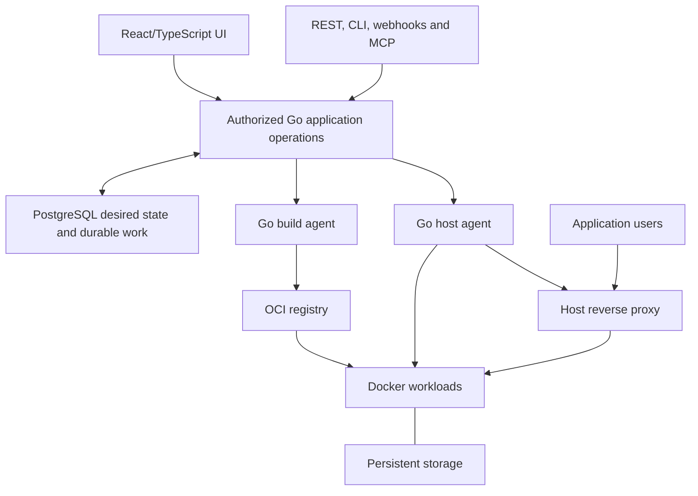

# Architecture

Planning baseline: `a763a90b3896257b784c9498d01650ccdad2427a`, inspected on
2026-10-22. The [product specification](product-spec.md) defines the full Go
hosting platform target. The [plan](plan.md) orders implementation and the
[compatibility ledger](compatibility.md) records support limits. The current
implementation below and the target design are distinct.

## Current implementation

NeroCD records automation intent and authorization, leases work to enrolled
runners, and retains operational evidence. It is not a general CI system.

| Component | Responsibility |
| --- | --- |
| `cmd/nerocd` | Server, CLI, migration, bootstrap, runner, and operations commands. |
| `internal/api` | `/api/v1` routing, request limits, authentication, and errors. |
| `internal/app` | Authorization, business operations, audit writes, and transactions. |
| `internal/store` | PostgreSQL persistence and explicit disposable memory development store. |
| `internal/runner` | Enrollment, credentials, fenced leases, execution, logs, and replay data. |
| `web/app` | React/Vite/TanStack application built into `web/dist` and embedded in Go. |
| `db/migrations` | Ordered PostgreSQL schema changes with checksum protection. |

## Flow

1. A local session or provisioned OIDC identity authenticates a user.
2. The API applies global and project authorization, writes audit records, and
   stores work in PostgreSQL.
3. A runner claims a fenced lease and executes an allowed shell or Docker
   Compose plan sequentially.
4. The runner reports logs, artifacts, completion, and provenance. Lease and
   replay checks stop stale runners from completing newer work.

List APIs use bounded offset pagination (`limit`, `offset`, `count`, `total`).
Treat IDs as opaque and use [openapi.yaml](../openapi.yaml) as the contract.

## Deployment shape

Development Compose owns a disposable PostgreSQL service, migration, and seed
fixture. Production is a separate profile: migrations use an owner credential,
the server uses an application credential, and the database is reachable only
on an internal network. The server joins the external proxy network without a
published host port. This arrangement keeps database administration out of the
ordinary application process.

## Trust boundaries

Control-plane state is separate from runners. Runner credentials, repository
access, and file-backed secrets remain at the runner boundary; secret values
are excluded from API responses, run specifications, audit records, logs, and
artifact metadata. Production uses separate owner and app database roles,
strict secret files, an internal database network, and a public proxy network.

OIDC accepts one configured issuer and exact pre-provisioned issuer/subject
bindings. It does not infer identity or authorization from claims; local
passwords remain the recovery path.

## Current limits

NeroCD does not claim SAML, LDAP, SCIM, group mapping, automatic provisioning,
multi-provider OIDC, general scheduling, parallel workflows, or production
encrypted secret storage. These are product limits, not configuration switches.

## Target hosting architecture

Retain the modular Go application, PostgreSQL authority, authorization, durable
execution protocol and React/TypeScript frontend. Go owns the API, orchestration,
controllers, job workers, host agents and CLI. Docker, Compose, BuildKit,
automatic builders and established proxies remain versioned dependencies.
These boundaries do not require separate microservices.

The host proxy serves application traffic independently of control-plane
availability. A single-server mode may use its local image store. Dedicated
builders require an authorized registry or an explicitly supported transfer
mechanism, with destination architecture and pull checks.

### Organization and placement

The target hierarchy is `Team → Project → ProjectEnvironment → Resource`.
Resources are applications, databases or Compose stacks with independently
versioned configuration. A resource deployment binding owns its destination,
effective configuration and mutation concurrency. Two resources in one project
environment can deploy independently.

Server identity, Docker destination identity and agent-process authority are
separate. Replacing an agent does not move a resource or its volumes. Tags select
eligible build capacity; they cannot authorize relocation of stateful workloads.
Host agents extend the runner lease, fence, cancellation, journal and replay
foundations. This persistent-agent design intentionally differs from Coolify's
SSH deployment model.

### Build, release and deployment

A discriminated source represents Git, registry image, stored Dockerfile,
stored Compose or catalog installation. No-Git resources need no repository
placeholder. A build snapshots source, settings, builder/version, architecture
and secret references, then produces resolved images and evidence.

An immutable release contains the selected image set and normalized configuration
with secret identities and versions. A destination-specific plan binds that
release to storage, networking and policy. A deployment attempts to apply the
plan. Retrying a deployment reuses its prepared output without silently rebuilding.
Optional approval follows image preparation and binds the release, destination
and relevant policy/configuration generations.

Single-image, Compose and database deployment strategies have separate readiness
and data rules. Generic health does not require application revision headers.
Image rollback does not reverse database migrations or uploaded-file changes.

### Authority, secrets and recovery

Durable resource-binding mutation holds survive terminal operation states when
Docker effects remain unresolved. Shared proxy, storage and network mutations
have their own ownership constraints. Database fencing alone cannot make Docker
side effects exactly once. Reconciliation must resolve uncertain effects before
conflicting mutation proceeds.

Managed secrets require persistence, authorization, scope/version semantics,
protected delivery, revocation, key rotation and recovery. Persist reference-bearing
configuration and materialize values only at the authorized execution boundary.
Secret-expanded Compose is not a release, audit payload or ordinary artifact.
Build, runtime, preview and bootstrap grants remain separate. Project permissions
do not isolate hostile containers sharing one Docker host.

Desired state, last operation result and timestamped observed state remain
independent. Missing observations become stale or unknown. Backups separately
record platform, database and storage recovery contracts, consistency method,
artifacts and location outcomes. Restored control planes invalidate stale
execution authority and reconcile actual host ownership before mutation.

### Migration and interfaces

Add schema and compatibility mappings without changing applied migrations.
Preserve legacy IDs, approvals and effective permissions. Each legacy
service-specific environment maps to a resource binding; equal names do not
justify automatic grouping. Drain or reconcile in-flight work and require
agent capability negotiation before new operations.

UI, REST, CLI, webhook and MCP paths use the same authorized application
operations. Legacy routes remain explicit adapters for a declared support
window. Coolify feature, migration and unchanged-client compatibility are
separate claims, each requiring its own evidence.
