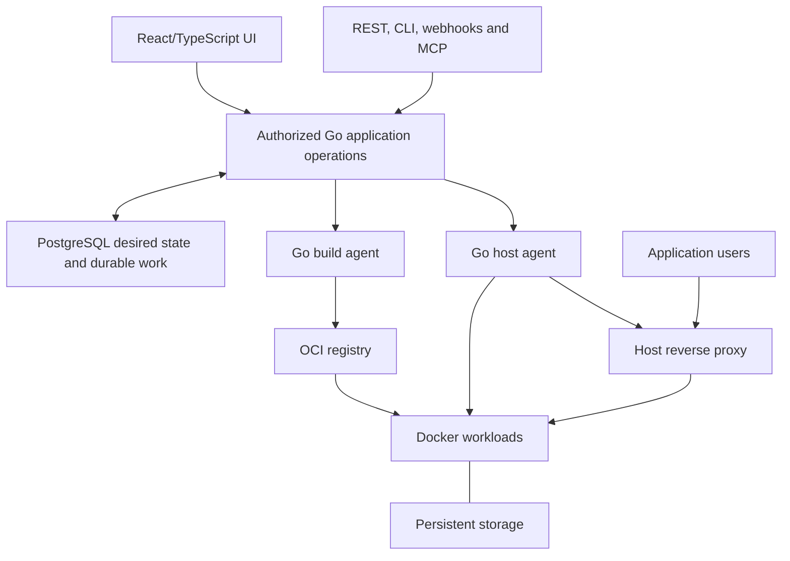

# Architecture

Planning baseline: `a763a90b3896257b784c9498d01650ccdad2427a`, inspected on
2026-10-22. Current accepted assessment:
`eef72d3b182acdb66f81c24787f2df8bd82abb85`, also dated 2026-10-22.
The [product specification](product-spec.md) defines the full Go
hosting platform target. The [plan](plan.md) orders implementation and the
[compatibility ledger](compatibility.md) records support limits. The current
implementation below and the target design are distinct.

## Current implementation

NeroCD records automation intent and authorization, leases work to enrolled
runners, and retains operational evidence. It is not a general CI system.

| Component | Responsibility |
| --- | --- |
| `cmd/nerocd` | Server, CLI, migration, bootstrap, runner, and operations commands. |
| `internal/api` | `/api/v1` routing, request limits, authentication, and errors. |
| `internal/app` | Authorization, business operations, audit writes, and transactions. |
| `internal/store` | PostgreSQL persistence and explicit disposable memory development store. |
| `internal/runner` | Enrollment, credentials, fenced leases, execution, logs, and replay data. |
| `internal/runnerruntime` | Fenced image/Compose execution and the controlled Git checkout adapter. |
| `internal/hostingjobs` | River OSS v0.44.1 image/proxy dispatch and optional BuildID adapter; no production build controller. |
| `internal/hostingbuild` | Standalone bounded local builds with confined settings and retained output receipts. |
| `internal/hostingproxy` | Standalone Linux Traefik configuration, TLS and state verification. |
| `web/app` | React/Vite/TanStack application built into `web/dist` and embedded in Go. |
| `db/migrations` | Ordered PostgreSQL schema changes with checksum protection. |

## Flow

1. A local session or provisioned OIDC identity authenticates a user.
2. The API applies global and project authorization, writes audit records, and
   stores work in PostgreSQL.
3. Legacy runners execute allowed sequential shell/Compose plans. Hosting image
   requests persist a snapshot, audit and River job together; dispatch creates
   an exact-target task for the enrolled agent's fenced image engine.
4. The runner reports logs, artifacts, completion, and provenance. Lease and
   replay checks stop stale runners from completing newer work. Proxy backend
   dispatch creates fenced exact-target tasks for explicitly enrolled
   `proxy_apply` Linux agents. Image-only agents cannot claim proxy work.

List APIs use bounded offset pagination (`limit`, `offset`, `count`, `total`).
Treat IDs as opaque and use [openapi.yaml](../openapi.yaml) as the contract.

## Deployment shape

Development Compose owns a disposable PostgreSQL service, migration, and seed
fixture. Production is a separate profile: migrations use an owner credential,
the server uses an application credential, and the database is reachable only
on an internal network. The server joins the external proxy network without a
published host port. This arrangement keeps database administration out of the
ordinary application process.

## Trust boundaries

Control-plane state is separate from runners. Runner credentials, repository
access, and file-backed secrets remain at the runner boundary; secret values
are excluded from API responses, run specifications, audit records, logs, and
artifact metadata. Project-managed encrypted versions have a separate explicit
owner reveal operation that commits its audit before returning plaintext.
Production uses separate owner and app database roles,
strict secret files, an internal database network, and a public proxy network.

OIDC accepts one configured issuer and exact pre-provisioned issuer/subject
bindings. It does not infer identity or authorization from claims; local
passwords remain the recovery path.

## Current limits

NeroCD does not claim SAML, LDAP, SCIM, group mapping, automatic provisioning,
multi-provider OIDC, general scheduling or parallel workflows. Project-managed
encrypted secret storage is available; managed execution delivery and external
providers remain incomplete.

The accepted image API/UI runs anonymous public images with ordinary HTTP
readiness on loopback ports. Automatic per-release port allocation retains
earlier containers; explicit same-port replacement can interrupt service.
Selected retained cleanup uses exact authority and preserves protected routes,
unresolved effects and ownership holds. Allocating a new port does not switch
public traffic. See [image execution](hosting-execution.md) and
[deployment UI](hosting-image-deployments.md).

The [controlled checkout](hosting-source-checkout.md) and
[local build engine](hosting-build-engine.md) are usable components with separate
contracts. Internal [source/build persistence](hosting-build-control.md) stores
source generations, credential grants, immutable requests, fenced receipts and
local OCI artifact identities. It has no public build API, production build consumer,
typed runner executor, source-to-engine bridge or deployment handoff.
The [private Git credential component](hosting-build-credentials.md) authorizes
and decrypts the exact immutable secret version for a live sourcing attempt.
Its audit-backed window and byte ownership do not install an endpoint or runtime
bridge. The [optional River BuildID adapter](hosting-build-jobs.md) requires a
real supplied handler; production build dispatch is not enabled.

The [proxy backend](hosting-proxy-control.md) authorizes hostname grants and
whole-proxy generations, derives settled binding targets, and dispatches typed
work through River. It rechecks [persisted mutation authority](hosting-proxy-auth.md).
The explicitly enrolled Linux agent now executes through the Traefik engine,
journaling preparation, intent and result before reporting. Exact committed
receipts replay without repeating admitted effects. Real combined fixtures cover
lost responses, retained holds, control-plane outage and autonomous TLS renewal.
Image-only enrollment presets remain unchanged.

The [managed routing UI](hosting-proxy-ui.md) configures proxies, hostname grants
and routes against settled healthy image releases. Real browser coverage reaches
HTTP and certificate-verified HTTPS with isolated fixture DNS and a trusted local
CA. It also covers revocation, withdrawal, disable, role denial and conflict
recovery. This is bounded image-to-routing evidence, not public DNS or production
ACME verification. Desired and loaded state, HTTP readiness and trusted HTTPS
observations stay separate and are not continuous monitoring. DNS-01, wildcard
certificates, custom certificates and Caddy remain absent.

Restore records independent holds for bindings and configured proxies. Read-only
observation cannot prove that a pre-backup command stopped and cannot clear
those holds. Trusted journal/process recovery and safe resumption remain
required. No A01–A37 scenario or M0–M4 milestone is complete, and R65 remains
ongoing.

## Target hosting architecture

Retain the modular Go application, PostgreSQL authority, authorization, durable
execution protocol and React/TypeScript frontend. Go owns the API, orchestration,
controllers, job workers, host agents and CLI. Docker, Compose, BuildKit,
automatic builders and established proxies remain versioned dependencies.
These boundaries do not require separate microservices.

The host proxy serves application traffic independently of control-plane
availability. A single-server mode may use its local image store. Dedicated
builders require an authorized registry or an explicitly supported transfer
mechanism, with destination architecture and pull checks.

### Organization and placement

The target hierarchy is `Team → Project → ProjectEnvironment → Resource`.
Resources are applications, databases or Compose stacks with independently
versioned configuration. A resource deployment binding owns its destination,
effective configuration and mutation concurrency. Two resources in one project
environment can deploy independently.

Server identity, Docker destination identity and agent-process authority are
separate. Replacing an agent does not move a resource or its volumes. Tags select
eligible build capacity; they cannot authorize relocation of stateful workloads.
Host agents extend the runner lease, fence, cancellation, journal and replay
foundations. This persistent-agent design intentionally differs from Coolify's
SSH deployment model.

### Build, release and deployment

A discriminated source represents Git, registry image, stored Dockerfile,
stored Compose or catalog installation. No-Git resources need no repository
placeholder. A build snapshots source, settings, builder/version, architecture
and secret references, then produces resolved images and evidence.

An immutable release contains the selected image set and normalized configuration
with secret identities and versions. A destination-specific plan binds that
release to storage, networking and policy. A deployment attempts to apply the
plan. Retrying a deployment reuses its prepared output without silently rebuilding.
Optional approval follows image preparation and binds the release, destination
and relevant policy/configuration generations.

Single-image, Compose and database deployment strategies have separate readiness
and data rules. Generic health does not require application revision headers.
Image rollback does not reverse database migrations or uploaded-file changes.

### Authority, secrets and recovery

Durable resource-binding mutation holds survive terminal operation states when
Docker effects remain unresolved. Shared proxy, storage and network mutations
have their own ownership constraints. Database fencing alone cannot make Docker
side effects exactly once. Reconciliation must resolve uncertain effects before
conflicting mutation proceeds.

Managed secrets require persistence, authorization, scope/version semantics,
protected delivery, revocation, key rotation and recovery. Persist reference-bearing
configuration and materialize values only at the authorized execution boundary.
Secret-expanded Compose is not a release, audit payload or ordinary artifact.
Build, runtime, preview and bootstrap grants remain separate. Project permissions
do not isolate hostile containers sharing one Docker host.

Desired state, last operation result and timestamped observed state remain
independent. Missing observations become stale or unknown. Backups separately
record platform, database and storage recovery contracts, consistency method,
artifacts and location outcomes. Restored control planes invalidate stale
execution authority and reconcile actual host ownership before mutation.

### Migration and interfaces

Add schema and compatibility mappings without changing applied migrations.
Preserve legacy IDs, approvals and effective permissions. Each legacy
service-specific environment maps to a resource binding; equal names do not
justify automatic grouping. Drain or reconcile in-flight work and require
agent capability negotiation before new operations.

UI, REST, CLI, webhook and MCP paths use the same authorized application
operations. Legacy routes remain explicit adapters for a declared support
window. Coolify feature, migration and unchanged-client compatibility are
separate claims, each requiring its own evidence.

## Hosting job infrastructure

`internal/hostingjobs` wraps River OSS v0.44.1 with its pgx v5 driver. It owns the
`hosting_control` queue and typed `hosting.prepare_deployment.v1` arguments,
which contain only `operation_id`. Transactional insertion shares the caller's
application database transaction. River does not replace the existing fenced
runner execution protocol.

The PostgreSQL server starts real image and proxy dispatch consumers after
schema validation. Consumers resolve immutable snapshots and exact destinations
into work for the existing fenced runner protocol. They do not execute Docker
in the control-plane job worker. Queue completion is distinct from workload or
proxy completion. The optional BuildID worker registers only when the supplied
handler implements its build interface. No production source/build controller
supplies that handler, and no build executor or deployment handoff is installed.

The owner migration CLI applies River's pinned migration bundle under the same
advisory lock as native migrations. Each River version and its adapter checksum
commit together. Startup never applies migrations. The wrapper validates the
complete pinned set before its explicit `Start`. Native migration 0048
additively binds build functions to their owning schema without changing 0047
or earlier checksums. Accepted PostgreSQL integration includes nondefault-schema,
shadow-object and real dump/restore regression coverage at `836a3a92`.
This persistence evidence does not install a build execution workflow.

See [Hosting job infrastructure](hosting-jobs.md) for lifecycle, compatibility,
and integration contracts.
