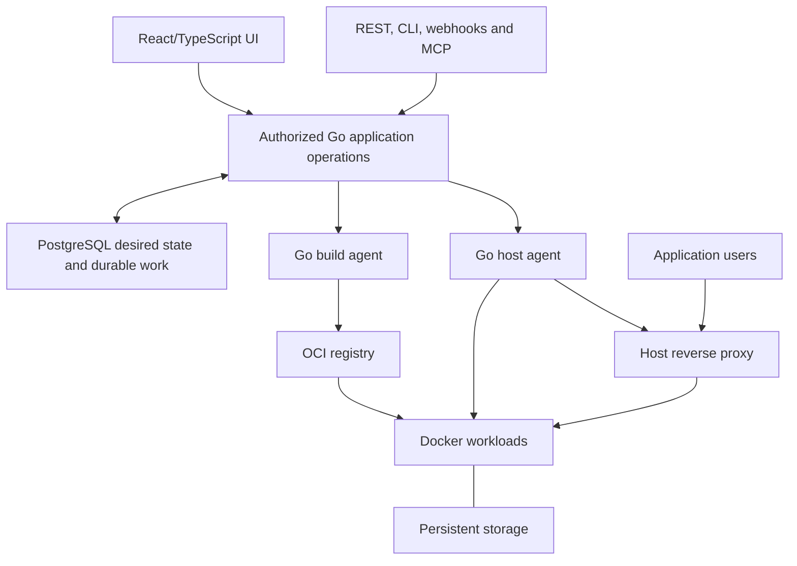
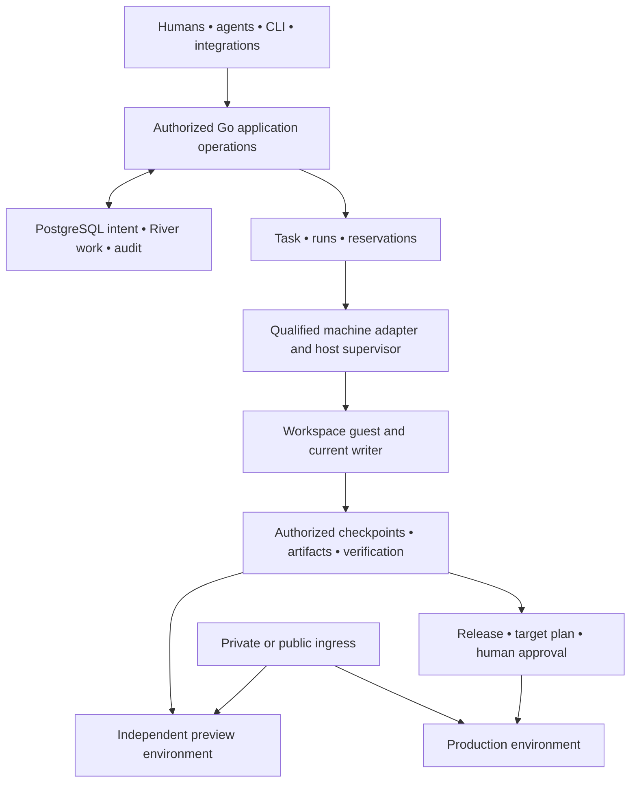

# Architecture

Revision 3 current assessment: `852f8e6b8d5624a95865c276dcea4a239d1f8fea`,
2026-10-22. The supplied `09d65d4ddcbfdf27e97158a9c08beb02a721818c`
and earlier `a763a90b3896257b784c9498d01650ccdad2427a` are historical.
The [specification](product-spec.md) defines the workspace and hosting targets.
The [plan](plan.md), [workspace ledger](workspace-capabilities.md) and
[hosting ledger](compatibility.md) distinguish accepted behavior from proposed design.
The [glossary](../CONTEXT.md) fixes Task, Run, Workspace and Environment terminology.

## Current implementation

NeroCD records automation intent and authorization, leases work to enrolled
runners, and retains operational evidence. Accepted hosting extends those execution foundations.

| Component | Responsibility |
| --- | --- |
| `cmd/nerocd` | Server, CLI, migration, bootstrap, runner, and operations commands. |
| `internal/api` | `/api/v1` routing, request limits, authentication, and errors. |
| `internal/app` | Authorization, business operations, audit writes, and transactions. |
| `internal/store` | PostgreSQL persistence and explicit disposable memory development store. |
| `internal/runner` | Enrollment, credentials, fenced leases, execution, logs, and replay data. |
| `internal/runnerruntime` | Fenced image/Compose execution, public Git builds, same-host artifact deployment and typed build output delivery/replay. |
| `internal/hostingjobs` | River OSS v0.44.1 image/proxy/build dispatch, with a production handler for enabled public builds. |
| `internal/hostingbuild` | Bounded local builds with confined settings, immutable output receipts and serialized raw output observation. |
| `internal/hostingproxy` | Standalone Linux Traefik configuration, TLS and state verification. |
| `web/app` | React/Vite/TanStack application built into `web/dist` and embedded in Go. |
| `db/migrations` | Ordered PostgreSQL schema changes with checksum protection. |

## Flow

1. A local session or provisioned OIDC identity authenticates a user.
2. The API applies global and project authorization, writes audit records, and
   stores work in PostgreSQL.
3. Legacy runners execute allowed sequential shell/Compose plans. Hosting image
   requests persist a snapshot, audit and River job together; dispatch creates
   an exact-target task for the enrolled agent's fenced image engine.
4. The runner reports logs, artifacts, completion, and provenance. Lease and
   replay checks stop stale runners from completing newer work. Proxy backend
   dispatch creates fenced exact-target tasks for explicitly enrolled
   `proxy_apply` Linux agents. Image-only agents cannot claim proxy work.

Most list APIs use bounded offset pagination (`limit`, `offset`, `count`, `total`).
Typed build logs instead use ordered sequence cursors, retained gaps and a 200-row limit.
Treat IDs as opaque and use [openapi.yaml](../openapi.yaml) as the contract.

## Deployment shape

Development Compose owns a disposable PostgreSQL service, migration, and seed
fixture. Production is a separate profile: migrations use an owner credential,
the server uses an application credential, and the database is reachable only
on an internal network. The server joins the external proxy network without a
published host port. This arrangement keeps database administration out of the
ordinary application process.

## Trust boundaries

Control-plane state is separate from runners. Runner credentials, repository
access, and file-backed secrets remain at the runner boundary; execution protocols keep credential material out of ordinary specifications,
audit and artifact metadata. Known-material output redaction is bounded and
cannot guarantee removal of unknown secrets printed by source or tools. Project-managed encrypted versions have a separate explicit
owner reveal operation that commits its audit before returning plaintext.
Production uses separate owner and app database roles,
strict secret files, an internal database network, and a public proxy network.

OIDC accepts one configured issuer and exact pre-provisioned issuer/subject
bindings. It does not infer identity or authorization from claims; local
passwords remain the recovery path.

## Current limits

NeroCD does not claim SAML, LDAP, SCIM, group mapping, automatic provisioning,
multi-provider OIDC, general scheduling or parallel workflows. Project-managed
encrypted secret storage is available; managed execution delivery and external
providers remain incomplete.

The accepted image API/UI runs anonymous public images with ordinary HTTP
readiness on loopback ports. Automatic per-release port allocation retains
earlier containers; explicit same-port replacement can interrupt service.
Selected retained cleanup uses exact authority and preserves protected routes,
unresolved effects and ownership holds. Allocating a new port does not switch
public traffic. See [image execution](hosting-execution.md) and
[deployment UI](hosting-image-deployments.md).

The [controlled checkout](hosting-source-checkout.md) and
[local build engine](hosting-build-engine.md) are usable components with separate
contracts. Internal [source/build persistence](hosting-build-control.md) stores
source generations, credential grants, immutable requests, fenced receipts and
local OCI artifact identities. The accepted [Git configuration API/UI](hosting-git-resources.md)
admits public HTTPS under an operator allowlist and stores atomic source/version
references through migration 0049. Reads resolve the exact immutable version;
CAS review exposes all current settings. PostgreSQL is required, and configuration
performs no network fetch. Private Git configuration remains unsupported.
Separate [build UI/API operations](hosting-git-resources.md) now request,
inspect and cancel builds through the production controller and River handler.
The [normal agent runtime](hosting-build-runtime.md) connects source checkout,
source receipts, local engine and artifact completion. The separately enabled
[same-host local deployment runtime](hosting-local-build-runtime.md) applies
that exact artifact through the hosting lifecycle. Its [UI](hosting-build-deployments.md)
requires current source/resource generations and explicit review; it does not
rebuild, transfer an image or select a route automatically.

[Typed build output](hosting-build-log-delivery.md) is redacted before durable
append, acknowledged with exact full-authority/content receipts and drained
before build completion. Journal format 7 retains requested-sequence cursors.
Historical exact log receipts do not authorize new output or execution. The
[opt-in viewer](hosting-build-logs.md#resource-build-output-viewer) bounds local
plaintext and revalidates project access. This is separate from application-runtime
logs, terminals and continuous health, which remain planned.
The [private Git credential component](hosting-build-credentials.md) authorizes
and decrypts the exact immutable secret version for a live sourcing attempt.
Its audit-backed window and byte ownership do not install an endpoint or runtime
bridge. The [source checkout contract](hosting-source-checkout.md) keeps the
credential window through fetch, tree validation, committed receipt and confirmed
transport-file removal/byte clearing. Those credentials are cleared before the
use/build callback; final checkout cleanup follows use. Once transport cleanup
is confirmed, a build may outlast credential expiry, while the parent operation
deadline, cancellation and budgets still govern use.
The [optional River BuildID adapter](hosting-build-jobs.md) requires a
real supplied handler, now provided by the configured production controller.
Build admission stays disabled until the server has an explicit trusted policy.
The agent separately requires a strict owned mode-0600 build configuration,
matching enrolled `hosting_build_v1`, exact placement and matching frozen policy.
Shell and build execution cannot be combined.

The [proxy backend](hosting-proxy-control.md) authorizes hostname grants and
whole-proxy generations, derives settled binding targets, and dispatches typed
work through River. It rechecks [persisted mutation authority](hosting-proxy-auth.md).
The explicitly enrolled Linux agent now executes through the Traefik engine,
journaling preparation, intent and result before reporting. Exact committed
receipts replay without repeating admitted effects. Real combined fixtures cover
lost responses, retained holds, control-plane outage and autonomous TLS renewal.
Image-only enrollment presets remain unchanged.

The [managed routing UI](hosting-proxy-ui.md) configures proxies, hostname grants
and routes against settled healthy image releases. Real browser coverage reaches
HTTP and certificate-verified HTTPS with isolated fixture DNS and a trusted local
CA. It also covers revocation, withdrawal, disable, role denial and conflict
recovery. This is bounded image-to-routing evidence, not public DNS or production
ACME verification. Desired and loaded state, HTTP readiness and trusted HTTPS
observations stay separate and are not continuous monitoring. DNS-01, wildcard
certificates, custom certificates and Caddy remain absent.

Restore records independent holds for bindings and configured proxies. Read-only
observation cannot prove that a pre-backup command stopped and cannot clear
those holds. Trusted journal/process recovery and safe resumption remain
required. No complete Coolify parity or D0–D3 workspace milestone is claimed. R65 now
requires a new durable Task collaboration view alongside direct hosting.

## Target hosting architecture

Retain the modular Go application, PostgreSQL authority, authorization, durable
execution protocol and React/TypeScript frontend. Go owns the API, orchestration,
controllers, job workers, host agents and CLI. Docker, Compose, BuildKit,
automatic builders and established proxies remain versioned dependencies.
These boundaries do not require separate microservices.

The host proxy serves application traffic independently of control-plane
availability. A single-server mode may use its local image store. Dedicated
builders require an authorized registry or an explicitly supported transfer
mechanism, with destination architecture and pull checks.

### Organization and placement

The target hierarchy is `Team → Project → ProjectEnvironment → Resource`.
Resources are applications, databases or Compose stacks with independently
versioned configuration. A resource deployment binding owns its destination,
effective configuration and mutation concurrency. Two resources in one project
environment can deploy independently.

Server identity, Docker destination identity and agent-process authority are
separate. Replacing an agent does not move a resource or its volumes. Tags select
eligible build capacity; they cannot authorize relocation of stateful workloads.
Host agents extend the runner lease, fence, cancellation, journal and replay
foundations. This persistent-agent design intentionally differs from Coolify's
SSH deployment model.

### Build, release and deployment

A discriminated source represents Git, registry image, stored Dockerfile,
stored Compose or catalog installation. No-Git resources need no repository
placeholder. A build snapshots source, settings, builder/version, architecture
and secret references, then produces resolved images and evidence.

An immutable release contains the selected artifact set, source/build evidence
and deployable recipe version. A destination-specific plan binds that release
to effective runtime configuration, secret identities/versions, storage,
networking, policy and data preconditions. A deployment attempts to apply the
plan. Retrying a deployment reuses its prepared output without silently rebuilding.
Optional approval follows image preparation and binds the release, destination
and relevant policy/configuration generations.

Single-image, Compose and database deployment strategies have separate readiness
and data rules. Generic health does not require application revision headers.
Image rollback does not reverse database migrations or uploaded-file changes.

### Authority, secrets and recovery

Durable resource-binding mutation holds survive terminal operation states when
Docker effects remain unresolved. Shared proxy, storage and network mutations
have their own ownership constraints. Database fencing alone cannot make Docker
side effects exactly once. Reconciliation must resolve uncertain effects before
conflicting mutation proceeds.

Managed secrets require persistence, authorization, scope/version semantics,
protected delivery, revocation, key rotation and recovery. Persist reference-bearing
configuration and materialize values only at the authorized execution boundary.
Secret-expanded Compose is not a release, audit payload or ordinary artifact.
Build, runtime, preview and bootstrap grants remain separate. Project permissions
do not isolate hostile containers sharing one Docker host.

Desired state, last operation result and timestamped observed state remain
independent. Missing observations become stale or unknown. Backups separately
record platform, database and storage recovery contracts, consistency method,
artifacts and location outcomes. Restored control planes invalidate stale
execution authority and reconcile actual host ownership before mutation.

### Migration and interfaces

Add schema and compatibility mappings without changing applied migrations.
Preserve legacy IDs, approvals and effective permissions. Each legacy
service-specific environment maps to a resource binding; equal names do not
justify automatic grouping. Drain or reconcile in-flight work and require
agent capability negotiation before new operations.

UI, REST, CLI, webhook and MCP paths use the same authorized application
operations. Legacy routes remain explicit adapters for a declared support
window. Coolify feature, migration and unchanged-client compatibility are
separate claims, each requiring its own evidence.

## Hosting job infrastructure

`internal/hostingjobs` wraps River OSS v0.44.1 with its pgx v5 driver. It owns the
`hosting_control` queue and typed `hosting.prepare_deployment.v1` arguments,
which contain only `operation_id`. Transactional insertion shares the caller's
application database transaction. River does not replace the existing fenced
runner execution protocol.

The PostgreSQL server starts real image and proxy dispatch consumers after
schema validation. Consumers resolve immutable snapshots and exact destinations
into work for the existing fenced runner protocol. They do not execute Docker
in the control-plane job worker. Queue completion is distinct from workload or
proxy completion. The BuildID worker registers when the supplied handler
implements its build interface. The accepted production controller supplies
that handler, and the explicitly enabled compiled agent executes public builds.
Private credential HTTP/runtime delivery remains absent. Same-host artifact
deployment is accepted through the existing operation queue and an explicitly
enabled agent; it creates no second queue.

The accepted nonsecret [phase protocol](hosting-build-protocol.md),
[build phase journal](hosting-build-journal.md) and
[HTTP client](hosting-build-client.md) provide exact messages, immutable local
intent and acknowledgment validation. Historical receipts do not authorize new
effects. The client does not retry automatically, and status proof must match
retained intent before local acknowledgment. The accepted controller installs
nonsecret phase endpoints, and the compiled
agent uses them and the journal around source-to-engine execution. No default
build capability is advertised without validated local configuration. Live
completion atomically settles build/task/lease evidence; uncertain intent and
cleanup records fail closed rather than silently rebuilding.

The owner migration CLI applies River's pinned migration bundle under the same
advisory lock as native migrations. Each River version and its adapter checksum
commit together. Startup never applies migrations. The wrapper validates the
complete pinned set before its explicit `Start`. Native migration 0048
additively binds build functions to their owning schema without changing 0047
or earlier checksums. Accepted PostgreSQL integration includes nondefault-schema,
shadow-object and real dump/restore regression coverage at `836a3a92`.
That persistence checkpoint alone did not install build execution. Current
accepted controller/runtime evidence is recorded in the [ledger](compatibility.md#accepted-foundations-and-evidence).
It now includes public builds, explicit same-host artifact deployment and durable
build output. Private Git and the complete hosting/workspace journeys remain planned.

See [Hosting job infrastructure](hosting-jobs.md) for lifecycle, compatibility,
and integration contracts.

## Target workspace architecture

This section describes unimplemented revision 3 contracts. Existing hosting
Server, resource, lease and operation records are reusable foundations, not
already qualified Machine, Workspace or Task-grant implementations.

### Independent lifecycles and authority

A Task is the durable human goal and collaboration history. A Run is a bounded
execution and each attempt has its own lease, fence, reservation and result.
A Workspace is mutable checkout/tool state. A Checkpoint is an immutable
recovery boundary with explicit adapter continuation limits. A project environment
contains independently operated resources and can outlive both Run and Workspace.

Admission persists task/source links and queued intent before acknowledgment.
Claim atomically records reservation and attempt authority. Existing River and
runner mechanisms should be extended for those contracts. Browser/client
disconnect must not own the lifetime of accepted remote work. Unknown host
effects retain ownership and uncertain capacity until reconciled.

Writable takeover must quiesce/revoke the previous writer or create a separate
checkpoint-derived Workspace. A PostgreSQL fence does not prove a disconnected
process stopped writing or making external requests. The target host/guest helper
and credential broker must enforce writer generations and revocation.

### Machine identity, placement and isolation

Machine names the stable owned host; preserve the existing Server IDs and
destination/data ownership when introducing that model. An enrolled agent
credential identifies process authority. A destination identifies a particular
runtime boundary, networks and data location, not any host with matching tags.

Filter placement by authorization, trust, location, architecture, required
isolation and hard capacity before ranking cache locality or preferences.
Reservations account for persistent application capacity separately from
opportunistic tasks. Budgets aggregate across retries and show measurement gaps.
Unavailable capacity leaves durable blocked work. Cloud fallback needs explicit
provider, location, source/data-transfer and spend authority.

The first proposed untrusted-work adapter is one qualified Linux/KVM/Firecracker
backend and architecture. Version the privileged host helper and guest supervisor;
separate host administration, guest execution and task grants. Deny personal
home directories, SSH agents, host Docker sockets and LAN/metadata routes unless
explicitly authorized. Enforce network policy outside the guest, including IPv6
and DNS/address revalidation. Rootful shared-host Docker remains a trusted mode.
Current Docker-in-Docker acceptance fixtures do not qualify this VM design.

Mac Virtualization.framework, restricted Windows VMs, trusted WSL, NAS roles
and GPU/device access need separate qualification. WSL settings alone do not
make an untrusted-code boundary. An authenticated model endpoint is a service
grant, not access to its host shell, model files or GPU. The specification's
[W1–W13 references](product-spec.md#workspace-implementation-references) support
these design limits; none proves a NeroCD adapter already exists.

### Build, artifact, verification and plan identities

Capture a mutable Workspace into an immutable source checkpoint and effective
build input manifest before constructing a candidate. Inputs include context,
Dockerfile/frontend, named contexts, target, platform, resolved bases,
toolchain/settings, dependencies and output-affecting opaque secret generations.
A matching commit alone is insufficient. Do not publish guessable secret hashes.

Keep layer-cache reuse, complete-artifact reuse and verification reuse separate.
First qualify registry-backed layer exports with independent read/write trust
scopes and controlled shared references. Local cache mounts are a separate
transport problem. Remote builders must publish authorized artifacts with digest
verification and completion state before a valid candidate release exists.
Missing publication cannot become a successful release. Preserve original
provenance when reusing artifacts.

Verification names the exact source or final artifact, trusted check/policy
versions, platform, fixtures, time and result. Agent narrative and edited tests
cannot replace mandatory trusted checks. Native and emulated results remain
distinct. Retain index and selected platform-manifest identities; seal embedded
attestations before index approval or attach later immutable evidence externally.

An immutable Release becomes a target-specific Deployment plan with effective
configuration/secret references, required evidence and data preconditions.
Agent-produced production changes require human authorization over that plan
through every interface, including auto-deploy and webhooks. Source, target or
material plan changes require a new decision. Promotion uses the same reviewed
artifact without rebuilding, while runtime data/configuration may differ.

### Preview, ingress and recovery

The first target preview contains an application and isolated seeded PostgreSQL,
plus a worker when required. It has an independent runtime/data lifetime,
authenticated project-scoped ingress, a named release, required component
observations, expiry and owned cleanup. Completion of an agent Run or draining
its builder must not remove a retained preview.

Application traffic stays on its proxy/authorized tunnel path while the control
plane restarts. A gateway does not keep an offline application host alive and
must not become a general LAN route. Source editing, preview viewing, workspace
attachment and production deployment are distinct permissions.

Checkpoints, task history, runtime logs, preview data, caches, pinned releases
and backups need separate retention. Host loss can recover only through a
supported checkpoint or data-recovery contract. It does not imply universal
session migration, shared memory, GPU pooling or live stateful relocation.
Restores and application upgrades need version/data-aware verification and
writer coordination, not merely a successful archive extraction.
