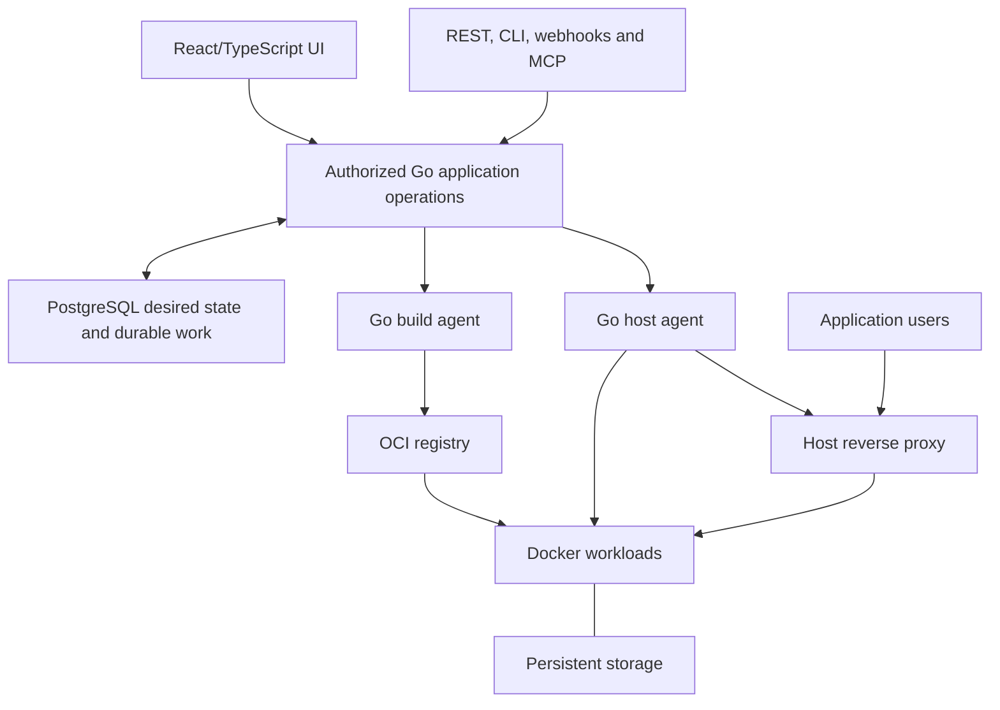
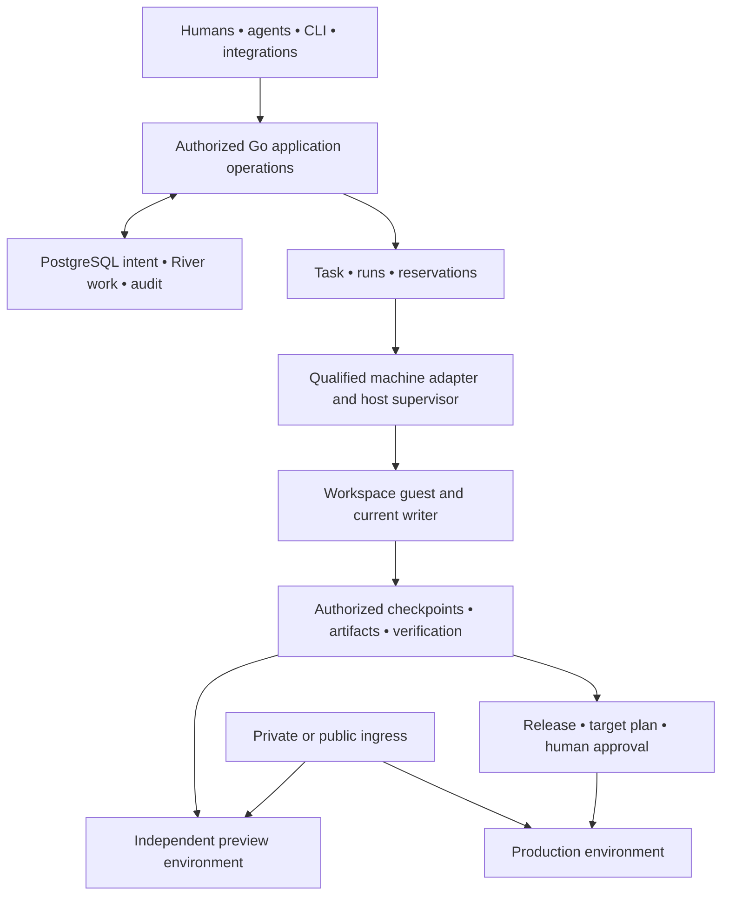

# Architecture

NeroCD has a Go control plane, PostgreSQL persistence, enrolled Go runners and an
embedded React/TypeScript UI. The control plane records desired state and
authority. Runners execute work on the selected application host.

Hosting is the current delivery priority. The [product specification](product-spec.md)
defines the full target, [compatibility](compatibility.md) describes tested
support, and the [plan](plan.md) orders remaining work. The
[glossary](../CONTEXT.md) defines Task, Run, Workspace and project environment.

## Current implementation

NeroCD records automation intent and authorization, leases work to enrolled
runners, and retains operational evidence.

| Component | Responsibility |
| --- | --- |
| `cmd/nerocd` | Server, CLI, migration, bootstrap, runner, and operations commands. |
| `internal/api` | `/api/v1` routing, request limits, authentication, and errors. |
| `internal/app` | Authorization, business operations, audit writes, and transactions. |
| `internal/store` | PostgreSQL persistence and explicit disposable memory development store. |
| `internal/runner` | Enrollment, credentials, fenced leases, execution, logs, and replay data. |
| `internal/runnerruntime` | Fenced image/Compose execution, public and explicitly enabled private HTTPS Git builds, same-host artifact deployment and typed build output delivery/replay. |
| `internal/hostingjobs` | River OSS v0.44.1 image/proxy/build dispatch, with a production handler for enabled public builds. |
| `internal/hostingbuild` | Bounded local builds with confined settings, immutable output receipts and serialized raw output observation. |
| `internal/hostingproxy` | Standalone Linux Traefik configuration, TLS and state verification. |
| `web/app` | React/Vite/TanStack application built into `web/dist` and embedded in Go. |
| `db/migrations` | Ordered PostgreSQL schema changes with checksum protection. |

## Connected stateful hosting

The [connected application workflow](hosting-database-connections.md) combines
one image application, PostgreSQL or Redis, and one owned named upload volume on
the same destination. It is qualified on a trusted native Linux arm64 profile.
Public ACME, arbitrary nonroot initialization, cross-host storage and disk-loss
recovery remain outside that qualification.

The controller freezes resource, binding, storage and route inputs in immutable
plans. For an owned writable volume, the runner stops the exact predecessor
before admitting the replacement as sole writer. Ready yield, proxy application
and finalization settle separate receipts. Recovery needs fresh reviewed
authority and preserves candidate-written records and uploads. It does not undo
data writes. Storage-less replacement has a different candidate-before-retirement
contract.

## Flow

1. A local session or provisioned OIDC identity authenticates a user.
2. The API applies global and project authorization, writes audit records, and
   stores work in PostgreSQL.
3. Legacy runners execute allowed sequential shell/Compose plans. Hosting image
   requests persist a snapshot, audit and River job together; dispatch creates
   an exact-target task for the enrolled agent's fenced image engine.
4. The runner reports logs, artifacts, completion, and provenance. Lease and
   replay checks stop stale runners from completing newer work. Proxy backend
   dispatch creates fenced exact-target tasks for explicitly enrolled
   `proxy_apply` Linux agents. Image-only agents cannot claim proxy work.

Most list APIs use bounded offset pagination (`limit`, `offset`, `count`, `total`).
Typed build logs instead use ordered sequence cursors, retained gaps and a 200-row limit.
Treat IDs as opaque and use [openapi.yaml](../openapi.yaml) as the contract.

## Deployment shape

Development Compose owns a disposable PostgreSQL service, migration, and seed
fixture. Production is a separate profile: migrations use an owner credential,
the server uses an application credential, and the database is reachable only
on an internal network. The server joins the external proxy network without a
published host port. This arrangement keeps database administration out of the
ordinary application process.

## Trust boundaries

Control-plane state is separate from runners. Runner credentials, repository
access, and file-backed secrets remain at the runner boundary; execution protocols keep credential material out of ordinary specifications,
audit and artifact metadata. Known-material output redaction is bounded and
cannot guarantee removal of unknown secrets printed by source or tools. Project-managed encrypted versions have a separate explicit
owner reveal operation that commits its audit before returning plaintext.
Production uses separate owner and app database roles,
strict secret files, an internal database network, and a public proxy network.

OIDC accepts one configured issuer and exact pre-provisioned issuer/subject
bindings. It does not infer identity or authorization from claims; local
passwords remain the recovery path.

## Current limits

Hosting capabilities require explicit server policy, runner configuration and
matching persisted capabilities. A saved resource or enrolled runner does not
establish host readiness. Build and shell execution cannot be combined.

The current supported paths and their limits are in
[compatibility](compatibility.md). Key distinctions are:

- Image readiness uses ordinary HTTP on loopback. A new port does not switch
  public traffic. Fixed-port replacement can interrupt service.
- Public and granted private HTTPS Git builds produce immutable local artifacts.
  Same-host deployment applies the exact recorded image without rebuilding or
  transferring it. Remote builders, registry publication and shared cache remain
  separate work.
- Private Git credentials are confined to source transport. Checkout confirms
  credential-file removal and byte clearing before build use. A build can then
  outlast credential expiry, but remains subject to its deadline and cancellation.
- Runtime environment delivery pins configuration and secret versions. It audits
  metadata before decryption and cannot recall bytes already delivered. Docker
  administrators can inspect container environments.
- Build output, runtime logs and status observations have separate retention and
  authorization contracts. Status can become stale or unknown. Redaction covers
  known material and does not guarantee arbitrary output is secret-free.
- Managed Traefik routing has private-CA HTTP/HTTPS fixture coverage. Public ACME,
  DNS-01, wildcard/custom certificates and Caddy still need qualification.
- Restoring the control plane invalidates stale execution authority and records
  binding/proxy holds. Read-only observation cannot prove that an old process
  stopped or clear a hold.

OIDC supports one pre-provisioned issuer. SAML, LDAP, SCIM, group mapping and
automatic provisioning are outside current support. General schedules, terminals,
external secret providers and the broader workspace product remain incomplete.

## Active target hosting architecture

Retain the modular Go application, PostgreSQL authority, authorization, durable
execution protocol and React/TypeScript frontend. Go owns the API, orchestration,
controllers, job workers, host agents and CLI. Docker, Compose, BuildKit,
automatic builders and established proxies remain versioned dependencies.
These boundaries do not require separate microservices.

The host proxy serves application traffic independently of control-plane
availability. A single-server mode may use its local image store. Dedicated
builders require an authorized registry or an explicitly supported transfer
mechanism, with destination architecture and pull checks.

### Organization and placement

The target hierarchy is `Team → Project → ProjectEnvironment → Resource`.
Resources are applications, databases or Compose stacks with independently
versioned configuration. A resource deployment binding owns its destination,
effective configuration and mutation concurrency. Two resources in one project
environment can deploy independently.

Server identity, Docker destination identity and agent-process authority are
separate. Replacing an agent does not move a resource or its volumes. Tags select
eligible build capacity; they cannot authorize relocation of stateful workloads.
Host agents extend the runner lease, fence, cancellation, journal and replay
foundations. This persistent-agent design intentionally differs from Coolify's
SSH deployment model.

### Build, release and deployment

A discriminated source represents Git, registry image, stored Dockerfile,
stored Compose or catalog installation. No-Git resources need no repository
placeholder. A build snapshots source, settings, builder/version, architecture
and secret references, then produces resolved images and evidence.

An immutable release contains the selected artifact set, source/build evidence
and deployable recipe version. A destination-specific plan binds that release
to effective runtime configuration, secret identities/versions, storage,
networking, policy and data preconditions. A deployment attempts to apply the
plan. Retrying a deployment reuses its prepared output without silently rebuilding.
Optional approval follows image preparation and binds the release, destination
and relevant policy/configuration generations.

Single-image, Compose and database deployment strategies have separate readiness
and data rules. Generic health does not require application revision headers.
Image rollback does not reverse database migrations or uploaded-file changes.

### Authority, secrets and recovery

Durable resource-binding mutation holds survive terminal operation states when
Docker effects remain unresolved. Shared proxy, storage and network mutations
have their own ownership constraints. Database fencing alone cannot make Docker
side effects exactly once. Reconciliation must resolve uncertain effects before
conflicting mutation proceeds.

Managed secrets require persistence, authorization, scope/version semantics,
protected delivery, revocation, key rotation and recovery. Persist reference-bearing
configuration and materialize values only at the authorized execution boundary.
Secret-expanded Compose is not a release, audit payload or ordinary artifact.
Build, runtime, preview and bootstrap grants remain separate. Project permissions
do not isolate hostile containers sharing one Docker host.

Desired state, last operation result and timestamped observed state remain
independent. Missing observations become stale or unknown. Backups separately
record platform, database and storage recovery contracts, consistency method,
artifacts and location outcomes. Restored control planes invalidate stale
execution authority and reconcile actual host ownership before mutation.

### Migration and interfaces

Add schema and compatibility mappings without changing applied migrations.
Preserve legacy IDs, approvals and effective permissions. Each legacy
service-specific environment maps to a resource binding; equal names do not
justify automatic grouping. Drain or reconcile in-flight work and require
agent capability negotiation before new operations.

UI, REST, CLI, webhook and MCP paths use the same authorized application
operations. Legacy routes remain explicit adapters for a declared support
window. Coolify feature, migration and unchanged-client compatibility are
separate claims, each requiring its own evidence.

## Hosting job infrastructure

`internal/hostingjobs` wraps River OSS v0.44.1 with its pgx v5 driver. It owns the
`hosting_control` queue. Typed deployment jobs carry `operation_id`, and build
jobs carry BuildID. Transactional insertion shares the application's database
transaction, so intent, audit and queued work commit together.

After schema validation, the server starts dispatch consumers. They resolve
immutable snapshots and exact destinations into fenced runner tasks. Docker
execution stays on the runner. Queue completion is distinct from workload or
proxy completion. The configured production controller supplies the build handler;
public/private builds and same-host artifact deployment use the existing queue.

The [phase protocol](hosting-build-protocol.md), [journal](hosting-build-journal.md)
and [HTTP client](hosting-build-client.md) retain immutable intent and validate
acknowledgments. Historical receipts authorize replay of the recorded result,
not new execution. Uncertain intent or cleanup blocks completion and rebuilding.

The migration CLI applies River's pinned bundle under the native migration
advisory lock. Schema versions and adapter checksums commit together. Startup
requires compatible native and River schemas. Backup manifests retain both
identities; restore invalidates active authority and preserves ownership holds.
See [hosting job infrastructure](hosting-jobs.md) for the protocol details.

## Deferred target workspace architecture

The workspace architecture is future scope. Supported hosting does not require
a Task, Workspace, agent, reservation system or VM backend. Any bounded part must first pass the [hosting-dependency test](plan.md#hosting-dependency-test):
name the hosting requirement, need now, minimum scope and acceptance test.
General future usefulness and sunk effort are insufficient. Existing hosting
Server, resource, lease and operation records are reusable foundations, not
already qualified Machine, Workspace or Task-grant implementations.

### Independent lifecycles and authority

A Task is the durable human goal and collaboration history. A Run is a bounded
execution and each attempt has its own lease, fence, reservation and result.
A Workspace is mutable checkout/tool state. A Checkpoint is an immutable
recovery boundary with explicit adapter continuation limits. A project environment
contains independently operated resources and can outlive both Run and Workspace.

Admission persists task/source links and queued intent before acknowledgment.
Claim atomically records reservation and attempt authority. Existing River and
runner mechanisms should be extended for those contracts. Browser/client
disconnect must not own the lifetime of accepted remote work. Unknown host
effects retain ownership and uncertain capacity until reconciled.

Writable takeover must quiesce/revoke the previous writer or create a separate
checkpoint-derived Workspace. A PostgreSQL fence does not prove a disconnected
process stopped writing or making external requests. The target host/guest helper
and credential broker must enforce writer generations and revocation.

### Machine identity, placement and isolation

Machine names the stable owned host; preserve the existing Server IDs and
destination/data ownership when introducing that model. An enrolled agent
credential identifies process authority. A destination identifies a particular
runtime boundary, networks and data location, not any host with matching tags.

Filter placement by authorization, trust, location, architecture, required
isolation and hard capacity before ranking cache locality or preferences.
Reservations account for persistent application capacity separately from
opportunistic tasks. Budgets aggregate across retries and show measurement gaps.
Unavailable capacity leaves durable blocked work. Cloud fallback needs explicit
provider, location, source/data-transfer and spend authority.

Supported trusted-host deployment does not wait for a VM adapter. Keep untrusted
execution disabled until its actual isolation requirements are satisfied for the
declared workflow. The deferred proposed untrusted-work adapter is one qualified Linux/KVM/Firecracker
backend and architecture. Version the privileged host helper and guest supervisor;
separate host administration, guest execution and task grants. Deny personal
home directories, SSH agents, host Docker sockets and LAN/metadata routes unless
explicitly authorized. Enforce network policy outside the guest, including IPv6
and DNS/address revalidation. Rootful shared-host Docker remains a trusted mode.
Current Docker-in-Docker acceptance fixtures do not qualify this VM design.

Mac Virtualization.framework, restricted Windows VMs, trusted WSL, NAS roles
and GPU/device access need separate qualification. WSL settings alone do not
make an untrusted-code boundary. An authenticated model endpoint is a service
grant, not access to its host shell, model files or GPU. The specification's
[W1–W13 references](product-spec.md#workspace-implementation-references) support
these design limits; none proves a NeroCD adapter already exists.

### Build, artifact, verification and plan identities

Capture a mutable Workspace into an immutable source checkpoint and effective
build input manifest before constructing a candidate. Inputs include context,
Dockerfile/frontend, named contexts, target, platform, resolved bases,
toolchain/settings, dependencies and output-affecting opaque secret generations.
A matching commit alone is insufficient. Do not publish guessable secret hashes.

Keep layer-cache reuse, complete-artifact reuse and verification reuse separate.
First qualify registry-backed layer exports with independent read/write trust
scopes and controlled shared references. Local cache mounts are a separate
transport problem. Remote builders must publish authorized artifacts with digest
verification and completion state before a valid candidate release exists.
Missing publication cannot become a successful release. Preserve original
provenance when reusing artifacts.

Verification names the exact source or final artifact, trusted check/policy
versions, platform, fixtures, time and result. Agent narrative and edited tests
cannot replace mandatory trusted checks. Native and emulated results remain
distinct. Retain index and selected platform-manifest identities; seal embedded
attestations before index approval or attach later immutable evidence externally.

An immutable Release becomes a target-specific Deployment plan with effective
configuration/secret references, required evidence and data preconditions.
Agent-produced production changes require human authorization over that plan
through every interface, including auto-deploy and webhooks. Source, target or
material plan changes require a new decision. Promotion uses the same reviewed
artifact without rebuilding, while runtime data/configuration may differ.

### Preview, ingress and recovery

The later workspace target preview contains an application and isolated seeded PostgreSQL,
plus a worker when required. It has an independent runtime/data lifetime,
authenticated project-scoped ingress, a named release, required component
observations, expiry and owned cleanup. Completion of an agent Run or draining
its builder must not remove a retained preview.

Application traffic stays on its proxy/authorized tunnel path while the control
plane restarts. A gateway does not keep an offline application host alive and
must not become a general LAN route. Source editing, preview viewing, workspace
attachment and production deployment are distinct permissions.

Checkpoints, task history, runtime logs, preview data, caches, pinned releases
and backups need separate retention. Host loss can recover only through a
supported checkpoint or data-recovery contract. It does not imply universal
session migration, shared memory, GPU pooling or live stateful relocation.
Restores and application upgrades need version/data-aware verification and
writer coordination, not merely a successful archive extraction.
