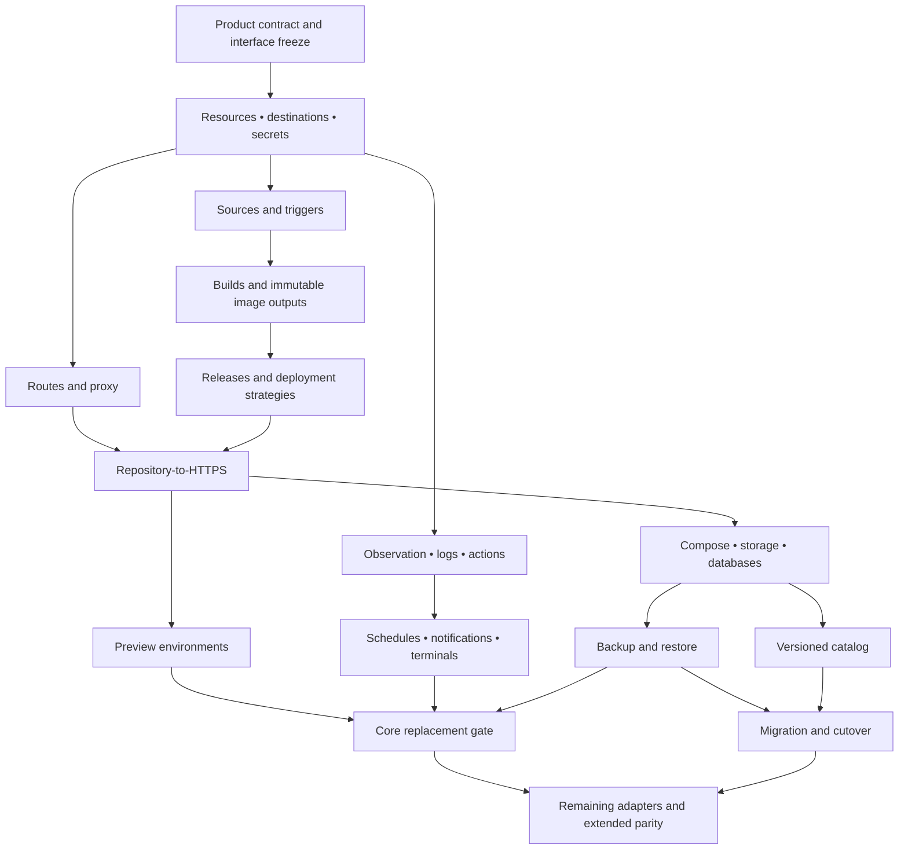

# Hosting implementation plan

Accepted planning basis: one-time Astra architectural plan, dated 2026-10-22. This plan adopts the complete [product specification](product-spec.md), including every R01–R68 requirement and A01–A37 scenario. Package and milestone sequencing does not defer any declared feature out of the target product. Status at adoption: P00 documents the contract; P01–P18 are planned. No application-hosting milestone is validated by this documentation commit.

Use the [compatibility ledger](compatibility.md) for limits and fixture status and [architecture](architecture.md) for current and target structure. Implementation issues and runtime evidence are not yet assigned; add concrete issue and evidence links as each bounded package starts and completes. Do not treat an uncreated issue or planned fixture as passing evidence.

The accepted planning review examined the complete supplied specification, including R01–R68 and A01–A37, against NeroCD `a763a90b3896257b784c9498d01650ccdad2427a`. The review verified that the pinned Coolify commit exists and inspected relevant source at `b12d1386f3d458618b4c579babcd1e339c6c40b3`. Current official documentation was reviewed separately on 2026-10-22. This was bounded architectural discovery, not an exhaustive audit of either repository.

## The architectural decision

Keep the existing modular Go application, PostgreSQL authority, authorization, durable execution and React frontend. Build hosting capabilities around those components. Do not translate Coolify’s PHP classes directly or create a second orchestration system.

The current implementation provides useful execution guarantees, but several existing concepts cannot carry the target product unchanged:

| Existing evidence | Consequence for the port |
|---|---|
| [Service and environment types](../internal/domain/domain.go) require repository-backed services and place environments beneath services. | Add shared project environments and typed resources. Keep legacy environments as mapped deployment bindings during migration. |
| [CreateService](../internal/app/deployments_service.go) requires repository and Compose fields. | Introduce explicit source variants. Images, databases, stored Dockerfiles and pasted Compose must not need fake repositories. |
| [Compose validation](../internal/runnerruntime/provenance_resolver.go) rejects builds, service volumes and many host capabilities. | Replace the blanket restrictions with compilation, capability admission and storage ownership. Simply deleting the rejection list would leave essential behavior undefined. |
| [Compose apply](../internal/runnerruntime/compose_engine.go) uses force recreation; [HTTP health](../internal/runnerruntime/compose_engine.go) requires the revision header. | Add separate single-image, Compose and database strategies, plus generic readiness. |
| [Active-root exclusion](../db/migrations/0027_linked_rollback_lifecycle.sql) is scoped to environment and excludes `manual_intervention`. | Move exclusion to the resource binding and introduce a durable unresolved-mutation hold that survives terminal operation states. |
| [Secret encryption](../internal/secretcrypto/secretcrypto.go) is an encryption helper, not a managed secret service, and authenticates project-scoped identities. | Build persistence, access, delivery, recovery and rotation. Team-owned credentials need authenticated ownership semantics, not a fake project ID. |
| [Platform restore](../cmd/nerocd/backup_restore.go) checks schema compatibility and revokes restored sessions and leases. | Preserve that discipline and add host ownership reconciliation before restored state can mutate workloads. |
| [Application dependencies](../internal/app/service.go) and [repository interfaces](../internal/store/repositories.go) already separate authorized operations from persistence. | Extend these boundaries with focused hosting modules and transaction-level methods. Avoid routing new clients around them. |

The pinned upstream confirms the breadth we need to implement: shared environments contain applications, database types and services; application deployment handles Dockerfile, image, Compose, Nixpacks and Railpack paths; database and volume backups have separate jobs. These are behavioral references, not proposed Go package boundaries. See the pinned [environment model](https://github.com/coollabsio/coolify/blob/b12d1386f3d458618b4c579babcd1e339c6c40b3/app/Models/Environment.php), [deployment job](https://github.com/coollabsio/coolify/blob/b12d1386f3d458618b4c579babcd1e339c6c40b3/app/Jobs/ApplicationDeploymentJob.php), [database backup job](https://github.com/coollabsio/coolify/blob/b12d1386f3d458618b4c579babcd1e339c6c40b3/app/Jobs/DatabaseBackupJob.php) and [volume backup job](https://github.com/coollabsio/coolify/blob/b12d1386f3d458618b4c579babcd1e339c6c40b3/app/Jobs/VolumeBackupJob.php).

## Freeze these interfaces before parallel implementation

The freeze should establish field meanings, ownership, lifecycle transitions and failure behavior. Individual package internals remain free to evolve.

| Contract | Required meaning |
|---|---|
| Organization | `Team → Project → ProjectEnvironment → Resource`. A resource has a declared kind and independently versioned configuration. Existing project permissions remain effective during migration. |
| Placement | `ResourceBinding` identifies a resource, stable destination and runtime identity. `Server`, `Destination` and the current agent process have distinct identities. Tags select eligible build capacity; they never relocate stateful runtime ownership. |
| Source | A discriminated source definition covers Git, image, stored Dockerfile, stored Compose and catalog installation. Each variant declares its source of truth, credentials and version semantics. |
| Build | A build snapshots source identity, configuration generation, builder/version, architecture and secret references. It produces an image set and evidence. Retrying deployment uses that output without rebuilding it. |
| Release | An immutable release contains resolved images and normalized configuration with secret identities and versions. A destination-specific plan binds that release to placement, storage, networking and policy. Neither contains expanded secret values. |
| Approval | Approval binds release, plan, destination and policy generation. Relevant changes invalidate it. Unprotected trusted deployments proceed automatically. |
| Execution | Typed operation payloads retain the current full run/lease/attempt/fence authority and add required protocol capabilities, destination identity and expected generation. Persist mutation intent, reconciliation evidence and receipts. |
| Ownership | Resource mutations acquire a binding hold. Proxy, network and shared storage changes use their own ownership constraints. Uncertainty survives a failed or canceled operation until reconciliation resolves it. |
| Secrets | `SecretRef` records owner scope, stable identity, version or declared mutable-provider behavior, and permitted use. Build, runtime, preview and bootstrap access remain separate. Reveal and execution delivery are explicit authorized operations. |
| Observation | Desired state, last operation result and timestamped observed state are independent. Missing observations become stale or unknown. They do not become invented stopped or healthy states. |
| Recovery | Backups record consistency method, engine/tool version, resource identity, artifacts and location-specific outcomes. Restore has an explicit destination and recovery policy. Image rollback is separate. |
| Events | Transactional event/outbox records drive notifications and provider status. Scheduled occurrences and webhook deliveries have durable identities and bounded retries. |
| Clients | UI, REST, CLI, webhook handlers and MCP call the same application operations. Legacy NeroCD routes remain adapters for a declared support window. |

Keep domain contracts separate from Docker, proxy, builder and provider implementations. The dependency direction should be application operations toward narrow repository and execution interfaces, with concrete wiring in the command entrypoints.

For Compose, adopt a pinned `compose-go` adapter after compatibility fixtures validate it. It supplies a maintained parsing model, but does not establish runtime compatibility by itself. Use controlled interpolation inputs rather than inheriting ambient process environment. The upstream project describes its role as parsing and loading the Compose specification. [Compose Go reference library](https://github.com/compose-spec/compose-go)

The execution design also needs one explicit limitation: database fencing does not make Docker side effects exactly once. Preserve process cancellation and journal replay, add target-specific reconciliation, and block conflicting mutation when the old process or effects remain uncertain.

## Dependency-ordered work packages

These packages are planning boundaries. Each becomes several narrow commits and worker briefs, not a single giant commit. Every package includes its applicable API, permission, audit and UI behavior before its capability can be declared complete.

| Package | Work and primary ownership | Dependencies | Requirements and primary acceptance |
|---|---|---|---|
| P00. Product contract and compatibility ledger | Add `docs/product-spec.md`, ordered plan and pinned compatibility ledger; align README and architecture. Record source links, supported limits, fixture IDs and deliberate differences. | None | R68; trace all R/A IDs |
| P01. Organization and resources | New domain files, additive schema, application/store operations, resource authorization and legacy mappings. Shared environments, typed resources, per-binding concurrency. | P00 | R01–R02, R08, R20; A08, A34, A35 |
| P02. Servers, destinations and execution | Stable host/destination records, capability negotiation, manual and SSH-assisted enrollment, roles, drain/reconnect/rotation, mutation holds and host reconciliation. Extend runner foundations. | P00; P01 identity contract; P03 for bootstrap credentials | R03–R07, R20, R23, R64; A01, A13, A14, A27 |
| P03. Managed secrets and variables | Versioned encrypted storage, explicit grants, protected delivery, reveal audit, scope precedence, rotation and key recovery. Preserve `runner_file`. | P00 ownership contract | R04, R29–R33; A03, A18, A35 |
| P04. Sources and triggers | Public/private Git and no-Git inputs; GitHub integration first; signed delivery receipts, source resolution, deduplication, ordering and supersession. | P01–P03 | R08–R10, R57; A09 |
| P05. Builds and image delivery | Dockerfile, automatic builders, static packaging and compiled SPA, Compose builds; bounded execution, cache keys, retention, registry publishing and architecture checks. | P02–P04 | R11–R16; A02–A07 |
| P06. Releases and deployments | Frozen release/plan records, optional approval, binding admission, single-image replacement, Compose replacement and database strategies; generic health, cancellation and retained-release rollback. | P01–P05; P07 traffic switch contract | R17–R24; A08, A10–A14 |
| P07. Routes, proxy and TLS | Route reservations, Traefik configuration and rollback, DNS diagnostics, generated domains, ACME lifecycle, DNS challenge and custom certificate handling. | P02–P03; P06 runtime identities | R25–R28; A20 |
| P08. Compose and storage | Controlled normalization, managed/raw distinction, mixed image/build components, initialization jobs, capabilities, stable mounts, external ownership and explicit deletion. | P01–P03, P05–P07 | R34–R40; A15, A16, A19 |
| P09. Database resources | Engine adapters, generated credentials, private networking, application bindings, readiness, rotation, version compatibility and engine-specific operations. | P03, P06, P08 | R41–R44; A17, A18 |
| P10. Backup and recovery | Distinct platform, database and storage workflows; staging/upload outcomes, retention receipts, new-resource restore, writer coordination and recovery mode. | P02–P03, P08–P09; P14 schedule/event contracts | R45–R49; A25–A27, A37 |
| P11. Catalog | Versioned imported definitions, stable generated values, component identities, installation validation and explicit upgrade previews. | P03, P08–P10 | R50–R53; A21, A22 |
| P12. Previews | Provider-linked derived resource sets, isolated secrets/routes/storage, quota and trust policies, status reporting and generation-safe cleanup. | P04–P08; P13 observations | R54–R56; A23, A24 |
| P13. Continuous operations | Host/container observations, periodic reconciliation, runtime log streams, retention, component actions, diagnostics, limits and owned cleanup. | P02, P06–P08 | R58–R60, R64; A28, A29 |
| P14. Schedules and notifications | Resource-bound occurrences, current-container resolution, DST/missed-run/overlap policies, durable delivery and channel adapters. | P01–P03; P13 target lookup | R62–R63; A25, A30, A31 |
| P15. Terminals | Short-lived actor/target/resource grants, separate host/container permissions, session revocation and termination, metadata audit. | P02–P03, P13 | R61; A32, A35 |
| P16. Complete product interfaces | Resource-first navigation, generated REST client, CLI and MCP operations, validation recovery, keyboard/mobile workflows and legacy API adapters. | Starts with P01; follows each capability | R65–R68; A35, A36 |
| P17. Migration | NeroCD upgrade rehearsal; Coolify discovery/report, intermediate manifest, staged configuration/data copy, automation handoff, cutover and recovery window. | P01 from M0; complete import requires P04–P15 | R67 and specification §7; A33, A34 |
| P18. Remaining compatibility adapters | Additional Git providers, both automatic builders, all engines, raw Compose, Caddy/custom proxy, external secrets, catalog breadth, log drains, multi-server, Swarm, provisioning, GitHub Actions runners and justified Coolify API adapters. | Corresponding core package | R09, R11, R28, R33, R35, R44, R53, R63; fixture matrices |

The working dependency graph is:

UI and client delivery accompany these paths. They are not a final workstream that starts after backend completion.

## Milestones and acceptance

| Milestone | Concrete outcome | Required acceptance coverage |
|---|---|---|
| M0 | Shared resources, stable destinations, secret foundation and migration mappings. Existing behavior remains available through its original contract. | A08, A13, A14, A34, A35, plus secret key recovery and legacy permission fixtures |
| M1 | Install, enroll a server, connect Git or choose an image, build, deploy and open HTTPS. Include static/SPA paths, automatic trusted deployment, optional approval, runtime logs and basic observations. | A01–A06, A08–A10, A20, A27–A29, A35 for this scope |
| M2 | PostgreSQL and Redis, persistent files, Git/pasted Compose, a tested initial catalog, backup scheduling and useful notifications, plus application-verified restore. | A15–A22, A25–A27, A37; retain all M1 gates |
| M3 | Dedicated builders, remaining core provider/build/database coverage, previews, deployment strategies, general schedules, channel coverage, terminals and complete native UI/API/CLI/MCP. | All core scenarios A01–A32 and A34–A37, with complete declared fixture matrices |
| M4 | Supported Coolify migration and remaining compatibility/infrastructure adapters. | A33 and adapter-specific matrices; retained core gates |

A36 is a release assertion: the declared core workflows must pass on the same release candidate. It cannot be satisfied by collecting successful results from incompatible branches.

For database coverage, maintain separate adapter rows for PostgreSQL, Redis, MySQL, MariaDB, MongoDB, ClickHouse, Dragonfly, KeyDB and experimental SQLite. Do not infer restore or upgrade support from a shared container lifecycle. Keep the supplied backup/restore distinctions visible.

For automatic builders, implement Dockerfile first and choose Railpack for the first automatic-builder path, with a pinned tool version and explicit status. Add Nixpacks as a separately tested compatibility adapter during M3. Current Coolify documentation calls Railpack Beta and distinguishes its Buildx path from Nixpacks; that supports separate fixtures and labels. [Railpack documentation](https://coolify.io/docs/applications/build-packs/railpack)

For notification coverage, the pinned source identifies email, Discord, Slack, Telegram, Pushover and webhook settings. Start with email and generic webhooks in M2, then complete those remaining channels in M3. [Pinned team notification integration](https://github.com/coollabsio/coolify/blob/b12d1386f3d458618b4c579babcd1e339c6c40b3/app/Models/Team.php)

## Implementation details that should be settled now

1. **Source events update desired generations.** Store provider delivery identity and intended revision. Before admitting a release, compare its generation with current desired state. A delayed webhook cannot win simply because it arrived last. Define cancellation of superseded queued work separately from already-running builds.

2. **Approval follows preparation.** Complete source resolution and image preparation before approval. Freeze relevant configuration and destination evidence. Changed secret references, policy, mounts or selected images require reevaluation; revocation remains effective even for an approved release.

3. **Storage identities do not follow names.** Use stable managed volume identities and canonical host paths. Resource deletion retains data by default. External storage is always protected from resource cleanup. Ownership transfer is a separate audited operation.

4. **Host identity survives agent replacement.** An agent credential identifies an enrolled process authority, while server and Docker destination records identify runtime placement. Re-enrollment must verify the existing target identity before restoring mutation rights.

5. **Build and runtime credentials are different grants.** Private Git credentials go to source retrieval, registry push credentials to publishing, and runtime secrets only to the selected workload. Do not pass a general project secret collection into an arbitrary build.

6. **Secret substitution has two representations.** Persist a reference-bearing workload definition and materialize protected execution files only at the authorized execution boundary. Secret-expanded Compose output is not an ordinary artifact, release manifest or provenance payload. Test required/default interpolation behavior without hashing low-entropy plaintext into published identities.

7. **Proxy updates have their own reconciliation.** Use route ownership and configuration generations. Validate generated configuration before activation, preserve the last accepted configuration and reconcile response loss. Application traffic stays on the host proxy while the control plane is unavailable. Coolify’s documentation confirms this separation and its Traefik/Caddy modes. [Networking model](https://coolify.io/docs/core/networking-in-coolify), [Traefik overview](https://coolify.io/docs/core/networking/proxy/traefik/overview), [Caddy overview](https://coolify.io/docs/core/networking/proxy/caddy/overview)

8. **Backups are recoverable operations.** Persist the original running set before quiescing writers. Resume exactly that set after success, failure or timeout. Keep unsuccessful resume reconciliation visible. Separate artifact creation from upload and retention results.

9. **Preview trust is enforceable placement policy.** Default to trusted actors. An ordinary container on a shared Docker host does not provide isolation for hostile Dockerfiles. Public-fork execution requires an explicitly isolated build/runtime pool and no production secret or writable-volume inheritance.

10. **Restored control planes start in recovery mode.** Invalidate restored execution authority, inventory actual hosts and reconcile ownership before issuing mutation. A stale database must not cause a healthy running deployment to be overwritten.

## Migration must begin in M0

For existing NeroCD installations:

- Add tables and compatibility mappings without editing applied migrations.
- Preserve old service, environment, revision and deployment IDs.
- Map every old service-specific environment to its own resource binding.
- Do not merge same-name environments automatically.
- Preserve effective project membership and service-account permissions. Any new team grouping must not broaden access.
- Treat ambiguous runner-to-server mappings as unresolved. Tags are insufficient evidence to authorize a destination.
- Convert available source evidence into release records without inventing missing provenance.
- Preserve historical approvals under their original meaning.
- Drain or reconcile in-flight work before changing its execution contract. Capability negotiation prevents older agents from claiming new work.
- Rehearse upgrade, failed upgrade and restore using representative historical data.

For Coolify migration, build a versioned intermediate manifest and a read-only compatibility report first. Prefer supported API/export inputs. Report inaccessible secrets as missing rather than empty.

The first supported cutover sequence is temporary destination domains, isolated dependencies, initial data transfer, source automation suspension, writer coordination, final synchronization, read/write verification, explicit route or DNS handoff, then destination automation activation. Record which controller owns every mutation throughout. A post-cutover rollback must account for writes made on the new destination.

Existing-container adoption remains a separate capability. Labels can help discovery; they do not prove that the previous controller surrendered ownership.

## The first execution wave

The next action should be P00 and the smallest foundation contracts needed by M1. There is no blocking product question that prevents starting this work.

1. A documentation worker saves the supplied specification with its requirement IDs intact, adds the evidence-linked ledger, and updates README, architecture and plan. Use the inspected NeroCD SHA as the explicitly dated planning baseline, without claiming it was the earlier specification’s unnamed baseline.

2. A contract worker introduces the agreed ownership/source/operation types and narrow repository interfaces in focused new files. Shared constructor wiring, API registration and generated contract changes are serialized through this owner. Review this candidate before starting dependent writers.

3. From that accepted base, use three disjoint Sol 6.1 worktrees:

| Worker | Initial bounded ownership | First demonstrable result |
|---|---|---|
| Resources worker | New resource domain/application/store files, allocated resource migrations, legacy mappings and focused tests | Two resources share a project environment; access remains project-scoped; binding conflicts are independent |
| Secrets worker | `internal/secretcrypto` only if an authenticated scope extension is required; new managed-secret files, allocated secret migrations and tests | Versioned create/rotate/revoke, audited authorized delivery, cross-scope denial and wrong-key failure |
| Destination worker | New server/destination files, allocated destination migrations, capability contracts and focused agent tests | Stable destination survives agent replacement; same-tag hosts cannot substitute for one another |

Allocate migration numbers before dispatch. If another accepted change has already used the next number, allocate from that new base rather than renaming an applied migration.

These workers must not concurrently edit central files such as `internal/app/service.go`, `internal/store/repositories.go`, `internal/api/routes.go`, `openapi.yaml`, generated clients or the UI route tree. A designated worker prepares the required shared wiring in a separate reviewed candidate. The integrator combines approved commits; it does not invent missing feature glue.

Each first-wave package should use coherent boundaries such as additive schema and storage contract, then authorized operations and migration behavior, then interface exposure. Required tests and generated files stay with the behavior they validate.

After foundation integration, the next wave produces one real vertical journey: manual enrollment, registry-tag application, ordinary health, managed route and HTTPS. Then add public/private Git, Dockerfile, automatic builder and static/SPA paths to satisfy the complete M1 gate.

## Execution and review protocol

Use the repository’s native protocol for the implementation campaign:

- The Leader stays read-only and owns interface freezes, routing, review gates and acceptance.
- Use Sol 6.1 roles at their configured effort. This Astra assignment is a one-time planning exception.
- Keep at most three child threads open, including reviewers. Children do not spawn children.
- Every worker receives the seven-part brief with exact worktree, named branch, full base SHA, owned paths, frozen contracts, authorization, checks and handoff evidence.
- Every initial or resumed child turn performs the current-turn `HOLD`/verified `GO` gate.
- Writers start in clean named worktrees and run the native start check.
- Each candidate is committed and checked with the full base/candidate SHA and exact allowlist.
- Independently review `code_hygiene` and `specification` at that SHA.
- Add `critical_security` for authorization, secrets, host execution, persistence, networking, lifecycle and similar critical boundaries. Add `cryptographic_correctness` when authenticated encryption, key handling or cryptographic binding changes.
- Repairs create new candidates and invalidate reviews of the old candidate.
- Integrate approved candidates serially. Conflicts or missing integration behavior return to a bounded worker and review, rather than becoming unreviewed integrator edits.
- Use native messages for coordination. Do not create coordination files.

The three-child limit means implementation, review and integration alternate. It does not allow three writers plus an additional reviewer or integrator.

## Validation should follow the behavior

Preserve and extend the existing gates in [Makefile](../Makefile), the [runner lifecycle skill](../.agents/skills/nerocd-runner-lifecycle/SKILL.md) and the [UI artifact verification skill](../.agents/skills/nerocd-ui-artifact-verification/SKILL.md).

| Changed behavior | Required evidence |
|---|---|
| Schema, admission, permissions | Real PostgreSQL migration and transaction tests, cross-project denial, duplicate requests, concurrent claims, rollback/receipt atomicity |
| Runner/agent lifecycle | Focused race/lifecycle tests and runtime failure injection for lease loss, process interruption, append-before-send, replay and unresolved mutation |
| Builds | Actual pinned toolchain fixtures for source types, architectures, secrets, cache invalidation, cancellation and registry delivery |
| Deployment and routing | Old version stays available after build/readiness failure; component identity checks; route conflicts; invalid proxy config; control-plane restart |
| Compose/storage | Differential fixtures against supported Docker Compose versions; initialization jobs; stable mounts; external ownership; deletion and transfer rules |
| Secrets | Cross-scope denial, output redaction, revocation, absent/wrong key, key rotation and recovery; authorized reveal separately tested |
| Databases/recovery | Engine-specific data fixtures and application reads/writes after restore; upload failure; writer-resume failure; version incompatibility |
| Schedules/previews | Duplicate/delayed events, generation-safe cleanup, DST, overlap, missed runs and container replacement |
| UI/API/CLI/MCP | Same authorization and lifecycle outcomes; complete UI workflows; contract generation; keyboard/mobile checks |
| Release | Current frontend build, deterministic `web/dist` manifest, Go embedding built afterward, required integration/runtime/release gates on the candidate |

Run narrow checks during implementation, then the affected integration gates at package boundaries. Run the complete required release checks at milestone/release boundaries. A required check reported `failed` or `not_run` blocks acceptance.

The largest risks are ownership migration, secret material escaping through normalized Compose, uncertainty after Docker mutation, data lifecycle mistakes, and mismatches between generated UI assets and the shipped binary. The proposed order addresses those before broad catalog or provider expansion. It leaves no declared feature silently removed from the campaign, and it makes each release claim depend on demonstrated workflows rather than the amount of code written.
