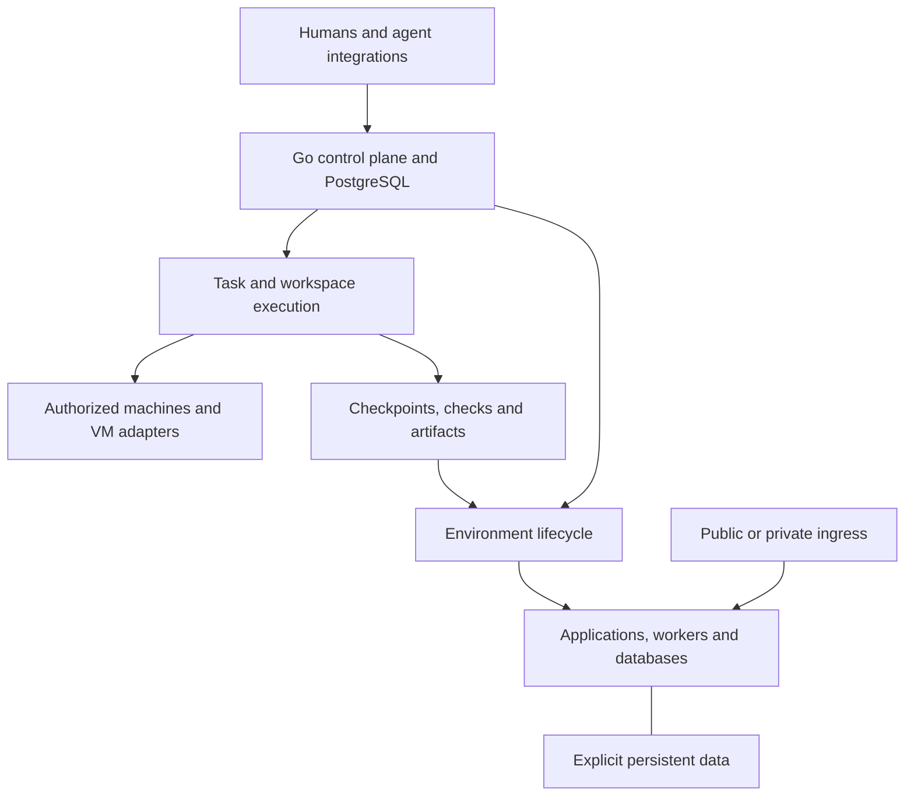

# NeroCD product specification: hosting replacement and future shared workspaces

Revision: 3, with hosting-first delivery amendment
Status: Adopted target specification; implementation status is recorded separately
Date: 22 October 2026
Supplied revision 3 baseline: edgefloor/NeroCD at `09d65d4ddcbfdf27e97158a9c08beb02a721818c`, a historical ancestor.

Accepted documentation baseline: `806b57e46db9f920da240ca9ed42f5578d21226a`. Its revision 3 adoption changed documentation only; accepted application/source assessment remains `852f8e6b8d5624a95865c276dcea4a239d1f8fea`, reviewed on 2026-10-22. Native migrations extend through 0051. Unaccepted Task checkpoints are not current product support.
Product reference: coollabsio/coolify at b12d1386f3d458618b4c579babcd1e339c6c40b3, with the hosting baseline reviewed for revision 2 and workspace implementation references reviewed for revision 3
Repository path: `docs/product-spec.md`

The [workspace capability ledger](workspace-capabilities.md), [hosting compatibility ledger](compatibility.md), [implementation plan](plan.md), and [domain glossary](../CONTEXT.md) separate the complete target from accepted support.

## 1. Product objective

The active objective is a functional replacement for the self-hosted hosting
workflows in the pinned Coolify reference. Prioritize R01–R68, A01–A37 and the
declared hosting matrices. Direct hosting is the primary navigation and
onboarding journey until core hosting replacement is complete:

> Connect a server → select a repository or image → configure the application → deploy → open its HTTPS URL → operate and recover it.

Users must not need a Task, coding agent, workspace or operational template to
deploy or operate an application. Deliver practical hosting first, then useful
stateful hosting, remaining core parity, and migration/extended compatibility.
Feature parity, migration compatibility and unchanged-client compatibility
remain separate claims.

Revision 3's broader direction is retained in full as a subsequent track:
a shared workspace where remote teams and AI agents build, test, review and
deploy software using machines the team controls, also supporting a personal
cloud operated by one person.

> Give your team and AI agents a place to work that stays running when you go offline, powered by machines you control.

In that future collaboration experience, a Task carries its goal, source
revision and changes, human and agent activity, checkpoints, preview,
verification evidence and deployment history. A teammate can inspect the
result and continue supported work without reconstructing another person's laptop.

The deferred workspace demonstration remains assigning a repository task to an
agent on a team-owned machine, retaining progress while the submitting laptop
is offline, building with shared cache, publishing an isolated preview, and
letting a teammate review and approve the same artifact for deployment. It no
longer defines the first public demonstration or a prerequisite for hosting.

Remote execution still requires an available execution machine. A durable task
record can survive worker failure, but another host can continue only from a
supported checkpoint with compatible capacity. A gateway cannot keep an offline
application host running.

### 1.1 Meaning of "rewrite in Go"

Go implements the platform API, orchestration, controllers, workers, host agents, lifecycle rules and CLI. Retain the React/TypeScript application. Platform-specific helpers, including a potential native Mac virtualization helper, can use the host's supported language and API while keeping the product control plane in Go.

Use established runtimes, BuildKit, Docker/Compose, registries, object storage and reverse proxies through versioned adapters. A Go rewrite does not require replacing these systems. Keep the initial implementation modular inside the existing application and PostgreSQL authority.

Track three hosting compatibility dimensions separately:

1. Feature compatibility: users can complete the declared hosting and operations workflows.
2. Migration compatibility: supported existing resources and data can move to the new platform.
3. Client compatibility: existing Coolify API clients, CLI scripts and integrations work unchanged where an explicit adapter is supplied.

Task collaboration, machine pooling and agent execution are additional product capabilities. Neither their existence nor a repository-to-HTTPS demo establishes complete Coolify compatibility.

### 1.2 Intended users and success

The active audience is developers, self-hosters and small platform teams operating their own application hosts. The later workspace direction also serves remote teams seeking asynchronous work and reproducible review on owned hardware. These are product hypotheses, not customer-research conclusions.

A successful product lets users:

- assign builds, tests and agent work to an authorized compatible machine with an explicit budget;
- leave accepted work running after the submitting browser or laptop disconnects;
- review a retained change, required checks and a working application in one task;
- continue work through a supported handoff and promote the reviewed artifact without rebuilding it;
- run ordinary applications, databases and Compose stacks with clear data ownership;
- recover supported applications through tested backup, restore, upgrade and migration procedures;
- understand unavailable capacity, stale observations, partial results and recovery limits.

Direct application hosting remains a complete journey. Users need not create a coding task or run an AI agent to install an application. Coolify's hosting categories and source/build paths remain the reference for that part of the product. C1, C2

### 1.3 Scope and delivery precedence

The later workspace direction retains task-centered collaboration, distinct Task/Run/Workspace/Environment lifecycles, capability-aware placement, qualified isolation for untrusted work, and separate cache/artifact/verification reuse. D0–D3 and Mac, Windows, NAS, GPU and additional runtimes remain visible deferred gates/tracks.

This amendment changes delivery order, not scope. R01–R102 and A01–A66 remain intact. Direct hosting stays primary now; R65's Task-centered main collaboration view applies to the later workspace phase. References from hosting requirements to future workspace detail require only the smallest justified hosting contract, not the whole workspace product.

Before any workspace-track change starts, identify the named hosting requirement, why current hosting needs it now, the minimum scope, and the hosting acceptance test. General future usefulness, sunk effort and a possible later integration are insufficient. See the [hosting-dependency test](plan.md#hosting-dependency-test).

Supported trusted-host deployment does not require a new VM backend. Keep untrusted execution disabled until a declared hosting/preview workflow has satisfied its qualified isolation requirements. Do not weaken trust or data boundaries to accelerate parity.

Requirements are targets. The pinned source inspection establishes reusable foundations and current limitations. The implementation sequence is a recommendation without asserted delivery dates, effort estimates or measured performance claims.

## 2. Scope and parity ledger

Maintain two linked ledgers: the proposed workspace product and the Coolify hosting baseline. Every reference capability must have a ledger entry recording the upstream reference, NeroCD implementation status, supported limits, acceptance fixture and any deliberate difference. Suggested states are planned, implemented, validated, partial and intentionally different.

A delivery phase is an implementation sequence. It does not remove later capabilities from the target product.

|Product area          |Required target                                                                                                     |Initial slice and completion path                                                                                               |
|----------------------|--------------------------------------------------------------------------------------------------------------------|--------------------------------------------------------------------------------------------------------------------------------|
|Server management     |Add local and remote servers, validate capabilities, manage destinations, build roles and proxies                   |Local enrollment and SSH-assisted remote onboarding first                                                                       |
|Resource organization |Teams, projects, shared environments, applications, databases and Compose stacks                                    |Introduce the correct domain model before exposing hosting workflows                                                            |
|Git sources           |Public and private repositories, branch/commit selection, deploy keys and provider integrations                     |GitHub first, then GitLab, Gitea, Bitbucket and generic Git/webhooks                                                            |
|Build strategies      |Dockerfile, automatic builders, static files, compiled static sites and Compose builds                              |Complete hosting Dockerfile/automatic/static paths; retain Nixpacks and Railpack as separate tested adapters|
|Inputs without Git    |Registry images, stored Dockerfiles, pasted Compose and catalog templates                                           |Do not require artificial repository records                                                                                    |
|Build placement       |Builds on application hosts or dedicated build servers, with image delivery and cache controls                      |Hosting remote-builder/image-delivery work under R14–R15/A07; no broader Task or Workspace prerequisite                                       |
|Domains and HTTPS     |Custom and generated domains, target ports, paths, redirects, certificate issuance and renewal                      |Managed Traefik first; Caddy and custom proxy modes tracked explicitly                                                          |
|Deployment automation |Manual deploy, deploy on push, deploy webhooks, redeploy and retained releases                                      |Automatic trusted-source deployment is a normal workflow                                                                        |
|Preview deployments   |PR/MR and task previews, isolated configuration and storage, domains, status reporting and cleanup                  |PR/MR previews remain core hosting parity; task-linked private previews belong to deferred workspace gates                                                        |
|Persistent storage    |Named volumes, directory mounts, managed files and existing host-file mounts                                        |Ownership and retention must exist before general stateful hosting                                                              |
|Databases             |Engine-specific creation, credentials, networking, storage, health, configuration and supported recovery            |PostgreSQL and Redis first; complete the engine matrix below                                                                    |
|Service catalog       |One-click installation, generated values, component controls and versioned upgrades                                 |Start with a useful tested catalog, then expand compatibility and breadth                                                       |
|Variables and secrets |Managed encrypted credentials, build/runtime scopes, shared values and external secret sources                      |Managed secrets are a foundation dependency                                                                                     |
|Ongoing operations    |Runtime status, logs, health, limits, start/stop/restart, terminals and diagnostics                                 |Basic operations ship with each resource type                                                                                   |
|Recovery              |Platform backup, database backup, storage backup, restore and image/configuration rollback                          |Implement separate contracts and interfaces                                                                                     |
|Automation            |Resource-bound schedules, notification channels, retries and execution history                                      |Required for core replacement completion                                                                                        |
|Programmatic access   |Versioned REST API, CLI and MCP access to supported operations                                                      |One authorized application layer behind every interface                                                                         |
|Migration             |NeroCD upgrade path and supported Coolify resource/data migration                                                   |Compatibility report and staged cutover before automatic adoption                                                               |
|Broader infrastructure|Additional proxy modes, multi-server application deployment, Swarm, provider provisioning and GitHub Actions runners|Explicit extended-parity backlog with separate capability tests                                                                 |

References for the baseline categories: build paths C2, Compose C3, server/build roles C4, routing C5, previews C6, databases C7, templates C8, operations C9, teams C10, and the reference repository C1.

### 2.1 Workspace capability ledger

|Product area            |Proposed target                                                                                        |Deferred workspace demonstration and follow-through                                                                                    |
|------------------------|-------------------------------------------------------------------------------------------------------|--------------------------------------------------------------------------------------------------------------------------|
|Machine pool            |Stable machine identities, roles, capabilities, architecture, availability, trust and bounded resources|Qualified Linux hosts first, with explicit host adapter qualification for other systems                                   |
|Durable tasks           |Goal, repository lineage, runs, activity, workspace, evidence and review history                       |One task survives client disconnect and records an agent attempt                                                          |
|Agent workspaces        |Isolated checkout and tool environment, scoped grants, checkpoints and human takeover                  |One agent adapter and a supported portable source checkpoint                                                              |
|Shared builds           |Remote BuildKit, authorized cache sharing, immutable artifacts and reuse decisions                     |Demonstrate imported cache on a second compatible builder and image delivery to another host                              |
|Review and promotion    |Private preview, trusted checks, immutable candidate and target-specific approval                      |Another teammate reviews and approves the same artifact for production                                                    |
|Model endpoints         |Team-owned inference services with endpoint grants, quotas and availability                            |An existing authenticated endpoint may be connected early; model lifecycle and GPU placement need their own support matrix|
|Owned and cloud capacity|Placement across authorized machines, with explicit cloud fallback policy                              |Manual addition of compatible cloud capacity first; provider provisioning follows                                         |
|Personal cloud          |Compute, storage and public-ingress roles across supported machines                                    |One always-on application host and a VPS gateway, with clear availability and data-location rules                         |
|Application care        |Supported updates, recovery, guided migration and restore tests                                        |Reuse the hosting lifecycle, then add application/version-specific support contracts                                      |
|Later operations        |Database-aware planning, progressive delivery, drift review and vendor packages                        |Each requires explicit eligibility, authority and failure/recovery behavior                                               |

### 2.2 Boundaries that remain valid

The self-hosted platform does not inherently provide a managed-cloud availability SLA, cross-host database replication, universal zero-downtime updates or isolation between hostile workloads sharing one Docker host.

Kubernetes, a replacement container runtime and a separate hosted billing business are not dependencies of the first workspace demonstration. Docker Swarm and other documented Coolify infrastructure features remain visible parity items rather than being silently conflated with Kubernetes.

A machine pool places separate jobs. It does not combine arbitrary machines into one shared-memory computer or imply distributed GPU inference. Cross-host data movement, live migration and host failure recovery need distinct support contracts.

Functional parity is measured against the pinned reference and its recorded capability ledger. Do not call the first repository-to-HTTPS implementation complete Coolify parity.

## 3. Starting codebase: reuse, extend and replace

The current baseline is accepted NeroCD `852f8e6b8d5624a95865c276dcea4a239d1f8fea`. Static inspection and retained revision-specific runtime reports support the bounded status below. They do not validate the proposed workspace product. The supplied `09d65d4ddcbfdf27e97158a9c08beb02a721818c` remains historical context.

|Existing area                                    |Decision              |Work required                                                                                                                 |
|-------------------------------------------------|----------------------|------------------------------------------------------------------------------------------------------------------------------|
|Go API and application services                  |Reuse                 |Add workspace and hosting operations through existing authorization and transaction boundaries                                |
|PostgreSQL, migrations and durable queue         |Reuse and extend      |Add durable task relationships, bounded reservations and typed workspace, build and hosting work                              |
|Runner enrollment, leases, fences and replay     |Reuse and extend      |Evolve into host agents and build workers with explicit server/destination identity                                           |
|Local/OIDC login and project authorization       |Reuse                 |Add team ownership and resource/server permission rules                                                                       |
|Managed service accounts                         |Reuse and extend      |Preserve principal lifecycle and add short-lived task grants with enforceable operation and resource scopes                   |
|React/Vite/TanStack frontend and generated client|Reuse infrastructure  |Keep direct hosting primary now; retain the richer Task collaboration view for the deferred workspace phase                    |
|Service/environment/revision model               |Extend accepted hosting|Shared project environments and typed resources already exist; add remaining kinds and legacy migration mappings              |
|Compose execution primitives                     |Reuse selectively     |Keep legacy restrictions explicit; extend managed Compose/storage without regressing ordinary hosting HTTP readiness           |
|Provenance and linked rollback                   |Extend                |Separate build outputs, releases, target-specific application and data recovery                                               |
|File-backed secrets and access audit             |Preserve and extend   |Reuse accepted encrypted managed-secret storage and protected reveal; complete scoped execution delivery and recovery            |
|Artifact and encryption helpers                  |Reuse selectively     |Complete the specific consumers, access rules and recovery procedures                                                         |
|Operational templates and runs                   |Preserve and extend   |Keep execution instances distinct from a durable user task, mutable workspace and preview environment                         |
|Production, backup and release tooling           |Reuse                 |Extend coverage to agents, proxy configuration, secrets and hosted workloads                                                  |

Sources: architecture N1, domain model N2, deployment service N3, runtime N4, service accounts N5, secrets N6, and storage/encryption foundations N7.

### 3.1 Historical assumptions and accepted changes

The legacy service/Compose contract remains supported. Its restrictions do not describe every accepted hosting path.

- **Environment cardinality.** Legacy `Environment` belongs to a service. Accepted `ProjectEnvironment` and typed `Resource` records provide shared project grouping. Remaining work includes the broader resource kinds, legacy mappings and complete concurrency acceptance. N2, N14
- **Source requirements.** Legacy services retain repository/Compose requirements. Accepted hosting supports registry-image input without a fake repository and versioned public HTTPS Git configuration. Private configuration, stored Dockerfiles, pasted Compose and catalog inputs remain planned. N3, N14
- **Build and deployment input.** The legacy provenance resolver still rejects unsupported Compose builds and mounts. Separately enabled public Git builds execute Dockerfile, pinned Railpack and prepared-static paths. Same-host local artifact deployment is accepted and applies the exact recorded ImageID without rebuilding or pulling. Remote registry publication and shared-cache/reuse guarantees remain planned. N4, N15
- **Health.** The legacy Compose check uses `X-NeroCD-Revision`; accepted image/local-artifact hosting uses ordinary HTTP readiness. Broader component/TCP/database health and continuous observation remain targets. N8, N15
- **Mutation ownership.** Accepted hosting uses resource-binding holds, exact destinations, leases and fenced receipts. Unresolved effects and restored ownership holds remain blocked. A shared environment does not authorize relocation or clearing a hold. N9, N14
- **Secrets and logs.** Project-managed encrypted secret versions and authorized reveal are accepted. Typed build output has durable receipt/cursor storage, runner delivery, redaction and an opt-in bounded WebUI. Managed-secret execution delivery, general runtime logs, terminals and continuous resource monitoring remain planned. Build logs are not runtime logs. N6, N16

These accepted features preserve the direct hosting journey. They do not supply the Task, Workspace, reservation, task-grant, checkpoint or VM contracts introduced below.

### 3.2 Workspace gaps in the accepted implementation

At the accepted baseline, `TaskRun` describes an execution instance and there is no durable user Task or Workspace entity. Add a separate long-lived Task for the user goal, collaborators, several attempts, review and environment links. Existing enrollment, leases and fences are useful execution foundations, but tags and primitive capabilities do not establish resource reservations, isolation suitability or data-location authorization. N12, N13

Existing managed service accounts have project roles and lifecycle controls. They are not already narrowly scoped task credentials. The local content-addressed artifact helper explicitly leaves authorization to its consumers. Complete access control, transport, retention and remote publication before calling it a shared artifact service. N5, N7

A database lease alone cannot stop an old process from writing a workspace or making an external request. Carry authority generations into the host/guest helper and credential broker, and reconcile uncertain effects before handing mutable work to another writer. This is an implementation requirement derived from the proposed handoff and recovery behavior.

## 4. Target architecture

Keep a modular Go application and the existing PostgreSQL authority. Separate responsibilities in code and job types before considering independently deployed services. Humans, agents, CLI and integrations use one authorized application layer.

Hosting contracts lead current implementation. The Task/Workspace, reservation,
agent and model architecture below remains future scope; any bounded part must
pass the hosting-dependency test before work starts. It is not a prerequisite
for supported trusted-host hosting.

The control plane records intent, policy and observations. Machines execute bounded work through local supervisors. OCI registries hold deployable images and supported BuildKit cache exports. Artifact storage holds checkpoints and evidence through a separate authorization and retention contract. A supported S3-compatible backend can be self-hosted, including a qualified Garage deployment. Backend choice does not establish backup, availability or registry compatibility by itself.

Application traffic flows through an ingress/proxy path independent of control-plane request handling. For a host behind NAT, an outbound authenticated tunnel can connect explicitly published services to a gateway. Do not grant the gateway or a preview blanket access to the owner's LAN. An ingress endpoint is not automatically a CDN or an edge execution location.

### 4.1 Execution mechanisms

Extend the existing runner protocol into a managed Go host agent. Support manual enrollment and SSH-assisted installation on supported Linux hosts. Keep stable machine identity separate from the identity of one agent process.

Coolify currently describes SSH-based management without requiring a persistent deployment agent. A Go agent is an intentional implementation difference suited to the existing runner model and proposed long-lived work. C11

Use a small privileged backend helper where virtualization or host networking requires it, and a guest-side supervisor for work inside an isolated Linux environment. Version and authenticate the interfaces. Keep host administration, guest execution and user task credentials separate.

For a future qualified untrusted-work backend, the proposed first adapter is Linux with working KVM and Firecracker, with Docker/Compose or BuildKit inside supported guests. This is deferred unless the hosting-dependency test establishes a bounded need for a declared untrusted hosting/preview workflow; trusted-host deployment does not wait for it. Firecracker requires a Linux host and runs guests matching the host architecture. Native Mac execution needs a different adapter, for example Apple Virtualization.framework. These are backend-specific implementations of one lifecycle contract. W1, W2

A task workspace, a preview environment and a production environment have separate lifecycle and authority boundaries. A supported preview can contain an application, worker and isolated database within one environment boundary. Persist its data only through declared volume bindings. Shared tenant Docker daemons are an explicitly trusted mode, not the default boundary for untrusted agent tasks.

Builds, agent sessions and application mutations use the same durable execution foundations but distinct credentials, scheduling rules and records. A database cannot move because another machine has matching tags. A build retry does not automatically resume an interrupted agent session.

Use versioned adapters for agents, models, VM backends, build tools and Compose. The Go Compose model remains a candidate dependency. Test actual runtime behavior rather than inferring compatibility from parsing alone. T1

### 4.2 Domain model

|Entity                                  |Responsibility and lifecycle                                                                                                                   |
|----------------------------------------|-----------------------------------------------------------------------------------------------------------------------------------------------|
|Team and project                        |Ownership, membership, policy, source connections and machine access                                                                           |
|Task                                    |Durable goal, owner, collaborators, source/issue/PR lineage, activity, review state and links to workspaces and environments                   |
|Run and attempt                         |Bounded execution with actor, worker, reservation, lease, fence, deadline and result; extend existing `TaskRun` internally                     |
|Workspace                               |Mutable checkout and tool state, current writer generation, storage location and checkpoint policy                                             |
|Checkpoint                              |Immutable source snapshot or patch, environment recipe and adapter-supported resume state, with a declared recovery limit                      |
|Project environment                     |Related running resources such as preview, staging or production, with an independent lifetime                                                 |
|Resource and deployment binding         |Application, database or stack, plus its destination, configuration, policy and mutation ownership                                             |
|Machine                                 |Stable physical/virtual host identity, architecture, roles, capabilities, trust, availability and observations; preserve legacy Server mappings|
|Destination                             |A specific runtime/guest boundary, networks and persistent-data placement on a machine                                                         |
|Reservation                             |Accounted CPU, memory, disk, GPU and concurrency allocation, including expiry and reconciliation state                                         |
|Task grant                              |Short-lived, enforceable authorization for a run or attachment, independent of the agent's stable identity                                     |
|Source connection                       |Git or registry access and credential references                                                                                               |
|Build input manifest and attempt        |Frozen effective inputs, eligibility for reuse, builder identity, logs and outcome                                                             |
|Artifact                                |Immutable content identity, platform, storage locations, original production evidence and retention references                                 |
|Verification run                        |Required-check definition and version, artifact/source subject, execution context, freshness and measured result                               |
|Release                                 |Immutable deployable artifact set and source/build evidence; a candidate is a release under review, not a mutable branch                       |
|Deployment plan                         |Release plus named target, effective runtime configuration, secret versions, verification evidence and data/migration preconditions            |
|Approval and deployment                 |Authorized decision over a specific plan, then a separately recorded attempt to apply it                                                       |
|Route and ingress binding               |Hostname/path/port ownership, certificate status, preview access policy and any authorized tunnel endpoint                                     |
|Storage binding and secret version      |Explicit data ownership/location and protected values or external references with lifecycle                                                    |
|Preview                                 |Task/PR-derived resource set, current release, visibility, expiry and independent runtime/data policy                                          |
|Backup execution and runtime observation|Recovery artifact/consistency/verification, and timestamped evidence about machine or resource state                                           |
|Model endpoint                          |Authenticated service, model/version identity where available, data policy, quota and availability, separate from an arbitrary host shell      |

Not every entity needs a separate page. The task view should show the current candidate, work and preview status, last checkpoint, required checks, budget and next available action. Keep application operations accessible without a task.

Staging and production may use different configuration and data. Promotion preserves the artifact identity while producing a target-specific plan. Further workspace changes create a new candidate and never silently modify the one a teammate reviewed.

### 4.3 Machine roles and qualification

The following is a proposed qualification matrix, not an implemented support claim.

|Machine                          |Useful roles                                                                                                   |Conditions and limits                                                                                                                                                                            |
|---------------------------------|---------------------------------------------------------------------------------------------------------------|-------------------------------------------------------------------------------------------------------------------------------------------------------------------------------------------------|
|Linux gaming PC or workstation   |Builds, tests, agent work, optionally a trusted model endpoint                                                 |Qualified KVM backend for VM-isolated work, bounded allocations, local availability policy and native target architecture                                                                        |
|Linux mini PC or dedicated server|Persistent applications, previews, builds and control services                                                 |Reserve capacity for persistent workloads and define disk ownership, backups and maintenance behavior                                                                                            |
|Apple Silicon Mac                |Native ARM64 build/workspace guests, supported persistent Linux guests, native model serving                   |Separate Virtualization.framework adapter and qualification; native Metal model service exposed through a constrained endpoint; no assumption of Firecracker support                             |
|Windows gaming PC                |Work inside a separately managed Linux VM; trusted work in WSL2; optionally a separately managed model endpoint|Use a qualified restricted VM boundary for untrusted work. A WSL distribution and its settings do not satisfy that boundary by themselves. Any nested VM backend requires separate qualification.|
|NAS                              |Backup/object storage and, where qualified, limited compute                                                    |Qualify OS, architecture, virtualization, memory and disk behavior; storage eligibility does not imply compute eligibility                                                                       |
|VPS                              |Public ingress, control plane, registry or eligible applications                                               |VM-isolated execution requires actual KVM access or an explicitly qualified alternative; inexpensive VPS capacity must not be assumed to expose it                                               |
|Additional cloud machine         |Authorized overflow for compatible jobs or environments                                                        |Explicit provider, location, trust, credentials, spend limit and data-transfer policy before fallback                                                                                            |

A machine's capability report describes eligibility. Authorization decides whether a project may use it. Placement first filters by authorization, trust, allowed location, architecture, isolation backend and hard capacity requirements, then ranks eligible hosts by queue, cache/data locality, availability and declared preferences.

Reserve resources on claim, enforce local limits, and reconcile reservations after uncertain failures. Do not infer GPU availability from a machine label. Record device identity, supported access mode and exclusive or shared ownership. GPU passthrough, native model serving and API access to a model are different capabilities.

Mac and Windows integration must be qualified against real host exposure. Apple's documented container machine mode, for example, shares the user's home directory and SSH agent by default, while WSL has host-drive and interoperability settings. NeroCD must configure an explicit isolation profile rather than inherit convenience defaults. Disabling WSL drive mounts and interoperability reduces exposure but does not turn WSL into an untrusted-code sandbox. W3, W4, W13

### 4.4 Durability and handoff contract

|Event                               |Required behavior                                                                                                                |
|------------------------------------|---------------------------------------------------------------------------------------------------------------------------------|
|Submitting client disconnects       |Accepted remote work continues under a supervisor independent of the browser, laptop connection or interactive BuildKit session  |
|Control plane restarts              |Persisted tasks remain, agents follow the documented lease/reconnect policy, and existing application traffic continues          |
|Worker becomes unreachable          |Mark observations stale and work uncertain/interrupted; retain known evidence and reconcile before granting conflicting authority|
|Worker returns                      |Reconnect to the recorded attempt where valid, or reject stale authority and reconcile its effects                               |
|Another machine takes over          |Restore the latest supported checkpoint to a compatible environment; describe lost uncheckpointed work and any restarted steps   |
|Human takes over a workspace        |Pause/revoke the previous writer, confirm quiescence or clone a checkpoint into a new workspace, then issue a new grant          |
|Agent run completes                 |Retain the candidate and evidence; keep the preview according to its independent policy                                          |
|Machine with persistent data is lost|Use the supported data recovery/migration path; scheduling another process alone cannot recover that data                        |

A checkpoint may contain source, a patch, uncommitted files, tool metadata and an agent adapter's documented continuation state. Exclude credentials and unrelated home-directory content. Process-memory snapshots are optional backend-specific optimizations, not the portable handoff format. Report whether recovery resumes a supported session, restarts from a checkpoint, or retains evidence only.

### 4.5 Build identity, cache and promotion

Expose three different decisions: reuse cached build steps, reuse a complete artifact, and reuse verification evidence. Each has a different correctness and trust contract.

A frozen build input manifest must cover the effective build context, Dockerfile and named contexts, target, platform, resolved base/frontend identities, builder/toolchain versions, generated configuration, relevant non-secret arguments, dependency inputs and output-affecting secret version identifiers. A Git commit alone cannot identify all these inputs. Snapshot a mutable agent checkout before building.

Whole-artifact reuse is eligible only when the recorded inputs and declared refresh policy support it. Unresolved mutable network inputs or untracked dependencies must disable that guarantee or use an explicit bounded refresh policy. Reuse under a freshness window satisfies that policy but does not prove unresolved external inputs remained unchanged. Reusing the original artifact preserves its original provenance and records the new task's reuse decision. It does not fabricate a new build.

Use registry-backed BuildKit exports for the initial shared layer-cache path, with isolated trust scopes and controlled publication of shared references. BuildKit's registry cache can be separate from the final image. Its RUN --mount=type=cache directories remain builder-local and are not exported by --cache-to; portable compiler/package caches require an additional supported mechanism. W5, W6

Build-secret contents do not participate automatically in BuildKit's cache checksum. Track an opaque version or generation for output-affecting secret changes and apply the supported invalidation mechanism without storing secret values or guessable hashes in build identity. W7

A self-hosted registry may use a qualified object-store backend. Do not make direct BuildKit-to-Garage S3 cache export the first interoperability guarantee: Docker's backend overview labels S3 unreleased, while its S3 page labels it experimental. Pin and test the actual combination if adopting it. W8, W9

Required runtime checks must identify the exact artifact they executed. Source-level tests, tests of a separate build stage and runtime verification have distinct subjects. Keep required check definitions under trusted policy so agent changes cannot replace mandatory verification. Reuse checks only when their recorded source or artifact subjects, check-definition and policy versions, relevant execution context, fixtures and freshness policy still match.

For multi-platform artifacts, retain the OCI index and selected platform-manifest digests and their verification coverage. Success on ARM64 does not establish native AMD64 runtime behavior. Emulated results must be labeled. Freeze any attestations included in the index before sealing that index digest, or attach later evidence through immutable external references. W10, W11

An approval binds the immutable release, required evidence and the destination-specific plan. It does not authorize future branch contents. Runtime configuration and data can differ between preview and production while the promoted application artifact remains identical.

## 5. Required user journeys

### 5.1 Repository to HTTPS application

A user installs the platform, adds or selects a server, connects a public or private repository, chooses a build strategy, supplies variables, configures a domain and selects Deploy. The platform resolves the source, builds the image, starts the application, checks readiness and configures HTTPS.

The user sees build progress, deployment progress, the live URL, runtime logs and current health. A subsequent push deploys automatically when enabled. Failed builds leave the running version available.

### 5.2 Application with a database and uploaded files

The user creates PostgreSQL, receives a private connection binding, attaches it to an application, and adds persistent storage for uploads. Generated credentials are stored by the platform. Redeploying either resource preserves its data.

The user configures database and storage backups, restores copies into new resources, verifies data, and sees the separate restore status of each dependency.

### 5.3 Compose or one-click service

The user selects a catalog entry, pastes Compose, or connects a repository containing Compose. The platform identifies components, required variables, persistent mounts and public endpoints. It generates credentials once, builds or pulls the images, and starts the stack.

Component pages expose logs, health, terminals, schedules and applicable database backup controls. A catalog refresh does not silently change an installed service.

### 5.4 Pull-request preview

A trusted PR/MR event creates or updates an isolated preview with its own routes, configuration and storage policy. The provider shows its status and URL. Closing the request removes the preview according to retention policy without touching production data.

Production secrets are not copied into previews by default. Public-fork execution requires an explicit trust policy and suitable build/runtime isolation.

### 5.5 Operate and recover

The operator inspects resource health after deployments finish, restarts a container, opens an authorized terminal, runs a scheduled command, receives a failed-backup notification and diagnoses an unreachable server.

A control-plane restart leaves hosted resources running. A restored control plane reconciles ownership before resuming mutation.

### 5.6 Task to reviewed deployment: deferred workspace demonstration

Use one supported Linux architecture and two physical machines with three logical roles: an always-on control/gateway role, a team-owned agent/build worker, and an always-on preview/deployment target. The control/gateway and target may share a machine with bounded allocations. Use a real registry transfer between build and deployment hosts.

1. A human creates a repository task against a concrete starting revision, a trusted check policy and a preview recipe containing an application and isolated seeded PostgreSQL. Add a worker component if the application needs one.
2. Placement selects an authorized compatible machine, records a reservation and creates an isolated workspace. One supported agent receives only the repository, model, build and preview grants required for the task.
3. The agent works in its checkout. NeroCD retains activity, source checkpoints and failures. The initiating human disconnects and work continues remotely.
4. An immutable source checkpoint and build input manifest freeze the inputs. BuildKit builds with authorized shared cache and publishes the artifacts. Successful publication creates the immutable candidate release. Required source checks identify their source subjects. Required runtime checks execute the final published candidate artifacts and record their digests.
5. The preview target pulls the artifact by digest and exposes a private URL with its own application data. It remains available after the agent run ends and the build machine is drained.
6. A teammate opens the task in another session, reviews changes, evidence and the live application, and can take over through a supported workspace handoff.
7. An authorized human approves the production plan. Deployment applies the reviewed artifact without rebuilding and records the destination, configuration and data preconditions. The observed platform-manifest digest must match the approved artifact for that platform.
8. A later source or relevant plan change requires a new decision. Preview expiry removes only owned disposable resources and retains task evidence and pinned releases.

The demonstration must also run a compatible build on a second builder and show imported cache use, elapsed time and transferred bytes. A warm cache on the original builder alone does not prove shared cache. Keep this small fixture isolated from persistent workloads.

This demonstrates one supported path. It does not assert universal agent resume, cross-architecture execution, application migration or full Coolify parity.

### 5.7 Personal cloud and owned model endpoint

A single owner enrolls a build-capable gaming PC, an always-on application host and a public VPS gateway. The platform shows which host executes work, which stores persistent data, and which publishes each endpoint. A NAS may be a configured backup target without joining the compute pool. A sleeping build host delays new jobs or triggers an explicitly configured fallback, while the independent application host continues serving.

The owner or team can register a model service running on suitable hardware. Tasks receive scoped endpoint access and usage limits, not arbitrary access to the model host. A failed or unavailable model endpoint appears as a dependency failure with a declared retry policy. First-class model installation, GPU allocation and model upgrades require separately qualified lifecycle support.

### 5.8 Reproduce, upgrade and recover

A failed deployment can open a reproduction task containing its exact release, available configuration references, selected diagnostics and an isolated environment recipe. Show missing data and unavailable external dependencies. Production data copies require authorization, an appropriate sanitization policy and blocked external side effects by default.

A supported application update declares its version path, preflight, backup, migration, verification and recovery procedure. Guided moves between machines transfer data explicitly, coordinate writers and switch traffic only after verification. Scheduled restore tests create disposable environments and verify application behavior, rather than merely confirming that an archive can be unpacked.

## 6. Functional requirements

All requirements below describe the complete target. The hosting-first amendment in sections 1.3 and 10 governs delivery order: R01–R68/A01–A37 and declared hosting matrices first; R69–R102/A38–A66 remain visible future scope. R65's Task-first collaboration view is deferred; direct hosting is primary now. No requirement definition is removed or narrowed by this ordering.

### 6.1 Organization and server management

R01. Shared environments. A project environment MUST contain independently operated applications, databases and stacks. Two unrelated resources in one environment MUST be able to deploy concurrently.

R02. Team and project authorization. Reuse existing identity and service-account behavior. Add explicit team ownership and server-access rules. Preserve current project permissions during migration. A viewer MUST not gain deploy, terminal, secret-reveal or data-deletion rights through a new UI or API.

R03. Machine onboarding. Support local installation, manual agent enrollment and SSH-assisted remote enrollment where the host adapter supports them. Probe operating system, architecture, virtualization/runtime availability, disk capacity, connectivity and relevant ingress readiness. Display qualified roles and unmet prerequisites. Validate SSH host identity and include installations or service restarts in the reviewed onboarding operation. Do not advertise VM isolation based only on a CPU flag or machine label.

R04. Credential separation. Bootstrap SSH credentials, enrolled-agent credentials, Git credentials and registry credentials MUST have separate scopes and lifecycles. State whether bootstrap credentials are retained for recovery. The browser MUST not receive permanent agent or host credentials.

R05. Stable destinations. Machine and destination identity MUST survive agent process replacement. Every deploy, rollback, volume operation, backup, route change and scheduled command MUST identify its intended runtime boundary and data location. Matching tags do not authorize relocation. Preserve legacy Server identifiers through migration mappings.

R06. Machine roles and lifecycle. Support declared build, agent, test, application, storage, ingress and model roles where qualified, including combined roles with bounded allocations. Provide drain, reconnect, credential rotation, maintenance and removal. Removal MUST not implicitly destroy workloads or data. Old agents MUST not claim unsupported operations. Show the impact of a role or availability change on persistent workloads and queued tasks.

R07. Execution trust. Untrusted agent tasks and untrusted build inputs MUST use a qualified isolation profile under R81 and R82. A shared host Docker daemon remains an explicitly trusted deployment mode. Database-level team separation does not sandbox hostile workloads. A machine administrator remains trusted with guest data and secrets placed on that machine. Capability matching never grants access to a machine, dataset or private network.

### 6.2 Sources and builds

R08. Source choices. Support public/private Git, selected branches and commits, registry image tags or digests, stored Dockerfiles, Git Compose, pasted Compose and catalog templates. Preserve the source of truth for each. A no-Git input MUST not require a repository placeholder.

R09. Git integrations. Provide repository and branch selection, scoped credentials, connection tests and webhook setup. Implement GitHub first, then the provider matrix in section 2. Generic Git and signed manual deploy webhooks remain supported paths.

R10. Trigger integrity. Authenticate provider events, record delivery identity, deduplicate retries and bind a deployment to the intended source revision. Define how superseded queued changes are handled. A delayed older event MUST not silently replace a newer active release. Replaying a webhook MUST not create unbounded duplicate builds.

R11. Build strategies. Support Dockerfile contexts and targets, automatic builders, static file packaging, compiled static output and Compose build sections. Record the exact builder/version and effective settings. Validate monorepo base paths, output directories and command overrides. Nixpacks and Railpack support must be tracked separately. Coolify currently marks Railpack as Beta. C12

R12. Static sites. Distinguish serving already-built files from compiling frontend source. Support publish directory, SPA fallback and configurable static-server behavior. A configuration baked into an image requires a rebuild rather than a misleading restart action. C13

R13. Build records and outputs. Record resolved source or workspace checkpoint, frozen build input manifest, platform, builder identity, logs, cache outcome and immutable output identities. Accept image tags as convenient inputs and record selected digests. Keep original build provenance when an artifact is reused. A deployment retry MUST not silently rebuild different contents. R87–R92 define input, trust and verification rules.

R14. Placement and image delivery. Support documented local builds and dedicated build workers. Remote builds MUST publish to an authorized registry or another qualified transfer mechanism. Verify target platform, artifact availability and pull access before mutation. A local image on one daemon is not available elsewhere by implication. The supervising build session MUST be owned by a remote service or worker so a submitting laptop disconnect does not cancel accepted work. Buildx provides a remote BuildKit driver, but product supervision and authorization remain NeroCD responsibilities. W12

R15. Cache and retention. Expose layer-cache reuse, complete-artifact reuse and verification reuse as separate outcomes. Scope cache access by project/team and trust policy. Track output-affecting secret versions and dependency refresh rules. Provide independent controls for disabling cache, rebuilding an artifact, refreshing mutable inputs and rerunning checks. Protect artifacts referenced by active deployments, retained releases and evidence roots. R87–R92 define the detailed contract.

R16. Build credentials and limits. Separate build-time credentials from runtime secrets. Scope source and registry access to the operation. Apply time, CPU, memory, disk and concurrency limits. A failed or canceled build MUST not modify the active resource or route. Untrusted preview code MUST not receive production credentials.

Build and deployment are separate product records even when they execute on one host. Coolify likewise supports distinct local and remote build paths. C2, C4

### 6.3 Releases and deployment behavior

R17. Automatic and protected deployments. Trusted push-triggered deployment remains a normal hosting workflow under an explicit resource/environment policy. Every deployment resolves a concrete release and target plan. Task work produced through an agent MUST pass independent human production authorization under R85. Agent access to a repository, branch or workflow MUST NOT become an indirect bypass of this rule through automatic deployment. New agent-workspace projects default production targets to protected.

R18. Frozen release and plan identity. A release MUST identify immutable artifacts, source/build evidence and the deployable recipe version. A deployment plan freezes the selected release, destination, effective workload configuration, secret references/versions, relevant variable generations, required verification and data preconditions. Durable records MUST retain secret references and version identifiers instead of expanded values. Resolve secrets only into protected execution material. Secret-expanded Compose output MUST NOT enter ordinary release exports, audit payloads or artifacts. Hash normalized configuration with secret identities rather than publishing hashes derived from low-entropy values. Distinguish immutable secret-provider versions from mutable references.

R19. Plan approval. Where approval is required, review the concrete plan after image preparation and required verification, before workload mutation. Bind the decision to release, target, effective configuration/secret generations and evidence. New selected contents, material evidence-policy changes, expiry or relevant plan changes require a new decision. Current authorization and revocation still apply at execution. State human self-approval policy separately from the prohibition on an agent approving its own production work.

R20. Admission and concurrency. Preserve durable idempotency and linked attempts. Scope active deployment exclusion to the resource binding. Extend current revision-level intent matching to release and plan identity. Coordinate shared proxy, network and storage mutations with their own ownership constraints.

R21. Deployment strategies. Provide separate strategies for a single-image application, a Compose stack and a stateful database. Eligible stateless applications should start a replacement, verify readiness, switch traffic and drain the old container. Fixed host ports, exclusive mounts or application constraints may require replacement with interruption. Show the selected strategy before deployment.

R22. Generic health. Support container health, HTTP, TCP and engine-specific readiness. Treat platform revision headers as optional extra evidence. Track expected components, images and container state through platform-owned metadata. Successful one-shot initialization jobs and optional components require different status rules from long-running services.

R23. Cancellation and uncertainty. Cancel queued/build/pre-mutation work where safe. Once mutation may have occurred, record cancellation intent and reconcile effects before retry, rollback or termination. Preserve attempt fencing, durable replay and target ownership. A terminal intervention or failed rollback MUST not unlock unresolved runtime effects for a competing deployment.

R24. Rollback and application data. Offer retained release selection, show the configuration and data-compatibility implications, and restore the selected supported release on the same destination. State whether the action uses the retained configuration or explicitly selected current overrides. Current authorization and secret revocation still apply. Never describe image rollback as reversal of database migrations or uploaded-file changes.

Coolify's own replacement strategies differ between single-image applications and Compose, and its documented image rollback uses current runtime configuration. This rewrite may provide a stronger retained-configuration option, but must label it as a deliberate improvement. C14, C15

### 6.4 Routing and certificates

R25. Managed routing. Provide an integrated Traefik path first. Store route ownership, hostname, path, target component and internal port. Support multiple domains and public components, redirects, WebSockets and appropriate forwarding headers. Do not confuse an internal target port with a public host-port mapping.

R26. Domain setup. Support custom domains and generated subdomains under a configured wildcard domain. Report DNS, ownership, reachability and route conflicts with actionable errors. Testing domains must be identified as such. Do not silently assume ownership of a domain or a working DNS record.

R27. Certificate lifecycle. Manage ACME issuance, renewal, status and failure reporting. Support ordinary HTTP validation and a separately configured DNS-validation path for wildcard certificates. Protect DNS-provider credentials. Use bounded retries and retain a valid certificate when a renewal attempt fails. Custom certificates need an explicit storage and rotation path.

R28. Proxy changes and availability. Validate new generated configuration and preserve the last working configuration on failure. Serialize shared proxy changes without blocking unrelated builds. Existing routes and workloads MUST continue serving during a control-plane restart. Track Caddy, custom-proxy operation and proxy migration in the parity ledger.

Current Coolify provides managed Traefik, Caddy and custom proxy choices. The rewrite can sequence those adapters while keeping routing a core requirement. C5

### 6.5 Variables, secrets and credentials

R29. Managed secret storage. Integrate encrypted secrets in the first application-hosting path. Cover Git, registry, SSH bootstrap, application, database, S3, webhook, DNS and notification credentials. Reuse existing cryptographic and lease-bound access foundations where suitable. Complete persistence, authorization, versioning, key provisioning, rotation and recovery before claiming support.

R30. Value scopes. Separate build-time, runtime and preview variables. Support shared references at team, project, environment and resource scopes with a documented override rule. Show the origin of each effective value and whether a change requires a rebuild, redeploy or restart. Shared secrets MUST not be injected into every resource merely because they exist at a parent scope.

R31. Disclosure and delivery. Mask secrets in ordinary views. Allow reveal or connection-string copy only through an explicit authorized operation with appropriate audit. Preserve one-time disclosure for credentials whose contract requires it. Deliver runtime/build secrets only to authorized execution. Redact supported output representations and keep plaintext out of stored job metadata and notification payloads.

R32. Rotation and provider behavior. Define rotation, revocation and unavailable-version behavior. A runner_file label does not by itself freeze file bytes. For database accounts, rotate the engine credential and dependent bindings through a recoverable operation. For external secret sources, state resolution time, cache policy, missing-key behavior and build-cache consequences.

R33. Key recovery and external sources. Preserve required encryption-key material through an explicit recovery process separate from ordinary database backups. Wrong or missing keys MUST fail closed. Retain runner_file as an operator option. Track Doppler, Infisical and Vault integration as parity work with provider-specific contracts. C16

### 6.6 Compose and persistent storage

R34. Compose compatibility. Support service images and builds, variables, commands, profiles, networks, health checks, dependencies, resource settings, named volumes and supported bind/file mounts. Publish a tested compatibility matrix covering managed and raw deployment modes. Replace the current blanket prohibitions with capability and ownership rules. Unsupported fields must produce a precise preflight error.

R35. Compose ownership. Git-owned Compose remains repository-owned. Pasted or template-derived Compose remains stored resource configuration. Generated routing, credentials and overrides must be reviewable and must not create a second conflicting source of truth. Preserve required/optional variable semantics and existing configured values when reloading definitions. Track raw Compose as an explicit parity mode that preserves operator-owned labels and networking and identifies which managed features are disabled. Raw mode MUST preserve authorization, destination ownership and data-retention rules. State its resolution and reproducibility limits for external inputs. Reject a protected-deployment policy during preflight if the raw definition cannot satisfy its required release guarantees without alteration.

R36. Multi-component execution. Resolve or build each required image and record the selected set before application. Interpret long-running services, initialization jobs and optional components explicitly. Show component-level status, endpoints, logs and controls. A healthy web endpoint alone is insufficient when a required database or worker failed.

R37. Advanced host access. Support administrator-authorized advanced Compose needs through explicit capabilities where qualified. Distinguish paths/devices inside a guest from physical-host access. Do not silently discard unsupported fields or grant physical-host access through a convenience setting. Host mounts, privileged execution or devices that weaken an isolation profile require a different explicit trust profile and may make a destination ineligible for untrusted work.

R38. Storage identity. Record each binding's destination, Docker volume identity or canonical host path, mount destination, mode, ownership and resource references. Keep identity stable across rename, redeploy and agent replacement. Distinguish managed files, managed directories and pre-existing host files. Classify each storage object as platform-managed or externally owned. Importing or mounting an external object does not transfer ownership; any supported ownership transfer MUST be separate, authorized and auditable.

R39. Data retention and deletion. Stop, redeploy, remove resource and delete data MUST be separate operations. Retain persistent data by default when removing a resource. Resource deletion and automated cleanup MUST preserve externally owned volumes, files and directories, including when deletion of managed data was explicitly selected. A destructive action must name the exact data objects and affected resources. Cleanup must protect retained data, active work, shared references and required recovery points.

R40. Cross-host state. A local volume remains bound to its destination. Moving a resource with data requires explicit transfer, restore or a supported replication/storage model. Matching server tags or a new container name cannot create continuity of data.

Current Coolify supports both Git and pasted Compose, as well as several storage mount workflows. Those are the compatibility baseline. C3, C17

### 6.7 Database resources

R41. Database creation. Provide engine/version selection, target/network, stable persistent storage, generated credentials, resource limits, readiness and connection details through the UI and API. Default to private networking. Public exposure requires an explicit operation with endpoint and access implications shown.

R42. Application bindings. Let users bind a database to an application through credential references and valid network information. Show unreachable cross-server bindings rather than inventing a shared Docker network. Redeployment must preserve credentials and data unless an explicit change is requested.

R43. Engine-specific lifecycle. Implement configuration, readiness, start/stop/restart, credential rotation and supported backup/restore per engine. Major-version upgrades must validate data layout and compatibility and show a recovery procedure. Changing an image tag must not be advertised as a universal database upgrade.

R44. Engine coverage. Maintain the matrix below in implementation and documentation. PostgreSQL and Redis may ship first, but the remaining documented engine coverage stays in the product plan. "Managed" describes supported lifecycle operations, not automatic replication or a database availability SLA.

|Engine    |Reference scheduled backup|Reference dashboard restore|Rewrite requirement                                             |
|----------|--------------------------|---------------------------|----------------------------------------------------------------|
|PostgreSQL|Yes                       |Yes                        |First stateful slice, with a tested application restore         |
|Redis     |No                        |No                         |Early hosting support with explicit persistence/recovery limits |
|MySQL     |Yes                       |Yes                        |Engine-specific backup and import                               |
|MariaDB   |Yes                       |Yes                        |Separate version/configuration compatibility tests              |
|MongoDB   |Yes                       |Yes                        |Supported authentication and dump/import formats                |
|ClickHouse|Yes                       |No                         |Backup parity, explicit restore procedure or labeled improvement|
|Dragonfly |No                        |No                         |Hosting and persistence support with honest recovery limits     |
|KeyDB     |No                        |No                         |Hosting and persistence support with honest recovery limits     |
|SQLite    |Yes (experimental)        |Yes (experimental)         |Retain an explicit experimental status until validated          |

The reference matrix is documented by Coolify. Similar-looking database controls must not imply identical support across engines. C7

### 6.8 Backups and restores

R45. Separate recovery types. Expose platform backups, database backups and storage backups as distinct workflows. A platform database backup does not contain hosted application data. A storage archive does not prove transactional consistency for a running database. Application rollback remains a fourth, separate operation.

R46. Backup execution. Support immediate and scheduled backups with target, format, consistency method, timeout, retention, concurrency policy and execution history. Record resource identity, engine/version, size, digest and available locations. Use local staging and S3-compatible remote storage where configured. A storage backup MUST state whether writers remain active or are quiesced. For a stop-during-backup policy, record which containers were running, stop the required writers, create the archive, and attempt to resume those containers after success, failure or timeout. Do not start containers that were already stopped. Reconcile incomplete resume attempts and preserve their failure evidence. A live file archive MUST NOT be labeled an application-consistent database backup.

R47. Partial outcomes and retention. Distinguish dump/archive success from remote-upload success. Preserve the local recovery artifact after failed upload. Keep local and remote retention independent. Replaying a retention request after response loss must return its receipt without deleting another batch. Preserve audit and receipt atomicity.

R48. Restore workflow. Prefer restore into a new database or volume for validation. In-place restore must identify its target, replacement behavior, compatibility, writer coordination and recovery point. Restore ownership and permissions where relevant. Verify an application can read and write restored data before marking the recovery test passed.

R49. Platform recovery. Preserve the existing compatible-image/schema restore discipline and invalidation of restored sessions and active leases. Recover required secret keys and configuration. Enter a recovery mode that observes existing hosts and confirms ownership before resuming mutation. Do not recreate or delete healthy workloads merely because the control-plane database was restored.

Coolify documents separate instance, database and storage backup paths with different limits. Its current storage archive workflow does not establish a complete dashboard restore path. A tested restore UI in the rewrite is an improvement that should be identified as such. C18, C19, C20, N10

### 6.9 Service catalog and upgrades

R50. Versioned templates. Store template identifier, source version, original definition, user changes, generated values, component identities and resolved images. Generate passwords and stable identifiers once. Redeployment and catalog refresh MUST not regenerate credentials.

R51. Installation experience. Search and filter catalog entries, show required variables, domains, storage, architecture, resource needs and component roles, then install through the same resource engine as pasted Compose. Templates must not bypass authorization or storage rules.

R52. Update semantics. Distinguish pulling newer images under saved tags, changing application configuration and upgrading the catalog definition. Show a change preview for images, variables, mounts, networks, health and migrations. Catalog updates MUST not silently rewrite installed resources. Block or explain rollback when data compatibility prevents it.

R53. Catalog compatibility. Support a useful initial tested catalog and expand through a published fixture matrix. Import compatible reference templates with recorded origin/version and required attribution. An imported YAML file is not validated support until installation, persistence and update behavior pass.

Coolify installs a copied resource definition from a template, and later catalog changes do not overwrite the deployed copy. Preserve that distinction. C8

### 6.10 Previews and delivery automation

R54. Preview identity. Represent a preview as a task-, PR/MR- or manually derived resource set with separate routes, configuration, networks and data. Support single-image and declared Compose paths, including application, workers and isolated databases. Its lifecycle MUST be independent of the agent run and mutable workspace. Record the current immutable release and its verification coverage.

R55. Preview trust and credentials. Default automatic previews to trusted repository actors and authenticated viewers. Public-fork execution requires an explicit policy and qualified isolation. Production secrets, database bindings and writable volumes MUST NOT be copied by default. Use isolated seed data unless a separate data-copy operation is authorized. Preview access, source editing and deployment permissions are distinct. Limits account for build and runtime capacity.

R56. Preview lifecycle. Update a preview from its intended candidate, report provider/task status and URL, and expire it under a recorded policy. Define failed-update, retry, data retention and extension behavior. Ending an agent run MUST NOT remove a retained preview. A delayed close event or repeated cleanup MUST NOT delete production, external data or a newer unrelated preview. Closing the creator's client does not alter the preview lifetime.

R57. Delivery policy. Expose auto-deploy branch selection, path filters where supported, manual deploy, deploy webhooks, optional approval and rollback policy. Keep ordinary push deployment simple. Advanced operational templates must not become mandatory configuration for a normal application.

Reference preview behavior includes provider events, separate variables/domains and cleanup. C6

### 6.11 Ongoing operations, schedules and notifications

R58. Continuous observation. Collect server reachability, container state, readiness, disk usage and bounded CPU/memory samples independently of deployment jobs. Combine event-driven updates with periodic reconciliation. Document collection and stale-state thresholds. An unreachable agent means current state is unknown, not that every workload stopped.

R59. Distinct logs. Provide build, deployment and runtime log views with clear source, time, component, ordering and retention. Runtime logs continue after a deployment ends. Live follow must reconnect and indicate gaps or truncation. Keep audit records separate. External log drains and metrics export are part of the operations plan.

R60. Resource actions. Support start, stop, restart, redeploy, inspect, force rebuild and supported rollback with resource-specific behavior. Display desired state, last operation result and latest observed state separately. Expose diagnostics and resource limits without requiring generic run IDs as the primary navigation.

R61. Terminals. Provide container and server terminals through short-lived grants bound to actor, destination and resource. Container access and host access require different permissions. Support server-level disablement, revocation and session termination. Audit session metadata without placing permanent credentials in the browser.

R62. Scheduled commands. Bind a schedule to a resource and component, then resolve its current container on the correct target at execution. Record occurrence identity, schedule version and actual target. Define timezone, DST, timeout, overlap and missed-run policy. The default should skip missed runs and forbid overlap rather than create an uncontrolled catch-up burst.

R63. Durable notifications. Start with email and generic webhooks, then complete the declared channel matrix. Users select events per channel. Include deployments, backup/upload failures, schedules, resource state, server reachability and disk pressure. Persist delivery attempts, bounded retries and deduplication keys. Test delivery must be distinct from exercising an actual event.

R64. Maintenance. Provide owned-image/cache cleanup, disk-pressure reporting, agent/proxy version visibility and supported upgrade procedures. Never prune all host resources indiscriminately. Platform and agent updates must preserve running applications, retain a recoverable control-plane state and explain compatibility limits.

Reference operations include continuous status collection, runtime metrics, terminals, container schedules and channel-specific notifications. C9, C21, C22

### 6.12 UI, API and compatibility

R65. Task-centered collaboration and direct operations. The main collaboration view is a durable Task showing its goal, source changes, agent/human activity, workspace status, checkpoint, required checks, candidate, preview, budget and deployment history. Provide direct navigation to projects, environments, applications, databases/stacks, machines, sources and settings. Users can host or operate an application without an agent task. Existing generic runs remain execution details and advanced automation, not a substitute for the new Task.

R66. Complete UI workflows. After documented platform installation, every supported resource can be created and operated without seeded fixtures, SQL or ad hoc API calls. Preserve non-secret form input after validation failure. Show missing prerequisites and direct actions. Verify keyboard access, responsive views and authorization failures.

R67. One application contract. UI, API, CLI, webhooks and MCP MUST call the same authorized application operations. Regenerate the TypeScript client from the versioned contract. Preserve legacy NeroCD routes during the supported migration window. Do not expose a shortcut that bypasses target, secret, approval or data-ownership rules.

R68. Evidence and releases. A capability is complete when schema, API, permissions, audit, UI, operational behavior and tests agree. Publish supported OS, architecture, Docker/tool versions and measured limits. Use candidate-specific checks and runtime evidence. Do not claim performance gains from choosing Go without measurement.

### 6.13 Durable tasks and workspaces

R69. Task identity and activity. Create a durable Task with owner, collaborators, goal, project, source lineage and linked environments. Support human, integration and agent actors, several runs, candidates and review decisions. An execution retry MUST NOT create a different user task or erase prior evidence. Activity must distinguish requested action, observed outcome and agent narrative.

R70. Durable admission and attempt authority. Acknowledge accepted work only after its task/source references and queued intent are durable. Atomically record a claimed attempt, its resource reservation and lease authority. Bound retries by the task's original deadline and aggregate budget. Reject stale state changes, credential requests and artifact/candidate publication. Reconcile possible external effects before conflicting mutations or releasing uncertain reservations. Do not claim exactly-once execution.

R71. Workspace lifecycle. Create an isolated checkout and declared tool environment per workspace, with a named base revision, branch or content snapshot and owned disk allocation. Separate writable work from immutable candidates. Use one writer by default. Permit concurrent experiments through separate workspaces or an explicit coordination protocol. Workspace cleanup MUST retain required checkpoints and never delete unrelated repositories or data.

R72. Checkpoints and continuation. Publish immutable checkpoints containing the declared source changes, selected uncommitted files, environment recipe and supported agent continuation metadata. Encrypt and authorize sensitive content, exclude credentials and report excluded files. Identify the latest durable checkpoint and possible lost work after interruption. Publish an adapter-specific distinction between session resume, restart from source/checkpoint and evidence-only recovery. No universal process-memory or cross-architecture migration guarantee is implied.

R73. Human attachment and handoff. A teammate can inspect the diff, logs, checks and preview and attach to supported workspace tools under a short-lived grant. Before writable takeover, revoke or pause the old writer and confirm quiescence. If the old host cannot be fenced, create a separate workspace from a checkpoint rather than granting a second writer to the same data. Preserve ownership generations and the handoff event. The first release can use terminal/editor attachment integrations without implementing a new IDE.

R74. Evidence persistence and disclosure. Retain task activity, checkpoints, diffs, command/check results and artifact references independently of temporary worker disks. Enforce project/task permissions on every download and stream. Indicate missing, truncated, stale and partially uploaded evidence. Apply separate retention to task history, logs, checkpoints, previews, caches and releases. Record deletion and preserve required references without exposing removed secrets.

R75. Source handoff. Allow a supported agent to submit a patch, commit or review branch tied to the task and candidate. Preserve the distinction between a source checkpoint, provider commit, pull request and deployed artifact. Repository write operations use the same explicit task authority. Branch restriction claims MUST be enforced by the provider or by a broker that holds broader credentials outside the guest. A repository-wide token handed to an agent cannot be described as branch-scoped merely because its task metadata names one branch.

### 6.14 Placement, availability and budgets

R76. Typed capabilities. Record machine OS/architecture, qualified execution backends, resource capacity, device capabilities, tool versions and observation freshness. Separate native target support from emulation and from cross-compilation. A successful capability probe is evidence of a tested prerequisite, not proof that every workload is supported. Revalidate material host changes and reject unsupported operation/backend combinations before execution.

R77. Placement and reservations. Filter by authorization, trust, data location, required isolation, architecture and hard resource constraints before applying scheduling preferences. Account for CPU, memory, disk, GPU/VRAM where supported and concurrency, with local enforcement and bounded overcommit policy. Reserve persistent application capacity separately from opportunistic jobs. Prefer cache locality only among eligible destinations. A tag match MUST NOT override stable destination or volume ownership.

R78. Budgets and expiry. Apply task/project limits for elapsed time, aggregate resource consumption, concurrency, workspace and preview storage, network usage where metered, and configured model/cloud spending. Show measurement gaps instead of invented precision. Budget is shared across retries and subtasks. Enforce stop/reject behavior at a documented boundary, with safe cleanup and retained evidence. Preview expiry must include a reviewable extension policy.

R79. Availability policy. Let owners declare always-on or opportunistic capacity, schedules and drain behavior. Show queued work blocked by unavailable eligible capacity. A submitting-client disconnect must not end accepted remote work. Sleep or loss of an executing host causes explicit interruption/uncertainty and supported recovery. Do not automatically move stateful applications or claim continuity of uncheckpointed work. Rejoining hosts must reconcile old authority before accepting conflicting work.

R80. Cloud fallback. Support adding compatible cloud machines through the same enrollment and policy model. Automated provisioning or fallback requires configured provider credentials, locations, allowed data, spending limits and cleanup ownership. Never silently upload private source, checkpoints, models or datasets to a different trust/location domain. When fallback is disallowed or exhausted, preserve the task and explain the blocked condition. Provider provisioning is separate from the first manual-capacity workflow.

### 6.15 Agents, isolation and models

R81. Qualified isolation profiles. Run untrusted code in a supported VM boundary, with an explicit host/kernel/backend/guest-image support matrix, patch/update policy and resource controls. Distinguish task, preview and production boundaries. Use disposable guest disks for ephemeral work and explicit bindings for retained data. Never claim that VM isolation makes arbitrary malicious code harmless. Native Mac, Windows and Linux implementations require their own tests. A WSL distribution alone is not a qualifying VM isolation boundary. GPU/host-device access needs a separate qualified profile. W13

R82. Filesystem and network grants. Deny access to personal home directories, host management interfaces, host Docker sockets, personal SSH agents and private networks unless explicitly granted for the task. Enforce network policy outside the untrusted guest, including IPv4/IPv6, host/private/metadata ranges, proxy paths and address revalidation after DNS resolution. Grant specific destinations, ports and data mounts with modes and lifetimes. An ingress tunnel only exposes authorized services and must not become a general LAN route. Revocation behavior must be exercised.

R83. Task-scoped authority. Associate a stable agent/service principal with short-lived run grants for task/project, repository operations, environment/destination, artifact/cache namespace, secrets, model endpoints and expiry. Enforce restrictions in the actual provider, broker or runtime, not just in a signed claim that a downstream service ignores. Prefer brokered access where narrow downstream credentials do not exist. Do not place production credentials in ordinary agent workspaces. Apply revocation to active sessions and outstanding operations as supported and report residual uncertainty. Grants do not promise to erase data already legitimately read.

R84. Agent adapter contract. Version an adapter for starting, observing, interrupting and collecting one supported coding agent. Declare its authentication, model requirements, tool access, checkpoint/resume semantics, costs where available and cancellation behavior. Preserve prompts, tool events and results according to project retention/disclosure policy. Agents use ordinary authorized build, preview and task APIs. Adapter availability must not depend on the initiating laptop staying online.

R85. Human production authorization. Agent-produced changes require an authorized human decision over the concrete production plan after required checks. Enforce this at the application boundary for UI, CLI, MCP, repository automation and webhooks. Agents cannot change protected deployment policy or replace trusted checks to authorize themselves. A reviewed merge may satisfy the human decision only under an explicit policy that binds the accepted source/artifact, required evidence and final target plan; an unrelated historical PR approval is insufficient. Content or target changes require a new decision.

R86. Model services. Register an authenticated model endpoint with allowed projects/tasks, model identity where available, context/request limits, concurrency, usage budget and availability. Record the selected model/service in task evidence and expose unavailable or unsupported behavior clearly. Access to the endpoint does not grant a shell, GPU device or model-host files. Separately qualify native Mac/GPU serving, model installation, storage, licensing constraints, upgrades and device ownership before claiming managed model-hosting support.

### 6.16 Shared results and verification

R87. Effective build inputs. Freeze a canonical build input manifest including effective context bytes after ignore rules, relevant named contexts, Dockerfile/frontend, target, platform, resolved base identities, builder/toolchain version, effective build settings, dependency material and output-affecting secret generations. Include submodule/LFS material where used. Retain source lineage separately from content equivalence. A live mutable checkout MUST NOT change while its candidate input is being captured without detection and retry.

R88. Conservative artifact reuse. Reuse an existing authorized artifact only when the manifest and refresh policy establish eligibility, the artifact is available with its expected identity, and current policy permits it. Unknown mutable external inputs require a declared freshness bound or disable complete-artifact reuse. Freshness-based reuse does not prove those external inputs remained unchanged. A matching Git SHA is insufficient. Record why reuse was accepted or refused and retain original provenance. Force rebuild, mutable-input refresh and check rerun are separate operations.

R89. Cache trust and transport. Qualify registry-backed build-result caching first. Scope read and write permissions separately by team/project/trust class. Untrusted contributions MUST NOT overwrite a protected cache reference or supply authoritative check results. Prefer immutable per-run exports and controlled shared-reference updates. Warn that caches can contain private build material and apply the same disclosure boundary as source. Distinguish shared layer results from builder-local compiler/package cache mounts. Cache eviction MUST NOT delete pinned releases or backups. W5, W6

R90. Required checks and reuse. Every check result records its exact source/artifact subject, definition version, execution environment/platform, time, outcome and retained evidence. Trusted policy chooses mandatory checks. Agent-edited tests can be useful additional evidence but cannot silently redefine the deployment gate. Runtime checks must execute the release artifact. Reuse of successful checks requires matching source/artifact subjects, check-definition and trusted-policy versions, fixtures, relevant environment and freshness criteria. Security or policy changes may require re-verification without rebuilding.

R91. Platform and attestation identity. Record target OS/architecture/variant, native or emulated execution and image index/platform-manifest identities. Display verification coverage per supported platform. Do not infer native correctness on one platform from a result on another. Seal index-embedded attestations before approval of that index, or retain later evidence by immutable references without mutating the approved identity. Deployment selects the approved eligible platform digest and records it. W10, W11

R92. Artifact availability and retention. Publish through authorized, bounded transfers with digest verification and explicit completion state. Candidate publication and deployment MUST NOT claim an artifact exists when required uploads failed. Protect artifacts referenced by retained releases, active deployments and required evidence, with separate cache and checkpoint policies. Reconcile registry/object-store retention and garbage collection. Report unavailable/corrupt artifacts and require a new build/approval where recovery changes their identity. Qualify any self-hosted storage/registry combination before advertising its guarantees.

### 6.17 Application care and deeper capabilities

R93. Reviewable environments. A task preview must show the candidate it serves, health of required components, access policy, data origin, expiry and source of verification. Default access is authenticated and project-scoped. Optional share links need explicit audience, expiry and revocation. A reviewer can inspect without receiving source-edit, terminal or production rights. A retained preview remains available only while its declared runtime dependencies remain available.

R94. Failure reproduction. Create a reproduction environment from an exact retained release, supported environment recipe and authorized diagnostic/configuration data. Show missing inputs and external dependencies. Production data copying is a distinct authorized operation with sanitization and retention rules. Block outbound email, payments, webhooks and other external side effects unless granted. Reproduction means a documented reconstruction attempt, not a claim of exact historical system state.

R95. Supported application updates. Maintain an application/version-path contract describing preflight, compatibility, backup/consistency method, migration, verification, expected interruption and tested recovery. Verify recovery prerequisites before mutation. Preserve reports for partial failure and unresolved writer state. An available newer image or VM snapshot does not establish a safe upgrade or database rollback. Unsupported update paths must be labeled manual/unsupported.

R96. Guided migration between machines. Plan destination capability/resource checks, image compatibility, secrets, data transfer, writer coordination, verification and route cutover. Name each data object and recovery point. Prevent both installations from concurrently performing exclusive schedules or consuming external events during cutover. Account for post-cutover writes in recovery. Cross-architecture migrations require supported images and application/data-format compatibility, not just successful file copy.

R97. Restore testing. Restore a selected backup into an owned disposable environment, verify application startup and meaningful data reads/writes, retain the result and then clean up by ownership. Record engine/application versions, recovery artifact identity, elapsed time and missing dependencies. Keep restored credentials, production data and outbound integrations under explicit policy. A successful archive extraction alone MUST NOT mark the application recovery test passed.

R98. Database-aware deployment planning. Describe migration direction, supported version pairs, backward/forward compatibility, writer coordination and the effect on image rollback. Use declared application support and executed checks. Do not infer semantic safety from SQL syntax alone. A plan must explain when rollback needs data restoration, a forward fix or interruption, and revalidate preconditions before applying it.

R99. Progressive delivery. Offer gradual exposure only for eligible workloads with a supported routing strategy, defined health metrics, sufficient observation criteria and abort/recovery behavior. Persist the rollout state and decisions. Do not automatically roll back an incompatible schema change merely because a metric crossed a threshold. Show unsupported stateful/shared-session cases explicitly.

R100. Drift detection and reconciliation. Compare observed platform-owned configuration with intended state, attribute known manual changes and show a reviewable reconciliation plan. Mark unknown/stale observations. Observe external resources without claiming ownership or deleting them. Apply plans through normal authorization, concurrency and data-retention rules.

R101. Vendor-managed application packages. Define versioned packages with verifiable publisher identity, artifact identities, supported platforms, configuration/data requirements, update checks and recovery contract. Customers approve installation/update policy and retain local control. Publisher authority to release a package does not grant remote administration of customer machines. Revocation, compromised updates and pinned versions need explicit behavior before this capability is declared supported.

R102. Evidence-based AI assistance. AI investigation and optimization proposals must link the failing observation or measured baseline, proposed change, actual checks/benchmarks and resulting measurements. Label untested hypotheses and measurement uncertainty. An agent's narrative cannot substitute for executed verification, approve production or author authoritative evidence without the corresponding trusted execution record.

## 7. Migration design

### 7.1 Migrate NeroCD's existing domain

Do not discard the existing code or history. Introduce the new domain alongside the old contract, then move workflows in bounded steps.

1. Add project-level environments, typed resources and server/destination identities.
2. Map each existing service-specific environment to a resource instance or deployment binding.
3. Keep legacy service/environment/deployment IDs available through mappings and compatibility reads.
4. Require an explicit grouping decision before combining old environments with the same name. Equal names do not prove shared ownership or variable scope.
5. Give image/database/template resources a source type that does not require Git.
6. Preserve active-deployment exclusion at the mapped resource binding.
7. Convert source evidence into build/release records without inventing missing provenance.
8. Preserve historical approvals as approvals under their original contract. Do not relabel them as approvals of newly introduced immutable plans.
9. Drain or explicitly reconcile in-flight work during the upgrade. Old agents cannot execute new operation types without the required capabilities.
10. Keep applied migration checksums unchanged and rehearse upgrade/restore with representative prior data.

Add Tasks and Workspaces without relabeling every historical TaskRun as an existing collaborative workspace. Historical runs can be linked to a new task through an explicit mapping. Preserve unknown checkpoint, artifact, platform and verification fields as unknown rather than inventing evidence.

Map existing enrolled runners to stable machine identities only after destination ownership is established. Re-probe capabilities and require an explicit trust/isolation profile before assigning untrusted agent work. Preserve legacy trusted Docker operation where declared. Existing service-account roles remain valid but do not automatically become narrow task grants or authorize cloud data movement.

The current service-specific environment can remain an internal binding during the transition. The UI can create the necessary rows together so users do not need to understand legacy storage structure.

### 7.2 Migrate workloads from Coolify

Provide a read-only discovery and compatibility report first. Prefer supported API/export inputs and explicit manifests over depending on undocumented database tables.

The report must cover source/build settings, resource types, domains, variables, inaccessible secrets, networks, storage, database versions, schedules and unsupported extensions.

The supported first migration path is:

1. Import configuration into a versioned intermediate manifest.
2. Map teams, projects, environments and destinations.
3. Request missing credentials rather than treating absent secret values as empty strings.
4. Create destination resources under temporary domains and isolated dependencies. Keep destination deployment triggers, schedules and external-event consumers disabled during validation.
5. Make an initial data copy using engine-compatible database backup/restore and a consistency-aware file transfer.
6. Disable source deployment triggers, schedules and other mutating automation for the moved resource.
7. Coordinate remaining application writers and perform final synchronization.
8. Verify readiness, application reads/writes, file permissions and external integration settings.
9. Transfer route or DNS ownership and record the cutover.
10. Enable the intended destination triggers, schedules and external-event consumers only after ownership and cutover are explicit.
11. Retain a recovery window with an explicit statement about writes made after cutover.

Current Coolify's own instance-migration documentation describes reconstruction and state transfer rather than a universal application import/export operation. The rewrite should not assume a complete export format exists. C23

Existing-container adoption is a separate mode. It requires explicit transfer of mutation ownership, preservation of real volume/network identities, and protection against both controllers managing the same resource. Reading Docker labels is insufficient evidence of a completed handoff.

### 7.3 API compatibility

Maintain native NeroCD API stability through versioned additions. Record Coolify endpoints required by target users and implement adapters where justified.

A compatibility test must cover behavior, authorization, error responses and lifecycle outcomes. Matching endpoint names is insufficient. Feature parity and API compatibility must have separate release statements.

## 8. Acceptance scenarios

These scenarios define the corrected product outcome. They are proposed tests, not claims that the current code passes them.

|ID |Scenario                                        |Required result                                                                                                                                                                                                                                                                      |
|---|------------------------------------------------|-------------------------------------------------------------------------------------------------------------------------------------------------------------------------------------------------------------------------------------------------------------------------------------|
|A01|New installation and remote server              |UI-assisted enrollment produces a ready server/destination without hand-editing database rows                                                                                                                                                                                        |
|A02|Public repository with Dockerfile               |Build and deploy through the UI, then open a valid HTTPS endpoint                                                                                                                                                                                                                    |
|A03|Private repository with automatic builder       |Scoped credentials work, source resolves, image builds and secrets do not leak into normal logs                                                                                                                                                                                      |
|A04|Static files and compiled SPA                   |Both paths serve assets and deep links using their declared build/output settings                                                                                                                                                                                                    |
|A05|Registry image supplied by tag                  |Platform records the selected digest and runs an ordinary third-party image without a revision header                                                                                                                                                                                |
|A06|Failed source build                             |Existing containers and routes continue serving the previous release                                                                                                                                                                                                                 |
|A07|Remote build server                             |Image reaches the deployment host through the declared registry path with architecture and pull checks                                                                                                                                                                               |
|A08|Two apps in one production environment          |They deploy independently while each resource prevents conflicting active mutation                                                                                                                                                                                                   |
|A09|Duplicate or delayed Git webhook                |Retries deduplicate and an older event does not silently replace newer desired state                                                                                                                                                                                                 |
|A10|Protected deployment                            |Approval identifies a resolved release and target; branch movement cannot substitute content                                                                                                                                                                                         |
|A11|Eligible stateless replacement                  |New version passes readiness before traffic moves; failed readiness retains the old working version                                                                                                                                                                                  |
|A12|Fixed host port or exclusive state              |Platform selects and explains an appropriate replacement strategy without promising universal zero downtime                                                                                                                                                                          |
|A13|Two hosts with identical tags                   |Deployment, rollback, backup and volume operations remain on their authorized destination                                                                                                                                                                                            |
|A14|Lost lease after possible Docker mutation       |Recovery observes actual effects and blocks conflicting work until ownership is resolved                                                                                                                                                                                             |
|A15|Git and pasted Compose                          |Both support mixed builds/images, variables, profiles, networks, volumes and component-level status; secret interpolation reaches the authorized workload while stored release evidence and ordinary exports retain references                                                       |
|A16|Stack with one-shot init, web and database      |Successful initialization is not reported as failed solely because its container exited                                                                                                                                                                                              |
|A17|PostgreSQL plus application                     |Generated credentials and binding work; data remains after application and database redeploy                                                                                                                                                                                         |
|A18|Credential rotation                             |Engine credentials and dependent bindings change through a recoverable operation                                                                                                                                                                                                     |
|A19|Rename and remove a stateful resource           |Rename preserves volume identity; removal retains managed data unless explicitly deleted and always preserves externally owned volumes and host paths                                                                                                                                |
|A20|Multiple routes and certificate renewal         |Correct components receive traffic; route conflicts and failed renewal retain useful status and working configuration                                                                                                                                                                |
|A21|Template install and redeploy                   |Generated passwords stay stable; component data survives                                                                                                                                                                                                                             |
|A22|Catalog update                                  |Installed definitions remain unchanged until an explicit upgrade, whose changes are reviewable                                                                                                                                                                                       |
|A23|PR preview and close                            |Preview has isolated route/configuration/storage; cleanup does not affect production                                                                                                                                                                                                 |
|A24|Untrusted fork preview                          |Default policy blocks execution or uses explicitly authorized isolation without production credentials                                                                                                                                                                               |
|A25|Backup dump succeeds, remote upload fails       |Local recovery data remains and the partial outcome generates an actionable notification                                                                                                                                                                                             |
|A26|Database and volume restore                     |Restore into new resources and verify application data, writes and file permissions                                                                                                                                                                                                  |
|A27|Platform restart and restore                    |Existing workloads/routes continue; restored control plane invalidates stale authority and reconciles before mutation                                                                                                                                                                |
|A28|Agent unreachable                               |Dashboard marks observations stale/unknown and reports reachability without inventing healthy or stopped state                                                                                                                                                                       |
|A29|Runtime logs after deployment completion        |Live container logs remain accessible with reconnect behavior and clear retention                                                                                                                                                                                                    |
|A30|Container replacement before scheduled execution|Task runs in the current intended component on the correct target with recorded occurrence identity                                                                                                                                                                                  |
|A31|Scheduler outage, overlap and DST               |Documented missed-run and overlap behavior holds without duplicate unintended executions                                                                                                                                                                                             |
|A32|Terminal permission revoked                     |New grants are denied and existing sessions terminate according to policy without leaking permanent credentials                                                                                                                                                                      |
|A33|Coolify migration with DB and uploads           |Configuration and both data types verify before cutover; source mutating automation is disabled before final synchronization, destination automation stays disabled until handoff, no scheduled side effect runs from both controllers, and recovery accounts for post-cutover writes|
|A34|Existing NeroCD upgrade                         |IDs/history remain accessible, environment grouping is explicit and old runners cannot execute incompatible work                                                                                                                                                                     |
|A35|Unauthorized direct API requests                |Cross-project reads and unauthorized mutations, terminal sessions, secret reveals and destructive data actions are denied                                                                                                                                                            |
|A36|Release claims core replacement                 |All declared core workflows pass for the same candidate; partial and extended-parity items remain visible                                                                                                                                                                            |
|A37|Storage backup fails after quiescing writers    |Previously running containers are resumed or an unresolved recovery failure is reported; previously stopped containers remain stopped and backup failure evidence is retained                                                                                                        |

### 8.1 Workspace and owned-machine acceptance

The deferred full task demonstration must pass the applicable workspace cases together with its hosting dependencies. Later capability rows are acceptance targets for those tracks, not claims of current hosting support or the active first demonstration.

|ID |Scenario                                                            |Required result                                                                                                                                                                       |
|---|--------------------------------------------------------------------|--------------------------------------------------------------------------------------------------------------------------------------------------------------------------------------|
|A38|Task accepted, submitting laptop disconnects                        |Remote work continues under its supervisor; reconnect shows the same task, attempts, checkpoint and evidence                                                                          |
|A39|Worker disappears and later returns                                 |State becomes stale/uncertain; retry follows the supported checkpoint contract; the old fence cannot publish or mutate the new candidate and possible effects are reconciled          |
|A40|Human takes over while an agent is writing                          |Old write authority is quiesced or a separate checkpoint-derived workspace is created; no two uncoordinated writers own the same workspace                                            |
|A41|Checkpoint restore on a compatible host                             |Declared source changes and supported continuation state restore; excluded secrets and lost uncheckpointed work are explicit                                                          |
|A42|Concurrent reservations and repeated retries                        |Capacity and aggregate budget are enforced; retries do not reset limits and uncertain allocations are reconciled before reuse                                                         |
|A43|Wrong architecture, absent KVM or incompatible backend              |Placement explains ineligibility before execution and does not silently weaken isolation or treat emulation as native validation                                                      |
|A44|Task attempts host/LAN access                                       |Personal files, Docker socket, SSH agent, management and metadata endpoints and private networks remain denied under the declared profile, including IPv6 and DNS/address-change cases|
|A45|Restricted repository write and revoked grant                       |The actual provider/broker blocks unauthorized refs and actions; active sessions follow revocation policy and no broad credential is mislabeled as narrowly scoped                    |
|A46|Agent changes tests or pushes to auto-deploy branch                 |Trusted mandatory checks and human production authorization cannot be bypassed; source tests and final-artifact runtime tests retain distinct subjects                                |
|A47|Code, target or relevant configuration changes after approval       |The previous decision cannot authorize the changed plan; unchanged approved artifact identity is observed at deployment                                                               |
|A48|Compatible build on a second worker                                 |Authorized registry cache is imported with step-level evidence and measured time/bytes; builder-local cache mounts are reported separately                                            |
|A49|Same Git SHA with changed build inputs                              |Base/config/toolchain/context/dependency changes affect eligibility; complete-artifact reuse follows the manifest and refresh rule and retains original provenance                    |
|A50|Output-affecting build secret rotates                               |The required cache/reuse invalidation occurs through opaque version/generation without exposing the value or a guessable public hash                                                  |
|A51|Untrusted task exports cache or check metadata                      |It cannot overwrite trusted shared cache references or publish a passing mandatory-check record; private cache reads remain authorized                                                |
|A52|Reuse checks after fixture/policy/freshness change                  |Invalid evidence is rerun or rejected while unchanged artifact reuse remains a separate decision                                                                                      |
|A53|Multi-platform candidate and later attestation                      |Coverage and native/emulated status are platform-specific; selected child digest matches the approved index/plan and late evidence does not mutate approved identity                  |
|A54|Agent completes and builder drains                                  |Independent preview stays healthy on its declared available target; review does not depend on the build worker or creator session                                                     |
|A55|Viewer opens a private preview or share link expires                |Authorized preview access works without source-edit/deploy rights; revoked/expired sharing stops according to documented policy                                                       |
|A56|Preview expiry, repeated cleanup and partial storage failure        |Only owned disposable objects are removed; production, external data, retained checkpoints and pinned releases remain protected; failures are visible                                 |
|A57|Model endpoint unavailable or GPU capacity occupied                 |Explicit dependency/capacity status, scoped access and usage policy apply; the task does not gain host-shell/device access or silently switch data locations                          |
|A58|Reproduce a failed release using copied production data             |Exact available artifact/configuration evidence is recorded; missing historical inputs are shown, data-copy authority holds and external side effects are blocked                     |
|A59|Move an application with uploads and a database                     |Destination and data verify, writers and automation are coordinated, cutover is recorded and recovery handles post-cutover writes                                                     |
|A60|Supported application upgrade fails after migration                 |The version-path contract governs recovery; incompatible image rollback is not advertised as safe and partial state remains actionable                                                |
|A61|Restore test opens application and exercises data                   |Result identifies backup and versions, verifies meaningful reads/writes, retains evidence and cleans only its owned isolated environment                                              |
|A62|Progressive rollout encounters health failure or incompatible schema|Eligibility, observation and recovery rules are enforced; no unsafe generic rollback is inferred from a failed metric                                                                 |
|A63|Manual configuration drift or vendor package update                 |Reconciliation/update plans show changes and retain local approval, identity checks and external-data ownership                                                                       |
|A64|Owned hosts unavailable and fallback disabled or capped             |Task remains durably blocked with a reason; no unauthorized cloud upload/provisioning or budget reset occurs                                                                          |
|A65|Artifact upload fails, cache is pruned or image disappears          |Partial publication is not a valid release; cache pruning preserves pinned artifacts and unavailable content produces explicit recovery or new approval                               |
|A66|AI proposes a build optimization or failure fix                     |Report links baseline, change and actually executed verification/measurements, and distinguishes untested conclusions                                                                 |

Additional fixture matrices must cover host/VM adapters, agent adapters and resume modes, network policy, native and emulated CPU architectures, cache and verification reuse, model endpoint types, builder strategies, database engines, Compose fields, provider events, proxy adapters and imported template versions.

## 9. Operational and implementation standards

Preserve useful existing guarantees while changing the product model:

- PostgreSQL remains authoritative for accepted work, leases, operation history and audit.
- A side effect is not exactly-once merely because a job has an idempotency key. Record intent and observed results and reconcile uncertainty.
- Background observation is distinct from active deployment ownership.
- OCI images, build cache, task checkpoints, verification evidence, runtime logs and backups have separate storage and retention policies.
- Secret-management key loss and backup restoration must be exercised, not handled only in documentation.
- Generic operational templates remain supported, but a user must not author one to create a normal application or database.
- Start with bounded job concurrency and measured quotas. Publish scale claims only after representative load testing.
- Use existing PostgreSQL, fencing, spool, secrets, enrollment, provenance, Compose, web, production, restore and release gates where applicable. Extend them for hosting workflows instead of replacing them with a parallel acceptance framework. N11

Retain the current API/application/store layers. Suggested additional modules cover tasks, workspaces, machine capabilities and reservations, grants, artifacts/verification, resources, builds, releases/plans, destinations, routes, storage, databases, previews and backups. These are code boundaries, not a requirement for separate services. Prefer the smallest extension of the existing durable queue and reconciliation mechanisms that satisfies the next complete journey.

### 9.1 Product and resource measurements

Measure time from task submission to eligible placement, retained candidate, healthy preview and human review. Show queue reasons, interruption recovery outcomes, checkpoint age and preview availability. For builds, distinguish cache-hit steps, downloaded/uploaded bytes, wall time, complete-artifact reuse and reused versus rerun checks. A cache percentage alone does not prove saved time.

Track resource allocation and observed consumption for persistent applications, previews, builds, agent sessions and model services separately. Record the capacity reserved for always-on work and how much opportunistic capacity is actually available. Do not claim a fixed number of customers from host RAM alone.

Owned hardware has power, maintenance, connectivity, storage and replacement costs. Hosted-service planning must additionally account for control-plane operations, ingress/relay traffic, retained artifacts/checkpoints, backup capacity, cloud overflow and any model-provider usage. The earlier hosted application cost model does not price this expanded agent/GPU workload without new workload assumptions. This revision sets measurement requirements and makes no new pricing claim.

## 10. Delivery plan

Hosting parity is the active priority. Complete the repository/image-to-HTTPS
hosting journey and its operation/recovery paths before the broader workspace
product. The [implementation plan](plan.md) identifies accepted foundations,
remaining gaps and candidate-specific acceptance.

| Order | Active hosting outcome | Required evidence |
| --- | --- | --- |
| H1 | Practical repository/image-to-HTTPS hosting: onboarding, private Git, required variables and secret delivery, trusted deploy-on-push, deployment policy, production TLS qualification, runtime logs and continuous status | Applicable R01–R33 and R57–R68; A01–A14, A20, A27–A29, A35 and relevant matrix/failure/recovery cases |
| H2 | Useful stateful hosting: Compose, persistent storage, PostgreSQL/Redis, application bindings, initial tested catalog, backups and application-verified restores | R34–R53 and related secrets/operations; A15–A22, A25–A27, A37 |
| H3 | Remaining core parity: PR/MR previews, remote builders/image delivery, provider/build/database coverage, terminals, schedules, notifications, authorized API/CLI/MCP | Remaining R01–R68 and core hosting matrices; applicable A01–A32, A35–A37 together on the release candidate |
| H4 | Declared migration and extended compatibility | R67 and section 7; A33–A34 plus explicit migration, unchanged-client and extended-infrastructure matrices |

Order individual slices by real dependencies and verified gaps. Any necessary
legacy-ID/permission mapping or data ownership protection ships with the hosting
behavior it protects; this sequence does not permit unsafe migration shortcuts.
A narrow deployment demo is not complete Coolify parity.

Before starting a workspace-track change, record the exact hosting R requirement,
evidence of need now, minimum scope and A acceptance test. Remote builders,
registry delivery, cache, immutable releases, approvals, permissions and runtime
observations can proceed through their hosting contracts without a durable
collaboration Task, coding agent or general machine reservation system.

Unaccepted workspace work remains a coherent recoverable checkpoint. Preserve
it and unrelated changes without deletion, reversion or history rewriting.
Do not integrate it because work has already been spent on it.

### 10.1 Deferred workspace demonstration

|Gate                                |Deliverable                                                                                                                                                                   |Exit conditions                                                                                                                               |
|------------------------------------|------------------------------------------------------------------------------------------------------------------------------------------------------------------------------|----------------------------------------------------------------------------------------------------------------------------------------------|
|D0: Machine and authority foundation|Shared environment/resource model, Task/run distinction, stable machines, one qualified Linux VM backend, capability checks, reservations, managed secrets and task grants    |A bounded remote task survives client disconnect; unauthorized/stale work is rejected; legacy data and destination ownership remain valid     |
|D1: Retained work and shared builds |One coding-agent adapter, isolated checkout, source checkpoints, BuildKit on remote workers, registry cache, authorized artifact publication and explicit build identity      |Task produces a retained candidate; a second compatible builder imports cache; interruption and budget behavior are demonstrated              |
|D2: Working environment and handoff |App plus seeded isolated PostgreSQL preview, private ingress/TLS, runtime observations/logs, trusted checks against the final artifact, teammate review and supported takeover|Another user opens the task and working application after the agent run ends; evidence and permissions agree; cleanup preserves data ownership|
|D3: Reviewed deployment             |Target-specific plan, human production approval, same-artifact promotion, mutation fencing and supported failure recovery                                                     |The full journey passes together, including changed-source/plan, lost-worker, revoked-grant, missing-artifact and expiry cases                |

D0–D3 remain the later workspace demonstration gates. They do not lead the active delivery plan or block trusted-host hosting. Their Task, agent, checkpoint, general reservation, model/GPU and vendor-package work stays deferred unless a bounded part passes the hosting-dependency test. One architecture/backend may qualify a later declared milestone only with explicit limits.

Implement conservative complete-artifact reuse and verification reuse after input/evidence recording is dependable. The deferred workspace demonstration may rebuild through shared layer cache and rerun checks. Its schema and UI must already distinguish these outcomes so later reuse does not require misleading history.

### 10.2 Subsequent capability tracks

H is the active hosting track. P/M/R/O/V retain their future scope; a bounded part may advance only when the hosting-dependency test establishes a current hosting need. The broader workspace tracks must not displace or delay hosting replacement.

|Track                            |Deliverable                                                                                                                                                               |Completion evidence                                                                                                 |
|---------------------------------|--------------------------------------------------------------------------------------------------------------------------------------------------------------------------|--------------------------------------------------------------------------------------------------------------------|
|H: Core hosting and compatibility|Direct source/image/Compose hosting, automatic builders, broader databases/catalog, storage, operations, schedules, notifications and Coolify migration                   |Original hosting cases A01–A37 and declared parity matrices pass for the release candidate                          |
|P: Broader owned-machine pool    |Native Mac adapter, qualified Windows VM and trusted WSL paths, qualified NAS roles, additional architectures, power/availability policies and explicit cloud provisioning|Backend-specific isolation, placement, recovery, networking and capacity fixtures pass                              |
|M: Owned model services          |Endpoint integration, supported model lifecycle, native/GPU execution profiles, model storage and quotas                                                                  |Model/driver/device matrix, authorization and interruption/upgrade behavior pass; measured resource use is available|
|R: Reuse and larger workloads    |Conservative full-artifact/check reuse, additional cache transports where justified, retention/garbage collection and measured concurrency                                |Reuse invalidation, trust, source/fixture identity, artifact availability and resource accounting cases pass        |
|O: Application care              |Version-specific upgrades, guided data migration, tested restores, database-aware plans, eligible progressive delivery and drift reconciliation                           |Application/version-path fixtures and failure/recovery cases pass                                                   |
|V: Vendor packages               |Verified package identity, customer-controlled installation/update policy, compatibility and recovery metadata                                                            |Publisher/customer authority, revocation, version pinning and compromised-update scenarios are defined and tested   |

Future model endpoints and manually enrolled cloud capacity remain valid smaller steps within their tracks. They do not receive active priority without a named current hosting dependency, and neither establishes managed GPU/model lifecycle or provider provisioning.

Additional proxy modes, raw Compose, provider/template breadth, multi-server application deployment, Swarm, GitHub Actions runner hosting, external secret/log integrations and requested Coolify API adapters remain visible compatibility entries. A generic shell job does not establish support for these workflows.

Self-hosted object storage, Wasm execution and a geographically distributed hosted edge remain compatible directions from the earlier hosting discussion. They are not prerequisites of the first task demonstration. Each needs explicit storage/runtime/region qualification and economics before being included in a supported offering. An ordinary VM image or uploaded Wasm module does not by itself establish a global edge product.

No delivery dates, staffing estimates or performance improvements are asserted. Order work by dependencies and demonstrated acceptance, then update the ledger with implementation evidence.

## 11. Documentation changes

Adopt this as the proposed revision of the product specification. Repository documentation should distinguish implemented behavior, planned workspace capabilities and the hosting compatibility target.

- README.md: lead with direct hosting and the repository/image-to-HTTPS-to-operation/recovery journey, while retaining the future workspace vision and explicit current support.
- docs/plan.md: order hosting H1–H4 first, preserve deferred D0–D3 and broader tracks, and require the hosting-dependency test before workspace work.
- docs/architecture.md: document task/run/workspace/environment lifecycles, stable machine identity, reservations, grants, build/artifact/verification/release/plan separation and independent workload traffic.
- Task and agent guides: describe submission, checkpoints, cancellation, budgets, human takeover, review, adapter resume limits and production authority.
- Machine guides: publish backend/OS/architecture qualification, trust profiles, model roles, availability policy, private ingress and cloud data-placement rules.
- Build and source guides: document all source/build paths, shared layer cache versus local cache mounts, whole-artifact reuse, verification reuse and explicit refresh controls.
- Hosting and operations guides: retain domains, certificates, variables, databases, storage, templates, logs, terminals, schedules, notifications, backups, restores and migration.
- Application support matrix: describe supported version transitions, recovery, migration and restore-test procedures per application/engine.
- Compatibility and capability ledgers: identify pinned references, tested versions, acceptance fixtures, partial support and deliberate differences.

The earlier revision 3 instruction to make Task collaboration and D0–D3 the first public demonstration is superseded by this delivery amendment. Direct hosting remains primary until core hosting replacement is complete. The richer durable Task stays future scope alongside all R69–R102/A38–A66 requirements. The earlier narrow prebuilt-only scope remains superseded.

## 12. Evidence and review limits

The priority amendment starts from accepted documentation `806b57e46db9f920da240ca9ed42f5578d21226a`; accepted application behavior is still assessed at `852f8e6b8d5624a95865c276dcea4a239d1f8fea`, not the supplied historical `09d65d4ddcbfdf27e97158a9c08beb02a721818c`. Both are repository commits and the supplied baseline is an ancestor. The maximum native migration is 0051. Earlier planning inspection at `a763a90b3896257b784c9498d01650ccdad2427a` and revision 2 hosting evidence remain historical, revision-specific records.

The implementation campaign changed application code and exercised real infrastructure before this documentation adoption. Retained accepted evidence includes:

| Accepted work | Revision and evidence | What it establishes |
| --- | --- | --- |
| Same-host build artifact runtime | `61b77e75f2d95f3f015b0275a15ce2e376d82330`; [runtime guide](hosting-local-build-runtime.md), [real controller/local-deploy fixture](../internal/runnerruntime/local_build_deployment_integration_test.go) | Explicit local deployment capability, exact artifact/daemon/platform checks, ordinary HTTP and separately selected managed routing; no cross-host transfer |
| Artifact deployment WebUI | `08b9ff21f8def396d13f9464a197469e4d59adba`; [workflow and real browser gate](hosting-build-deployments.md#deploy-through-the-resource-ui) | Real API/PostgreSQL/River/compiled CLI build and deployment with authenticated UI, retries, viewer denial and responsive layouts |
| Typed output persistence and API | `28fc384bdb8fb641558cd6d20224d207c7095f77`; earlier migration replay check `1938a2fb5b41223d5b01303b88807d09b8933e4e`; [log contract](hosting-build-logs.md) | Full-authority receipts, canonical hashes, ordered allocation, retention watermarks and explicit old-history gaps |
| Log pagination boundary | `3ea2f815f844ff60008ecf22891bec5b370fb07f`; [API boundary tests](../internal/api/hosting_build_log_pagination_test.go) | Typed build log limit 200 reaches the endpoint while legacy pagination limits remain intact |
| Runner output delivery | Candidate `65dc15c1462485d84c9d6d524577f26a20048677`, accepted integration `5c0a1329c89f4a784a254aac6679591db3d6b0b0`; [delivery contract](hosting-build-log-delivery.md), [real controller gate](../acceptance/runtime-hosting-build-controller/gate.sh) | Actual Dockerfile/Railpack/static output, response-loss recovery, log delivery before completion, lease renewal, retention cursor, SIGTERM/cancellation and owned cleanup; journal format 7 |
| Build output WebUI | Candidate `07ce38d8230a84d5d1ef469bc8f604c5230afde4`, accepted `852f8e6b8d5624a95865c276dcea4a239d1f8fea`; [bounded viewer contract](hosting-build-logs.md#resource-build-output-viewer), [browser scenario](../web/app/tests/browser/local-build-deployments.spec.ts) | Opt-in typed build output reads with sequence/gap/retention handling, bounded local plaintext, access revalidation and responsive behavior |

These are retained reports and source fixtures for their exact revisions. This documentation change does not rerun those application/runtime gates or turn their separate results into a complete current release assertion. Test-only isolated DNS and a trusted CA do not establish public DNS or production ACME.

Revision 3 targets remain unimplemented unless the ledgers identify narrower accepted behavior. In particular, no durable Task/Workspace product, qualified KVM/Firecracker backend, Mac/Windows/NAS/GPU adapter, reservation/budget system, remote shared cache, whole-artifact/check reuse, task preview, agent adapter or handoff is claimed. D0–D3 and A38–A66 require future implementation and combined qualification. Partial hosting evidence does not establish all of A01–A37 or complete Coolify parity.

The pinned Coolify reference stays `b12d1386f3d458618b4c579babcd1e339c6c40b3`; its revision 2 evidence is retained. W1–W13 were reviewed against primary documentation on 2026-10-22. They describe dependency behavior, not NeroCD integration qualification. Docker's overview still labels S3 cache unreleased, while its S3 page labels it experimental. Adoption must pin and test the chosen driver/backend combination.

The unaccepted Task backend checkpoint `6a3d04bc28e950d569cbc7705a5d1dbf8df8c5f5` and Task UI checkpoint `560ef12499cd361c7c2eae5a8a7d310c33ce34a7` are preserved and deferred. Neither is merged into the accepted baseline. The UI uses temporary DTO wiring; its Go/browser validation was not run. These checkpoints are not support claims or justification for integration.

Only documentation changes in this priority candidate. No new hosting feature or workspace runtime, schema, API, configuration or migration is implemented here. Earlier accepted application/runtime work remains recorded above.

## 13. Sources

NeroCD baseline

- N1: [Architecture.](architecture.md)
- N2: [Service, environment and deployment domain.](../internal/domain/domain.go)
- N3: [Deployment application service.](../internal/app/deployments_service.go)
- N4: [Provenance resolver and current Compose restrictions.](../internal/runnerruntime/provenance_resolver.go)
- N5: [Service-account lifecycle.](../internal/app/service_accounts_service.go)
- N6: [Secrets guide, runner secret handling, lease-bound access.](secrets.md)
- N7: [Local artifact store](../internal/artifactfs/store.go) and [secret encryption helper](../internal/secretcrypto/secretcrypto.go).
- N8: [Compose health and reconciliation.](../internal/runnerruntime/compose_engine.go)
- N9: [Linked rollback and active-deployment constraints, deployment persistence.](../internal/store/postgres_deployments.go)
- N10: [Production operations, restore authority invalidation.](production.md)
- N11: [Validation and release gates.](../Makefile)

- N12: [TaskRun, template, runner and lease domain](../internal/domain/domain.go). These are execution foundations, not a durable collaboration Task.
- N13: [Runner enrollment, claim and lease persistence](../internal/store/postgres_runners.go).
- N14: [Accepted hosting resource domain and placement](../internal/domain/hosting.go), [hosting services](../internal/app/hosting_service.go).
- N15: [Same-host artifact deployment](hosting-local-build-runtime.md), [resource deployment UI](hosting-build-deployments.md).
- N16: [Typed build output](hosting-build-logs.md), [durable runner delivery](hosting-build-log-delivery.md).

Coolify capability reference

- C1: [Pinned repository README.](https://github.com/coollabsio/coolify/blob/b12d1386f3d458618b4c579babcd1e339c6c40b3/README.md)
- C2: [Build and deployment model.](https://github.com/coollabsio/coolify/blob/b12d1386f3d458618b4c579babcd1e339c6c40b3/app/Jobs/ApplicationDeploymentJob.php)
- C3: [Docker Compose.](https://coolify.io/docs/applications/build-packs/docker-compose)
- C4: [Build servers](https://coolify.io/docs/core/infrastructure/servers/build-servers), [server overview](https://coolify.io/docs/core/infrastructure/servers/overview).
- C5: [Proxy overview, domains.](https://coolify.io/docs/core/networking-in-coolify)
- C6: [Preview deployments.](https://coolify.io/docs/applications/ci-cd/github/preview-deploy)
- C7: [Database capability matrix.](https://coolify.io/docs/databases)
- C8: [Services and template behavior.](https://coolify.io/docs/services)
- C9: [Monitoring and operations](https://coolify.io/docs/applications/operations/overview), [web terminal](https://coolify.io/docs/core/infrastructure/servers/web-terminal).
- C10: [Roles and permissions, team ownership.](https://github.com/coollabsio/coolify/blob/b12d1386f3d458618b4c579babcd1e339c6c40b3/app/Models/Team.php)
- C11: [How Coolify works.](https://coolify.io/docs/core/how-coolify-works)
- C12: [Railpack.](https://coolify.io/docs/applications/build-packs/railpack)
- C13: [Static applications.](https://coolify.io/docs/applications/build-packs/static)
- C14: [Rolling updates.](https://coolify.io/docs/applications/deployments/rolling-updates)
- C15: [Rollbacks.](https://coolify.io/docs/applications/deployments/rollbacks)
- C16: [External secret managers.](https://coolify.io/docs/integrations/security/using-secret-managers)
- C17: [Storage mounts.](https://coolify.io/docs/applications/configuration/persistent-storage)
- C18: [Instance backup](https://coolify.io/docs/core/backup-and-recovery/instance-backup), [instance restore](https://coolify.io/docs/core/backup-and-recovery/instance-restore).
- C19: [Database backups, database restore.](https://github.com/coollabsio/coolify/blob/b12d1386f3d458618b4c579babcd1e339c6c40b3/app/Jobs/DatabaseBackupJob.php)
- C20: [Storage backups.](https://github.com/coollabsio/coolify/blob/b12d1386f3d458618b4c579babcd1e339c6c40b3/app/Jobs/VolumeBackupJob.php)
- C21: [Create scheduled tasks.](https://coolify.io/docs/applications/operations/scheduled-tasks)
- C22: [Notification events, notification overview.](https://github.com/coollabsio/coolify/blob/b12d1386f3d458618b4c579babcd1e339c6c40b3/app/Models/Team.php)
- C23: [Application migration.](https://coolify.io/docs/applications/operations/migrate-between-instances)

Implementation reference

- T1: [Compose Go library](https://github.com/compose-spec/compose-go). This is a candidate dependency, not a claim that NeroCD already uses it.

### Workspace implementation references

Reviewed on 2026-10-22. These primary sources qualify design assumptions only; NeroCD host/backend integration and dependency-version qualification remain planned.

- W1: [Firecracker FAQ](https://github.com/firecracker-microvm/firecracker/blob/main/FAQ.md), Linux/KVM host and matching guest architecture.
- W2: [Apple Virtualization Linux VM guide](https://developer.apple.com/documentation/virtualization/creating-and-running-a-linux-virtual-machine), native Mac VM configuration and lifecycle.
- W3: [Apple container machine guide](https://github.com/apple/container/blob/main/docs/container-machine.md), home-directory and SSH-agent sharing defaults for this specific mode.
- W4: [Microsoft WSL advanced configuration](https://learn.microsoft.com/en-us/windows/wsl/wsl-config), host mounts, interoperability and VM settings.
- W5: [Docker registry cache](https://docs.docker.com/build/cache/backends/registry/), external build-result cache separate from the image.
- W6: [Dockerfile RUN cache mounts](https://docs.docker.com/reference/dockerfile/#run---mounttypecache), builder-local cache mounts are absent from cache-to exports.
- W7: [Docker cache invalidation](https://docs.docker.com/build/cache/invalidation/), build secrets do not automatically invalidate cache.
- W8: [Docker cache storage backends](https://docs.docker.com/build/cache/backends/), scoped exports and S3 still listed as unreleased.
- W9: [Docker Amazon S3 cache](https://docs.docker.com/build/cache/backends/s3/), experimental availability and a non-default driver requirement.
- W10: [OCI image index specification](https://github.com/opencontainers/image-spec/blob/main/image-index.md), platform descriptors and referenced manifests.
- W11: [Docker image attestation storage](https://docs.docker.com/build/metadata/attestations/attestation-storage/), attestation manifests within image indexes.
- W12: [Docker Buildx remote driver](https://docs.docker.com/build/builders/drivers/remote/), connections to externally managed BuildKit.
- W13: [Microsoft WSL security model](https://wsl.dev/technical-documentation/security/), distributions and integration settings do not create an untrusted-code sandbox.
