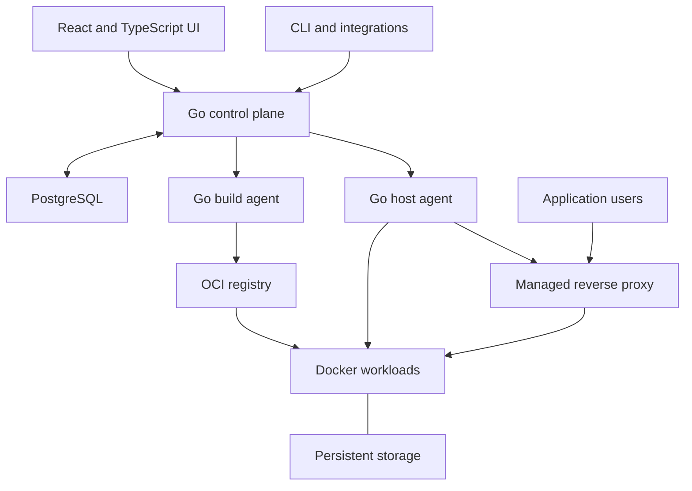

# Product specification

Adopted on 2026-10-22. This is the full supplied product contract, formatted for repository use. All R01–R68 requirements and A01–A37 acceptance scenarios remain in scope. Formatting and baseline clarification do not narrow the requirements.

The [implementation plan](plan.md) orders delivery. The [compatibility ledger](compatibility.md) tracks capability claims and fixture gaps. Proposed features below are target behavior, not evidence of current runtime support. The dated planning baseline is `a763a90b3896257b784c9498d01650ccdad2427a`. The supplied specification's earlier unnamed NeroCD baseline remains unknown.

Product reference: coollabsio/coolify at b12d1386f3d458618b4c579babcd1e339c6c40b3, with official documentation reviewed on the date above

## 1. Product objective

Build a self-hosted application platform in Go that replaces Coolify’s core user workflows. Use NeroCD’s existing Go control plane, PostgreSQL persistence, authorization, runner protocol, audit records and React/TypeScript application as the starting implementation.

The platform must let a user connect servers, deploy applications from source or images, run databases and Compose stacks, attach persistent storage, configure domains and HTTPS, automate releases, and operate those resources through a web interface and API.

The default user journey is:

> Connect a server, select a repository, configure the application, deploy it, and open its HTTPS URL.

The complete product also includes databases, generated credentials, backups and restores, service templates, preview environments, runtime logs, terminals, monitoring, scheduled tasks, notifications and migration from existing installations.

This revision replaces the previous specification’s narrow product scope. Builds, routing, TLS, databases, volumes and previews are required implementation work. NeroCD’s current restrictions do not define the destination product. Controlled deployment, provenance and audit support the hosting experience.

### 1.1 Meaning of “rewrite in Go”

Go implements the platform API, orchestration, controllers, job workers, host agents, lifecycle rules and command-line interface. The existing React/TypeScript frontend remains appropriate.

Use Docker, Compose, BuildKit, automatic builders and an established reverse proxy as dependencies. Rewriting the control plane does not require implementing a new container runtime, image builder, reverse proxy or certificate authority.

The target is a functional replacement for Coolify’s self-hosted product. Track three compatibility dimensions separately:

1. Feature compatibility: users can complete the declared hosting and operations workflows.
2. Migration compatibility: supported existing resources and data can move to the new platform.
3. Client compatibility: existing Coolify API clients, CLI scripts and integrations work unchanged where an explicit compatibility adapter is supplied.

Do not claim drop-in API or database compatibility merely because feature workflows exist.

### 1.2 Intended users and success

The initial users are developers, self-hosters and small platform teams operating their own servers. This is a product assumption, not a conclusion from customer research.

A successful platform lets them:

- deploy an ordinary application without writing deployment scripts or supplying a prebuilt image digest;
- run third-party applications without adding NeroCD-specific instrumentation;
- connect an application to a database without manually creating secret files on a server;
- change application versions without losing persistent data;
- inspect what is running, what failed and what action is available;
- recover application data and platform configuration through documented workflows;
- retain running workloads and routes during a control-plane restart.

Coolify’s documented product includes these hosting categories and distinct source/build paths. Its current implementation and documentation are the reference, not an instruction to reproduce every internal PHP class or UI detail. C1, C2

## 2. Scope and parity ledger

Every reference capability must have a ledger entry recording the upstream reference, NeroCD implementation status, supported limits, acceptance fixture and any deliberate difference. Suggested states are planned, implemented, validated, partial and intentionally different.

A delivery phase is an implementation sequence. It does not remove later capabilities from the target product.

|Product area          |Required target                                                                                                     |Initial slice and completion path                                                                                            |
|----------------------|--------------------------------------------------------------------------------------------------------------------|-----------------------------------------------------------------------------------------------------------------------------|
|Server management     |Add local and remote servers, validate capabilities, manage destinations, build roles and proxies                   |Local enrollment and SSH-assisted remote onboarding first                                                                    |
|Resource organization |Teams, projects, shared environments, applications, databases and Compose stacks                                    |Introduce the correct domain model before exposing hosting workflows                                                         |
|Git sources           |Public and private repositories, branch/commit selection, deploy keys and provider integrations                     |GitHub first, then GitLab, Gitea, Bitbucket and generic Git/webhooks                                                         |
|Build strategies      |Dockerfile, automatic builders, static files, compiled static sites and Compose builds                              |Dockerfile plus an automatic builder in the first application path; complete Nixpacks/Railpack compatibility through adapters|
|Inputs without Git    |Registry images, stored Dockerfiles, pasted Compose and catalog templates                                           |Do not require artificial repository records                                                                                 |
|Build placement       |Builds on application hosts or dedicated build servers, with image delivery and cache controls                      |Same-host builds first; registry-backed remote builds are a required later slice                                             |
|Domains and HTTPS     |Custom and generated domains, target ports, paths, redirects, certificate issuance and renewal                      |Managed Traefik first; Caddy and custom proxy modes tracked explicitly                                                       |
|Deployment automation |Manual deploy, deploy on push, deploy webhooks, redeploy and retained releases                                      |Automatic trusted-source deployment is a normal workflow                                                                     |
|Preview deployments   |PR/MR previews, isolated configuration and storage, domains, status reporting and cleanup                           |Required for core replacement completion                                                                                     |
|Persistent storage    |Named volumes, directory mounts, managed files and existing host-file mounts                                        |Ownership and retention must exist before general stateful hosting                                                           |
|Databases             |Engine-specific creation, credentials, networking, storage, health, configuration and supported recovery            |PostgreSQL and Redis first; complete the engine matrix below                                                                 |
|Service catalog       |One-click installation, generated values, component controls and versioned upgrades                                 |Start with a useful tested catalog, then expand compatibility and breadth                                                    |
|Variables and secrets |Managed encrypted credentials, build/runtime scopes, shared values and external secret sources                      |Managed secrets are a foundation dependency                                                                                  |
|Ongoing operations    |Runtime status, logs, health, limits, start/stop/restart, terminals and diagnostics                                 |Basic operations ship with each resource type                                                                                |
|Recovery              |Platform backup, database backup, storage backup, restore and image/configuration rollback                          |Implement separate contracts and interfaces                                                                                  |
|Automation            |Resource-bound schedules, notification channels, retries and execution history                                      |Required for core replacement completion                                                                                     |
|Programmatic access   |Versioned REST API, CLI and MCP access to supported operations                                                      |One authorized application layer behind every interface                                                                      |
|Migration             |NeroCD upgrade path and supported Coolify resource/data migration                                                   |Compatibility report and staged cutover before automatic adoption                                                            |
|Broader infrastructure|Additional proxy modes, multi-server application deployment, Swarm, provider provisioning and GitHub Actions runners|Explicit extended-parity backlog with separate capability tests                                                              |

References for the baseline categories: build paths C2, Compose C3, server/build roles C4, routing C5, previews C6, databases C7, templates C8, operations C9, teams C10, and the reference repository C1.

### 2.1 Boundaries that remain valid

The self-hosted platform does not inherently provide a managed-cloud availability SLA, cross-host database replication, universal zero-downtime updates or isolation between hostile workloads sharing one Docker host.

Kubernetes, a replacement container runtime and a separate hosted billing business are not dependencies of this rewrite. Docker Swarm and other documented Coolify infrastructure features remain visible parity items rather than being silently conflated with Kubernetes.

Functional parity is measured against the pinned reference and its recorded capability ledger. Do not call the first repository-to-HTTPS implementation complete Coolify parity.

## 3. Starting codebase: reuse, extend and replace

The following baseline is retained from the supplied specification's static inspection. Its original NeroCD commit was not named. The accepted planning inspection used NeroCD `a763a90b3896257b784c9498d01650ccdad2427a` on 2026-10-22. It does not assert runtime validation of every path.

|Existing area                                    |Decision              |Work required                                                                            |
|-------------------------------------------------|----------------------|-----------------------------------------------------------------------------------------|
|Go API and application services                  |Reuse                 |Add hosting operations through existing authorization and transaction boundaries         |
|PostgreSQL, migrations and durable queue         |Reuse and extend      |Add typed build, hosting, proxy, backup, schedule and notification work                  |
|Runner enrollment, leases, fences and replay     |Reuse and extend      |Evolve into host agents and build workers with explicit server/destination identity      |
|Local/OIDC login and project authorization       |Reuse                 |Add team ownership and resource/server permission rules                                  |
|Managed service accounts                         |Reuse                 |Preserve project scope, expiry, rotation, revocation and offboarding behavior            |
|React/Vite/TanStack frontend and generated client|Reuse infrastructure  |Replace the task-first product navigation with hosting workflows                         |
|Service/environment/revision model               |Generalize and migrate|Support multiple resource kinds inside a shared project environment                      |
|Compose execution primitives                     |Reuse selectively     |Replace prebuilt-only input restrictions, mount bans and mandatory revision-header health|
|Provenance and linked rollback                   |Extend                |Separate build outputs, releases, target-specific application and data recovery          |
|File-backed secrets and access audit             |Preserve as an option |Integrate managed encrypted secrets early                                                |
|Artifact and encryption helpers                  |Reuse selectively     |Complete the specific consumers, access rules and recovery procedures                    |
|Operational templates and runs                   |Preserve              |Expose as advanced automation and internal execution evidence                            |
|Production, backup and release tooling           |Reuse                 |Extend coverage to agents, proxy configuration, secrets and hosted workloads             |

Sources: architecture N1, domain model N2, deployment service N3, runtime N4, service accounts N5, secrets N6, and storage/encryption foundations N7.

### 3.1 Existing assumptions that must change

Environment cardinality. An existing NeroCD environment belongs to one service. A Coolify-style project environment contains several applications, databases and stacks. Merely changing the label in the UI would retain the wrong model. N2

Source requirements. Current services require repository and Compose information. Registry images, databases and pasted stacks must work without a Git repository. N2, N3

Input restrictions. The current Compose path rejects builds, service volume mounts and image references that are not already digest-pinned. The rewrite must accept convenient inputs and record immutable resolved outputs internally. N4

Health requirements. The existing HTTP check requires an X-NeroCD-Revision header. Generic application hosting must support ordinary health checks. Platform-owned labels, image identities and deployment evidence provide attribution without requiring application changes. N8

Deployment serialization. The existing active-root exclusion protects a service-specific environment. After introducing shared environments, preserve that protection at the resource deployment binding, not across every application in the shared environment. N9

Managed secrets and monitoring. UI-managed credentials and continuous resource observations are core hosting requirements. File-backed secrets and occasional manual inspection cannot be the only product paths.

## 4. Target architecture

Keep a modular Go application and the existing PostgreSQL authority. Separate responsibilities in code and job types before considering independently deployed services.

The registry is required when the chosen build and deployment hosts do not share an image store. A documented single-server mode may use local images. It must still record their resolved identities and retention.

Application traffic flows through the server’s proxy to containers. It must not depend on the Go control plane handling each request.

### 4.1 Execution mechanisms

Use the existing runner protocol as the basis for a managed Go agent. Provide an SSH-assisted installation path so users can add a server with the convenience expected from Coolify. Manual enrollment remains supported.

This is an intentional implementation difference: Coolify currently uses SSH for deployments and does not require a persistent deployment agent. A Go agent is justified here by the starting codebase and the desired ownership, replay and observation model. C11

Build jobs and resource mutation jobs use the same durable execution foundations but have separate capabilities, credentials, scheduling rules and records. A build can be retried on a compatible build host. A database or volume cannot move to another server merely because it has matching tags.

Use established build and Compose tooling through versioned adapters. The maintained Go Compose model is a candidate for parsing and normalization. Compatibility decisions must be tested against actual Docker Compose behavior rather than inferred from a YAML parser. T1

### 4.2 Domain model

|Entity                     |Responsibility                                                                            |
|---------------------------|------------------------------------------------------------------------------------------|
|Team                       |Ownership of projects, server access, source connections and shared settings              |
|Project                    |Application grouping and project authorization                                            |
|Project environment        |A shared grouping such as production, staging or a preview environment                    |
|Resource                   |An application, standalone database or Compose stack inside an environment                |
|Resource deployment binding|Runtime destination, effective configuration, policy and mutation ownership for a resource|
|Server                     |Enrolled machine identity, architecture, capabilities and operational state               |
|Destination                |Docker runtime and network placement on a server                                          |
|Source connection          |Git or registry access and credential references                                          |
|Build                      |Source resolution, build input snapshot, builder identity, output images and logs         |
|Release                    |Immutable resolved image set and effective deployable configuration references            |
|Deployment                 |An attempt to apply a release to a resource binding                                       |
|Route                      |Hostname/path/port ownership and certificate/routing status                               |
|Storage binding            |Persistent volume or host-path ownership and attachment                                   |
|Secret version             |Protected value or external reference with scope and lifecycle                            |
|Preview                    |Derived resource set tied to a PR/MR or manual preview identifier                         |
|Backup execution           |Recovery artifact, consistency method, locations and verification                         |
|Runtime observation        |Timestamped evidence about the server and hosted resources                                |

The UI should expose the resource users work with. It does not need to expose every internal definition or binding table.

A resource may have a reusable source definition. Do not force staging and production to share mutable runtime configuration merely because they share a repository.

## 5. Required user journeys

### 5.1 Repository to HTTPS application

A user installs the platform, adds or selects a server, connects a public or private repository, chooses a build strategy, supplies variables, configures a domain and selects Deploy. The platform resolves the source, builds the image, starts the application, checks readiness and configures HTTPS.

The user sees build progress, deployment progress, the live URL, runtime logs and current health. A subsequent push deploys automatically when enabled. Failed builds leave the running version available.

### 5.2 Application with a database and uploaded files

The user creates PostgreSQL, receives a private connection binding, attaches it to an application, and adds persistent storage for uploads. Generated credentials are stored by the platform. Redeploying either resource preserves its data.

The user configures database and storage backups, restores copies into new resources, verifies data, and sees the separate restore status of each dependency.

### 5.3 Compose or one-click service

The user selects a catalog entry, pastes Compose, or connects a repository containing Compose. The platform identifies components, required variables, persistent mounts and public endpoints. It generates credentials once, builds or pulls the images, and starts the stack.

Component pages expose logs, health, terminals, schedules and applicable database backup controls. A catalog refresh does not silently change an installed service.

### 5.4 Pull-request preview

A trusted PR/MR event creates or updates an isolated preview with its own routes, configuration and storage policy. The provider shows its status and URL. Closing the request removes the preview according to retention policy without touching production data.

Production secrets are not copied into previews by default. Public-fork execution requires an explicit trust policy and suitable build/runtime isolation.

### 5.5 Operate and recover

The operator inspects resource health after deployments finish, restarts a container, opens an authorized terminal, runs a scheduled command, receives a failed-backup notification and diagnoses an unreachable server.

A control-plane restart leaves hosted resources running. A restored control plane reconciles ownership before resuming mutation.

## 6. Functional requirements

All requirements below describe the target rewrite. Milestones in section 10 determine implementation order. Current limitations are recorded in the parity ledger, not used to remove these requirements.

### 6.1 Organization and server management

R01. Shared environments. A project environment MUST contain independently operated applications, databases and stacks. Two unrelated resources in one environment MUST be able to deploy concurrently.

R02. Team and project authorization. Reuse existing identity and service-account behavior. Add explicit team ownership and server-access rules. Preserve current project permissions during migration. A viewer MUST not gain deploy, terminal, secret-reveal or data-deletion rights through a new UI or API.

R03. Server onboarding. Support local installation, manual agent enrollment and SSH-assisted remote enrollment. Show supported operating system, architecture, Docker/Compose/Buildx availability, disk capacity, connectivity and proxy-port readiness. Validate SSH host identity and make any Docker installation or service restart part of the reviewed onboarding action.

R04. Credential separation. Bootstrap SSH credentials, enrolled-agent credentials, Git credentials and registry credentials MUST have separate scopes and lifecycles. State whether bootstrap credentials are retained for recovery. The browser MUST not receive permanent agent or host credentials.

R05. Stable destinations. Server and Docker destination identity MUST survive runner process replacement. Every deploy, rollback, volume operation, backup, route change and scheduled command MUST identify the intended destination. Matching tags do not authorize relocation.

R06. Server roles and lifecycle. Support build-only, deployment-only and combined roles. Provide drain, reconnect, credential rotation, maintenance and removal workflows. Removing a server record MUST not implicitly destroy workloads or data. Old agents MUST not claim operations whose required protocol they do not support.

R07. Execution trust. A Docker host is an execution trust boundary. Team isolation in the database does not sandbox mutually hostile containers or Dockerfiles on one host. Support separate server/build pools where that isolation is required. Privileged host access and terminal access need explicit capabilities.

### 6.2 Sources and builds

R08. Source choices. Support public/private Git, selected branches and commits, registry image tags or digests, stored Dockerfiles, Git Compose, pasted Compose and catalog templates. Preserve the source of truth for each. A no-Git input MUST not require a repository placeholder.

R09. Git integrations. Provide repository and branch selection, scoped credentials, connection tests and webhook setup. Implement GitHub first, then the provider matrix in section 2. Generic Git and signed manual deploy webhooks remain supported paths.

R10. Trigger integrity. Authenticate provider events, record delivery identity, deduplicate retries and bind a deployment to the intended source revision. Define how superseded queued changes are handled. A delayed older event MUST not silently replace a newer active release. Replaying a webhook MUST not create unbounded duplicate builds.

R11. Build strategies. Support Dockerfile contexts and targets, automatic builders, static file packaging, compiled static output and Compose build sections. Record the exact builder/version and effective settings. Validate monorepo base paths, output directories and command overrides. Nixpacks and Railpack support must be tracked separately. Coolify currently marks Railpack as Beta. C12

R12. Static sites. Distinguish serving already-built files from compiling frontend source. Support publish directory, SPA fallback and configurable static-server behavior. A configuration baked into an image requires a rebuild rather than a misleading restart action. C13

R13. Build records and outputs. A build MUST record resolved source, input configuration generation, target architecture, builder identity, logs, cache outcome and output image identities. Accept image tags as convenient input, then record the digest actually selected. A deployment retry MUST not silently rebuild different contents.

R14. Placement and image delivery. Support documented local builds and dedicated build servers. Remote builds MUST publish to an authorized registry or another explicitly supported image-transfer mechanism. Verify destination architecture and pull access before mutation. A local image on one daemon must not be assumed present elsewhere.

R15. Cache and retention. Cache identity MUST account for source, build settings, builder version, architecture and relevant dependency inputs. Changed build-secret references must invalidate reuse where their values cannot be proven unchanged. Provide force rebuild, cache controls and cleanup. Protect images referenced by active deployments and retained rollback releases.

R16. Build credentials and limits. Separate build-time credentials from runtime secrets. Scope source and registry access to the operation. Apply time, CPU, memory, disk and concurrency limits. A failed or canceled build MUST not modify the active resource or route. Untrusted preview code MUST not receive production credentials.

Build and deployment are separate product records even when they execute on one host. Coolify likewise supports distinct local and remote build paths. C2, C4

### 6.3 Releases and deployment behavior

R17. Automatic and protected deployments. Trusted push-triggered deployment MUST work without mandatory human preparation and confirmation steps. Approval is an optional resource/environment policy. Internally, every deployment still resolves a concrete release and effective configuration.

R18. Frozen release identity. A release MUST record source evidence when applicable, built or selected image identities, normalized workload configuration, secret references, relevant variable generations and target-specific plan evidence. Durable configuration MUST retain secret references and version identifiers instead of expanded secret values. Resolve secrets only into protected execution material when needed. Secret-expanded Compose output MUST NOT enter release records, downloadable manifests, audit payloads or ordinary artifacts. Hash normalized configuration with secret identities rather than publishing hashes derived from low-entropy secret values. Distinguish immutable provider versions from mutable external references.

R19. Optional approval. When approval is required, review the resolved release after image preparation and before workload mutation. Bind the decision to the release, destination and applicable configuration. A moving branch does not change an approved release. New selected content or relevant configuration changes require a new decision under policy. State whether self-approval is permitted.

R20. Admission and concurrency. Preserve durable idempotency and linked attempts. Scope active deployment exclusion to the resource binding. Extend current revision-level intent matching to release and plan identity. Coordinate shared proxy, network and storage mutations with their own ownership constraints.

R21. Deployment strategies. Provide separate strategies for a single-image application, a Compose stack and a stateful database. Eligible stateless applications should start a replacement, verify readiness, switch traffic and drain the old container. Fixed host ports, exclusive mounts or application constraints may require replacement with interruption. Show the selected strategy before deployment.

R22. Generic health. Support container health, HTTP, TCP and engine-specific readiness. Treat platform revision headers as optional extra evidence. Track expected components, images and container state through platform-owned metadata. Successful one-shot initialization jobs and optional components require different status rules from long-running services.

R23. Cancellation and uncertainty. Cancel queued/build/pre-mutation work where safe. Once mutation may have occurred, record cancellation intent and reconcile effects before retry, rollback or termination. Preserve attempt fencing, durable replay and target ownership. A terminal intervention or failed rollback MUST not unlock unresolved runtime effects for a competing deployment.

R24. Rollback and application data. Offer retained release selection, show the configuration and data-compatibility implications, and restore the selected supported release on the same destination. State whether the action uses the retained configuration or explicitly selected current overrides. Current authorization and secret revocation still apply. Never describe image rollback as reversal of database migrations or uploaded-file changes.

Coolify’s own replacement strategies differ between single-image applications and Compose, and its documented image rollback uses current runtime configuration. This rewrite may provide a stronger retained-configuration option, but must label it as a deliberate improvement. C14, C15

### 6.4 Routing and certificates

R25. Managed routing. Provide an integrated Traefik path first. Store route ownership, hostname, path, target component and internal port. Support multiple domains and public components, redirects, WebSockets and appropriate forwarding headers. Do not confuse an internal target port with a public host-port mapping.

R26. Domain setup. Support custom domains and generated subdomains under a configured wildcard domain. Report DNS, ownership, reachability and route conflicts with actionable errors. Testing domains must be identified as such. Do not silently assume ownership of a domain or a working DNS record.

R27. Certificate lifecycle. Manage ACME issuance, renewal, status and failure reporting. Support ordinary HTTP validation and a separately configured DNS-validation path for wildcard certificates. Protect DNS-provider credentials. Use bounded retries and retain a valid certificate when a renewal attempt fails. Custom certificates need an explicit storage and rotation path.

R28. Proxy changes and availability. Validate new generated configuration and preserve the last working configuration on failure. Serialize shared proxy changes without blocking unrelated builds. Existing routes and workloads MUST continue serving during a control-plane restart. Track Caddy, custom-proxy operation and proxy migration in the parity ledger.

Current Coolify provides managed Traefik, Caddy and custom proxy choices. The rewrite can sequence those adapters while keeping routing a core requirement. C5

### 6.5 Variables, secrets and credentials

R29. Managed secret storage. Integrate encrypted secrets in the first application-hosting path. Cover Git, registry, SSH bootstrap, application, database, S3, webhook, DNS and notification credentials. Reuse existing cryptographic and lease-bound access foundations where suitable. Complete persistence, authorization, versioning, key provisioning, rotation and recovery before claiming support.

R30. Value scopes. Separate build-time, runtime and preview variables. Support shared references at team, project, environment and resource scopes with a documented override rule. Show the origin of each effective value and whether a change requires a rebuild, redeploy or restart. Shared secrets MUST not be injected into every resource merely because they exist at a parent scope.

R31. Disclosure and delivery. Mask secrets in ordinary views. Allow reveal or connection-string copy only through an explicit authorized operation with appropriate audit. Preserve one-time disclosure for credentials whose contract requires it. Deliver runtime/build secrets only to authorized execution. Redact supported output representations and keep plaintext out of stored job metadata and notification payloads.

R32. Rotation and provider behavior. Define rotation, revocation and unavailable-version behavior. A runner_file label does not by itself freeze file bytes. For database accounts, rotate the engine credential and dependent bindings through a recoverable operation. For external secret sources, state resolution time, cache policy, missing-key behavior and build-cache consequences.

R33. Key recovery and external sources. Preserve required encryption-key material through an explicit recovery process separate from ordinary database backups. Wrong or missing keys MUST fail closed. Retain runner_file as an operator option. Track Doppler, Infisical and Vault integration as parity work with provider-specific contracts. C16

### 6.6 Compose and persistent storage

R34. Compose compatibility. Support service images and builds, variables, commands, profiles, networks, health checks, dependencies, resource settings, named volumes and supported bind/file mounts. Publish a tested compatibility matrix covering managed and raw deployment modes. Replace the current blanket prohibitions with capability and ownership rules. Unsupported fields must produce a precise preflight error.

R35. Compose ownership. Git-owned Compose remains repository-owned. Pasted or template-derived Compose remains stored resource configuration. Generated routing, credentials and overrides must be reviewable and must not create a second conflicting source of truth. Preserve required/optional variable semantics and existing configured values when reloading definitions. Track raw Compose as an explicit parity mode that preserves operator-owned labels and networking and identifies which managed features are disabled. Raw mode MUST preserve authorization, destination ownership and data-retention rules. State its resolution and reproducibility limits for external inputs. Reject a protected-deployment policy during preflight if the raw definition cannot satisfy its required release guarantees without alteration.

R36. Multi-component execution. Resolve or build each required image and record the selected set before application. Interpret long-running services, initialization jobs and optional components explicitly. Show component-level status, endpoints, logs and controls. A healthy web endpoint alone is insufficient when a required database or worker failed.

R37. Advanced host access. Support administrator-authorized advanced Compose needs through explicit capabilities, including controlled host mounts or devices where supported. Do not silently discard requested fields. Do not grant a project user arbitrary host access through an unreviewed convenience setting.

R38. Storage identity. Record each binding’s destination, Docker volume identity or canonical host path, mount destination, mode, ownership and resource references. Keep identity stable across rename, redeploy and agent replacement. Distinguish managed files, managed directories and pre-existing host files. Classify each storage object as platform-managed or externally owned. Importing or mounting an external object does not transfer ownership; any supported ownership transfer MUST be separate, authorized and auditable.

R39. Data retention and deletion. Stop, redeploy, remove resource and delete data MUST be separate operations. Retain persistent data by default when removing a resource. Resource deletion and automated cleanup MUST preserve externally owned volumes, files and directories, including when deletion of managed data was explicitly selected. A destructive action must name the exact data objects and affected resources. Cleanup must protect retained data, active work, shared references and required recovery points.

R40. Cross-host state. A local volume remains bound to its destination. Moving a resource with data requires explicit transfer, restore or a supported replication/storage model. Matching server tags or a new container name cannot create continuity of data.

Current Coolify supports both Git and pasted Compose, as well as several storage mount workflows. Those are the compatibility baseline. C3, C17

### 6.7 Database resources

R41. Database creation. Provide engine/version selection, target/network, stable persistent storage, generated credentials, resource limits, readiness and connection details through the UI and API. Default to private networking. Public exposure requires an explicit operation with endpoint and access implications shown.

R42. Application bindings. Let users bind a database to an application through credential references and valid network information. Show unreachable cross-server bindings rather than inventing a shared Docker network. Redeployment must preserve credentials and data unless an explicit change is requested.

R43. Engine-specific lifecycle. Implement configuration, readiness, start/stop/restart, credential rotation and supported backup/restore per engine. Major-version upgrades must validate data layout and compatibility and show a recovery procedure. Changing an image tag must not be advertised as a universal database upgrade.

R44. Engine coverage. Maintain the matrix below in implementation and documentation. PostgreSQL and Redis may ship first, but the remaining documented engine coverage stays in the product plan. “Managed” describes supported lifecycle operations, not automatic replication or a database availability SLA.

|Engine    |Reference scheduled backup|Reference dashboard restore|Rewrite requirement                                             |
|----------|--------------------------|---------------------------|----------------------------------------------------------------|
|PostgreSQL|Yes                       |Yes                        |First stateful slice, with a tested application restore         |
|Redis     |No                        |No                         |Early hosting support with explicit persistence/recovery limits |
|MySQL     |Yes                       |Yes                        |Engine-specific backup and import                               |
|MariaDB   |Yes                       |Yes                        |Separate version/configuration compatibility tests              |
|MongoDB   |Yes                       |Yes                        |Supported authentication and dump/import formats                |
|ClickHouse|Yes                       |No                         |Backup parity, explicit restore procedure or labeled improvement|
|Dragonfly |No                        |No                         |Hosting and persistence support with honest recovery limits     |
|KeyDB     |No                        |No                         |Hosting and persistence support with honest recovery limits     |
|SQLite    |Yes (experimental)        |Yes (experimental)         |Retain an explicit experimental status until validated          |

The reference matrix is documented by Coolify. Similar-looking database controls must not imply identical support across engines. C7

### 6.8 Backups and restores

R45. Separate recovery types. Expose platform backups, database backups and storage backups as distinct workflows. A platform database backup does not contain hosted application data. A storage archive does not prove transactional consistency for a running database. Application rollback remains a fourth, separate operation.

R46. Backup execution. Support immediate and scheduled backups with target, format, consistency method, timeout, retention, concurrency policy and execution history. Record resource identity, engine/version, size, digest and available locations. Use local staging and S3-compatible remote storage where configured. A storage backup MUST state whether writers remain active or are quiesced. For a stop-during-backup policy, record which containers were running, stop the required writers, create the archive, and attempt to resume those containers after success, failure or timeout. Do not start containers that were already stopped. Reconcile incomplete resume attempts and preserve their failure evidence. A live file archive MUST NOT be labeled an application-consistent database backup.

R47. Partial outcomes and retention. Distinguish dump/archive success from remote-upload success. Preserve the local recovery artifact after failed upload. Keep local and remote retention independent. Replaying a retention request after response loss must return its receipt without deleting another batch. Preserve audit and receipt atomicity.

R48. Restore workflow. Prefer restore into a new database or volume for validation. In-place restore must identify its target, replacement behavior, compatibility, writer coordination and recovery point. Restore ownership and permissions where relevant. Verify an application can read and write restored data before marking the recovery test passed.

R49. Platform recovery. Preserve the existing compatible-image/schema restore discipline and invalidation of restored sessions and active leases. Recover required secret keys and configuration. Enter a recovery mode that observes existing hosts and confirms ownership before resuming mutation. Do not recreate or delete healthy workloads merely because the control-plane database was restored.

Coolify documents separate instance, database and storage backup paths with different limits. Its current storage archive workflow does not establish a complete dashboard restore path. A tested restore UI in the rewrite is an improvement that should be identified as such. C18, C19, C20, N10

### 6.9 Service catalog and upgrades

R50. Versioned templates. Store template identifier, source version, original definition, user changes, generated values, component identities and resolved images. Generate passwords and stable identifiers once. Redeployment and catalog refresh MUST not regenerate credentials.

R51. Installation experience. Search and filter catalog entries, show required variables, domains, storage, architecture, resource needs and component roles, then install through the same resource engine as pasted Compose. Templates must not bypass authorization or storage rules.

R52. Update semantics. Distinguish pulling newer images under saved tags, changing application configuration and upgrading the catalog definition. Show a change preview for images, variables, mounts, networks, health and migrations. Catalog updates MUST not silently rewrite installed resources. Block or explain rollback when data compatibility prevents it.

R53. Catalog compatibility. Support a useful initial tested catalog and expand through a published fixture matrix. Import compatible reference templates with recorded origin/version and required attribution. An imported YAML file is not validated support until installation, persistence and update behavior pass.

Coolify installs a copied resource definition from a template, and later catalog changes do not overwrite the deployed copy. Preserve that distinction. C8

### 6.10 Previews and delivery automation

R54. Preview identity. Represent a preview as a derived resource or resource set tied to a provider request or manual identifier. Allocate separate route, configuration, network and storage identities. Support both single-image and declared Compose preview paths.

R55. Preview trust and credentials. Default automatic previews to trusted repository actors. Public-fork execution requires an explicit policy and appropriate isolated execution. Do not reuse production runtime secrets, database bindings or writable volumes by default. Preview limits must account for build and runtime capacity.

R56. Preview lifecycle. Update a preview from its intended revision, report provider status and URL, and clean it up on close/merge or configured expiry. Define retry, failed-build and retained-data behavior. A delayed close event or retried cleanup MUST not remove the production resource or a newer unrelated preview.

R57. Delivery policy. Expose auto-deploy branch selection, path filters where supported, manual deploy, deploy webhooks, optional approval and rollback policy. Keep ordinary push deployment simple. Advanced operational templates must not become mandatory configuration for a normal application.

Reference preview behavior includes provider events, separate variables/domains and cleanup. C6

### 6.11 Ongoing operations, schedules and notifications

R58. Continuous observation. Collect server reachability, container state, readiness, disk usage and bounded CPU/memory samples independently of deployment jobs. Combine event-driven updates with periodic reconciliation. Document collection and stale-state thresholds. An unreachable agent means current state is unknown, not that every workload stopped.

R59. Distinct logs. Provide build, deployment and runtime log views with clear source, time, component, ordering and retention. Runtime logs continue after a deployment ends. Live follow must reconnect and indicate gaps or truncation. Keep audit records separate. External log drains and metrics export are part of the operations plan.

R60. Resource actions. Support start, stop, restart, redeploy, inspect, force rebuild and supported rollback with resource-specific behavior. Display desired state, last operation result and latest observed state separately. Expose diagnostics and resource limits without requiring generic run IDs as the primary navigation.

R61. Terminals. Provide container and server terminals through short-lived grants bound to actor, destination and resource. Container access and host access require different permissions. Support server-level disablement, revocation and session termination. Audit session metadata without placing permanent credentials in the browser.

R62. Scheduled commands. Bind a schedule to a resource and component, then resolve its current container on the correct target at execution. Record occurrence identity, schedule version and actual target. Define timezone, DST, timeout, overlap and missed-run policy. The default should skip missed runs and forbid overlap rather than create an uncontrolled catch-up burst.

R63. Durable notifications. Start with email and generic webhooks, then complete the declared channel matrix. Users select events per channel. Include deployments, backup/upload failures, schedules, resource state, server reachability and disk pressure. Persist delivery attempts, bounded retries and deduplication keys. Test delivery must be distinct from exercising an actual event.

R64. Maintenance. Provide owned-image/cache cleanup, disk-pressure reporting, agent/proxy version visibility and supported upgrade procedures. Never prune all host resources indiscriminately. Platform and agent updates must preserve running applications, retain a recoverable control-plane state and explain compatibility limits.

Reference operations include continuous status collection, runtime metrics, terminals, container schedules and channel-specific notifications. C9, C21, C22

### 6.12 UI, API and compatibility

R65. Resource-first interface. Main navigation must make Projects, Environments, Applications, Databases, Services, Servers, Sources and Settings understandable. Resource pages expose configuration, deployments, runtime logs, domains, storage and relevant operations. Generic runs remain available as execution details or advanced automation.

R66. Complete UI workflows. After documented platform installation, every supported resource can be created and operated without seeded fixtures, SQL or ad hoc API calls. Preserve non-secret form input after validation failure. Show missing prerequisites and direct actions. Verify keyboard access, responsive views and authorization failures.

R67. One application contract. UI, API, CLI, webhooks and MCP MUST call the same authorized application operations. Regenerate the TypeScript client from the versioned contract. Preserve legacy NeroCD routes during the supported migration window. Do not expose a shortcut that bypasses target, secret, approval or data-ownership rules.

R68. Evidence and releases. A capability is complete when schema, API, permissions, audit, UI, operational behavior and tests agree. Publish supported OS, architecture, Docker/tool versions and measured limits. Use candidate-specific checks and runtime evidence. Do not claim performance gains from choosing Go without measurement.

## 7. Migration design

### 7.1 Migrate NeroCD’s existing domain

Do not discard the existing code or history. Introduce the new domain alongside the old contract, then move workflows in bounded steps.

1. Add project-level environments, typed resources and server/destination identities.
2. Map each existing service-specific environment to a resource instance or deployment binding.
3. Keep legacy service/environment/deployment IDs available through mappings and compatibility reads.
4. Require an explicit grouping decision before combining old environments with the same name. Equal names do not prove shared ownership or variable scope.
5. Give image/database/template resources a source type that does not require Git.
6. Preserve active-deployment exclusion at the mapped resource binding.
7. Convert source evidence into build/release records without inventing missing provenance.
8. Preserve historical approvals as approvals under their original contract. Do not relabel them as approvals of newly introduced immutable plans.
9. Drain or explicitly reconcile in-flight work during the upgrade. Old agents cannot execute new operation types without the required capabilities.
10. Keep applied migration checksums unchanged and rehearse upgrade/restore with representative prior data.

The current service-specific environment can remain an internal binding during the transition. The UI can create the necessary rows together so users do not need to understand legacy storage structure.

### 7.2 Migrate workloads from Coolify

Provide a read-only discovery and compatibility report first. Prefer supported API/export inputs and explicit manifests over depending on undocumented database tables.

The report must cover source/build settings, resource types, domains, variables, inaccessible secrets, networks, storage, database versions, schedules and unsupported extensions.

The supported first migration path is:

1. Import configuration into a versioned intermediate manifest.
2. Map teams, projects, environments and destinations.
3. Request missing credentials rather than treating absent secret values as empty strings.
4. Create destination resources under temporary domains and isolated dependencies. Keep destination deployment triggers, schedules and external-event consumers disabled during validation.
5. Make an initial data copy using engine-compatible database backup/restore and a consistency-aware file transfer.
6. Disable source deployment triggers, schedules and other mutating automation for the moved resource.
7. Coordinate remaining application writers and perform final synchronization.
8. Verify readiness, application reads/writes, file permissions and external integration settings.
9. Transfer route or DNS ownership and record the cutover.
10. Enable the intended destination triggers, schedules and external-event consumers only after ownership and cutover are explicit.
11. Retain a recovery window with an explicit statement about writes made after cutover.

Current Coolify’s own instance-migration documentation describes reconstruction and state transfer rather than a universal application import/export operation. The rewrite should not assume a complete export format exists. C23

Existing-container adoption is a separate mode. It requires explicit transfer of mutation ownership, preservation of real volume/network identities, and protection against both controllers managing the same resource. Reading Docker labels is insufficient evidence of a completed handoff.

### 7.3 API compatibility

Maintain native NeroCD API stability through versioned additions. Record Coolify endpoints required by target users and implement adapters where justified.

A compatibility test must cover behavior, authorization, error responses and lifecycle outcomes. Matching endpoint names is insufficient. Feature parity and API compatibility must have separate release statements.

## 8. Acceptance scenarios

These scenarios define the corrected product outcome. They are proposed tests, not claims that the current code passes them.

|ID |Scenario                                        |Required result                                                                                                                                                                                                                                                                      |
|---|------------------------------------------------|-------------------------------------------------------------------------------------------------------------------------------------------------------------------------------------------------------------------------------------------------------------------------------------|
|A01|New installation and remote server              |UI-assisted enrollment produces a ready server/destination without hand-editing database rows                                                                                                                                                                                        |
|A02|Public repository with Dockerfile               |Build and deploy through the UI, then open a valid HTTPS endpoint                                                                                                                                                                                                                    |
|A03|Private repository with automatic builder       |Scoped credentials work, source resolves, image builds and secrets do not leak into normal logs                                                                                                                                                                                      |
|A04|Static files and compiled SPA                   |Both paths serve assets and deep links using their declared build/output settings                                                                                                                                                                                                    |
|A05|Registry image supplied by tag                  |Platform records the selected digest and runs an ordinary third-party image without a revision header                                                                                                                                                                                |
|A06|Failed source build                             |Existing containers and routes continue serving the previous release                                                                                                                                                                                                                 |
|A07|Remote build server                             |Image reaches the deployment host through the declared registry path with architecture and pull checks                                                                                                                                                                               |
|A08|Two apps in one production environment          |They deploy independently while each resource prevents conflicting active mutation                                                                                                                                                                                                   |
|A09|Duplicate or delayed Git webhook                |Retries deduplicate and an older event does not silently replace newer desired state                                                                                                                                                                                                 |
|A10|Protected deployment                            |Approval identifies a resolved release and target; branch movement cannot substitute content                                                                                                                                                                                         |
|A11|Eligible stateless replacement                  |New version passes readiness before traffic moves; failed readiness retains the old working version                                                                                                                                                                                  |
|A12|Fixed host port or exclusive state              |Platform selects and explains an appropriate replacement strategy without promising universal zero downtime                                                                                                                                                                          |
|A13|Two hosts with identical tags                   |Deployment, rollback, backup and volume operations remain on their authorized destination                                                                                                                                                                                            |
|A14|Lost lease after possible Docker mutation       |Recovery observes actual effects and blocks conflicting work until ownership is resolved                                                                                                                                                                                             |
|A15|Git and pasted Compose                          |Both support mixed builds/images, variables, profiles, networks, volumes and component-level status; secret interpolation reaches the authorized workload while stored release evidence and ordinary exports retain references                                                       |
|A16|Stack with one-shot init, web and database      |Successful initialization is not reported as failed solely because its container exited                                                                                                                                                                                              |
|A17|PostgreSQL plus application                     |Generated credentials and binding work; data remains after application and database redeploy                                                                                                                                                                                         |
|A18|Credential rotation                             |Engine credentials and dependent bindings change through a recoverable operation                                                                                                                                                                                                     |
|A19|Rename and remove a stateful resource           |Rename preserves volume identity; removal retains managed data unless explicitly deleted and always preserves externally owned volumes and host paths                                                                                                                                |
|A20|Multiple routes and certificate renewal         |Correct components receive traffic; route conflicts and failed renewal retain useful status and working configuration                                                                                                                                                                |
|A21|Template install and redeploy                   |Generated passwords stay stable; component data survives                                                                                                                                                                                                                             |
|A22|Catalog update                                  |Installed definitions remain unchanged until an explicit upgrade, whose changes are reviewable                                                                                                                                                                                       |
|A23|PR preview and close                            |Preview has isolated route/configuration/storage; cleanup does not affect production                                                                                                                                                                                                 |
|A24|Untrusted fork preview                          |Default policy blocks execution or uses explicitly authorized isolation without production credentials                                                                                                                                                                               |
|A25|Backup dump succeeds, remote upload fails       |Local recovery data remains and the partial outcome generates an actionable notification                                                                                                                                                                                             |
|A26|Database and volume restore                     |Restore into new resources and verify application data, writes and file permissions                                                                                                                                                                                                  |
|A27|Platform restart and restore                    |Existing workloads/routes continue; restored control plane invalidates stale authority and reconciles before mutation                                                                                                                                                                |
|A28|Agent unreachable                               |Dashboard marks observations stale/unknown and reports reachability without inventing healthy or stopped state                                                                                                                                                                       |
|A29|Runtime logs after deployment completion        |Live container logs remain accessible with reconnect behavior and clear retention                                                                                                                                                                                                    |
|A30|Container replacement before scheduled execution|Task runs in the current intended component on the correct target with recorded occurrence identity                                                                                                                                                                                  |
|A31|Scheduler outage, overlap and DST               |Documented missed-run and overlap behavior holds without duplicate unintended executions                                                                                                                                                                                             |
|A32|Terminal permission revoked                     |New grants are denied and existing sessions terminate according to policy without leaking permanent credentials                                                                                                                                                                      |
|A33|Coolify migration with DB and uploads           |Configuration and both data types verify before cutover; source mutating automation is disabled before final synchronization, destination automation stays disabled until handoff, no scheduled side effect runs from both controllers, and recovery accounts for post-cutover writes|
|A34|Existing NeroCD upgrade                         |IDs/history remain accessible, environment grouping is explicit and old runners cannot execute incompatible work                                                                                                                                                                     |
|A35|Unauthorized direct API requests                |Cross-project reads and unauthorized mutations, terminal sessions, secret reveals and destructive data actions are denied                                                                                                                                                            |
|A36|Release claims core replacement                 |All declared core workflows pass for the same candidate; partial and extended-parity items remain visible                                                                                                                                                                            |
|A37|Storage backup fails after quiescing writers    |Previously running containers are resumed or an unresolved recovery failure is reported; previously stopped containers remain stopped and backup failure evidence is retained                                                                                                        |

Additional fixture matrices must cover builder strategies, CPU architectures, database engines, Compose fields, provider events, proxy adapters and imported template versions.

## 9. Operational and implementation standards

Preserve useful existing guarantees while changing the product model:

- PostgreSQL remains authoritative for accepted work, leases, operation history and audit.
- A side effect is not exactly-once merely because a job has an idempotency key. Record intent and observed results and reconcile uncertainty.
- Background observation is distinct from active deployment ownership.
- OCI images, build cache, runtime logs, downloadable artifacts and backups have separate storage and retention policies.
- Secret-management key loss and backup restoration must be exercised, not handled only in documentation.
- Generic operational templates remain supported, but a user must not author one to create a normal application or database.
- Start with bounded job concurrency and measured quotas. Publish scale claims only after representative load testing.
- Use existing PostgreSQL, fencing, spool, secrets, enrollment, provenance, Compose, web, production, restore and release gates where applicable. Extend them for hosting workflows instead of replacing them with a parallel acceptance framework. N11

A suggested code organization is to retain the current API/application/store layers and add hosting-focused modules for resources, builds, releases, destinations, routes, storage, databases, previews and backups. These are module boundaries, not a requirement to deploy separate microservices.

## 10. Delivery plan

The first visible milestone must demonstrate hosting. Foundation work should be scoped to the next complete user journey.

|Milestone                        |Deliverable                                                                                                                                                                                                                                          |Exit conditions                                                                            |
|---------------------------------|-----------------------------------------------------------------------------------------------------------------------------------------------------------------------------------------------------------------------------------------------------|-------------------------------------------------------------------------------------------|
|M0: Adapt the foundation         |Shared environment/resource model, target ownership, source kinds, managed secrets and migration adapters                                                                                                                                            |Existing data maps correctly; new resource authorization and target rules work             |
|M1: Repository to HTTPS          |Server onboarding, Git/image inputs, Dockerfile plus an automatic builder, variables, managed proxy/TLS, bounded continuous observation, runtime logs, auto-deploy and basic optional approval                                                       |A01–A06, A08–A10 and the applicable routing/authorization cases pass                       |
|M2: Useful stateful hosting      |Persistent storage, PostgreSQL/Redis, application bindings, broader Compose, initial catalog, backup scheduling, backup-failure notifications and tested recovery                                                                                    |A15–A22, A25–A27 and A37 pass for declared engines and mounts                              |
|M3: Core Coolify replacement     |Previews, dedicated builders, additional Git/build/database coverage, shared variables, broader deployment policy controls, general scheduled commands, notification-channel coverage, terminals, richer monitoring and native API/CLI/MCP operations|All declared core workflows and failure cases pass; API and UI agree                       |
|M4: Migration and extended parity|Supported Coolify migration, catalog breadth, raw Compose, external secret sources, extra proxy modes and remaining infrastructure integrations                                                                                                      |A33 and the corresponding compatibility matrices pass; outstanding differences are explicit|

M0 is not a separate product destination. M1 is an application-hosting milestone. M2 is the first useful stateful-hosting release. M3 is a core replacement claim against the declared ledger. M4 completes further compatibility and integration coverage.

The following remain visible ledger entries until implemented and tested: raw Compose, additional proxy adapters, full provider/template breadth, multi-server application deployment, Swarm, cloud provisioning, GitHub Actions runner hosting, external log integrations and any requested Coolify API adapters. Do not describe them as complete merely because the underlying queue can execute shell commands.

No delivery dates or effort estimates are asserted. Sequence work by dependencies and demonstrated acceptance.

## 11. Documentation changes

Adopt this document as the product specification. Make the repository documentation reflect the corrected objective:

- README.md: describe the Go self-hosted application platform and distinguish implemented features from planned parity.
- docs/plan.md: link the ordered hosting milestones, implementation issues and evidence.
- docs/architecture.md: document shared environments, typed resources, build/release/deployment separation, host agents and independent workload traffic.
- Source/build guides: cover repository, Dockerfile, automatic builder, static, image and Compose workflows.
- Hosting guides: cover domains, certificates, variables, databases, storage and templates.
- Operations guides: cover monitoring, logs, terminals, schedules, notifications, backups, restores and migration.
- Compatibility ledger: list the pinned reference, supported fixtures, partial features and deliberate differences.

The prior specification’s “prebuilt-only controlled deployment” scope is superseded. Its useful findings about destination identity, approval integrity, replay and recovery are retained within this broader hosting product.

## 12. Evidence and review limits

This is a product and architecture revision. The supplied revision did not identify its original NeroCD inspection commit. The accepted planning inspection used NeroCD `a763a90b3896257b784c9498d01650ccdad2427a` on 2026-10-22. Coolify’s repository and official documentation were used to establish the target capability surface.

All numbered requirements, proposed domain changes, implementation sequences and acceptance scenarios are design recommendations. They are not statements that those features already exist in NeroCD.

The supplied revision changed no application code or running infrastructure. This documentation adoption records that revision and the accepted plan in the repository. No runtime tests of the proposed features were performed. Existing CI evidence does not validate features that have not been implemented.

## 13. Sources

NeroCD baseline

- N1: [Architecture.](architecture.md)
- N2: [Service, environment and deployment domain.](../internal/domain/domain.go)
- N3: [Deployment application service.](../internal/app/deployments_service.go)
- N4: [Provenance resolver and current Compose restrictions.](../internal/runnerruntime/provenance_resolver.go)
- N5: [Service-account lifecycle.](../internal/app/service_accounts_service.go)
- N6: [Secrets guide, runner secret handling, lease-bound access.](secrets.md)
- N7: [Artifact store, secret encryption helper.](../internal/secretcrypto/secretcrypto.go)
- N8: [Compose health and reconciliation.](../internal/runnerruntime/compose_engine.go)
- N9: [Linked rollback and active-deployment constraints, deployment persistence.](../internal/store/postgres_deployments.go)
- N10: [Production operations, restore authority invalidation.](production.md)
- N11: [Validation and release gates.](../Makefile)

Coolify capability reference

- C1: [Pinned repository README.](https://github.com/coollabsio/coolify/blob/b12d1386f3d458618b4c579babcd1e339c6c40b3/README.md)
- C2: [Build and deployment model.](https://github.com/coollabsio/coolify/blob/b12d1386f3d458618b4c579babcd1e339c6c40b3/app/Jobs/ApplicationDeploymentJob.php)
- C3: [Docker Compose.](https://coolify.io/docs/applications/build-packs/docker-compose)
- C4: [Build servers](https://coolify.io/docs/core/infrastructure/servers/build-servers), [server overview](https://coolify.io/docs/core/infrastructure/servers/overview).
- C5: [Proxy overview, domains.](https://coolify.io/docs/core/networking-in-coolify)
- C6: [Preview deployments.](https://coolify.io/docs/applications/ci-cd/github/preview-deploy)
- C7: [Database capability matrix.](https://coolify.io/docs/databases)
- C8: [Services and template behavior.](https://coolify.io/docs/services)
- C9: [Monitoring and operations](https://coolify.io/docs/applications/operations/overview), [web terminal](https://coolify.io/docs/core/infrastructure/servers/web-terminal).
- C10: [Roles and permissions, team ownership.](https://github.com/coollabsio/coolify/blob/b12d1386f3d458618b4c579babcd1e339c6c40b3/app/Models/Team.php)
- C11: [How Coolify works.](https://coolify.io/docs/core/how-coolify-works)
- C12: [Railpack.](https://coolify.io/docs/applications/build-packs/railpack)
- C13: [Static applications.](https://coolify.io/docs/applications/build-packs/static)
- C14: [Rolling updates.](https://coolify.io/docs/applications/deployments/rolling-updates)
- C15: [Rollbacks.](https://coolify.io/docs/applications/deployments/rollbacks)
- C16: [External secret managers.](https://coolify.io/docs/integrations/security/using-secret-managers)
- C17: [Storage mounts.](https://coolify.io/docs/applications/configuration/persistent-storage)
- C18: [Instance backup](https://coolify.io/docs/core/backup-and-recovery/instance-backup), [instance restore](https://coolify.io/docs/core/backup-and-recovery/instance-restore).
- C19: [Database backups, database restore.](https://github.com/coollabsio/coolify/blob/b12d1386f3d458618b4c579babcd1e339c6c40b3/app/Jobs/DatabaseBackupJob.php)
- C20: [Storage backups.](https://github.com/coollabsio/coolify/blob/b12d1386f3d458618b4c579babcd1e339c6c40b3/app/Jobs/VolumeBackupJob.php)
- C21: [Create scheduled tasks.](https://coolify.io/docs/applications/operations/scheduled-tasks)
- C22: [Notification events, notification overview.](https://github.com/coollabsio/coolify/blob/b12d1386f3d458618b4c579babcd1e339c6c40b3/app/Models/Team.php)
- C23: [Application migration.](https://coolify.io/docs/applications/operations/migrate-between-instances)

Implementation reference

- T1: [Compose Go library](https://github.com/compose-spec/compose-go). This is a candidate dependency, not a claim that NeroCD already uses it.
